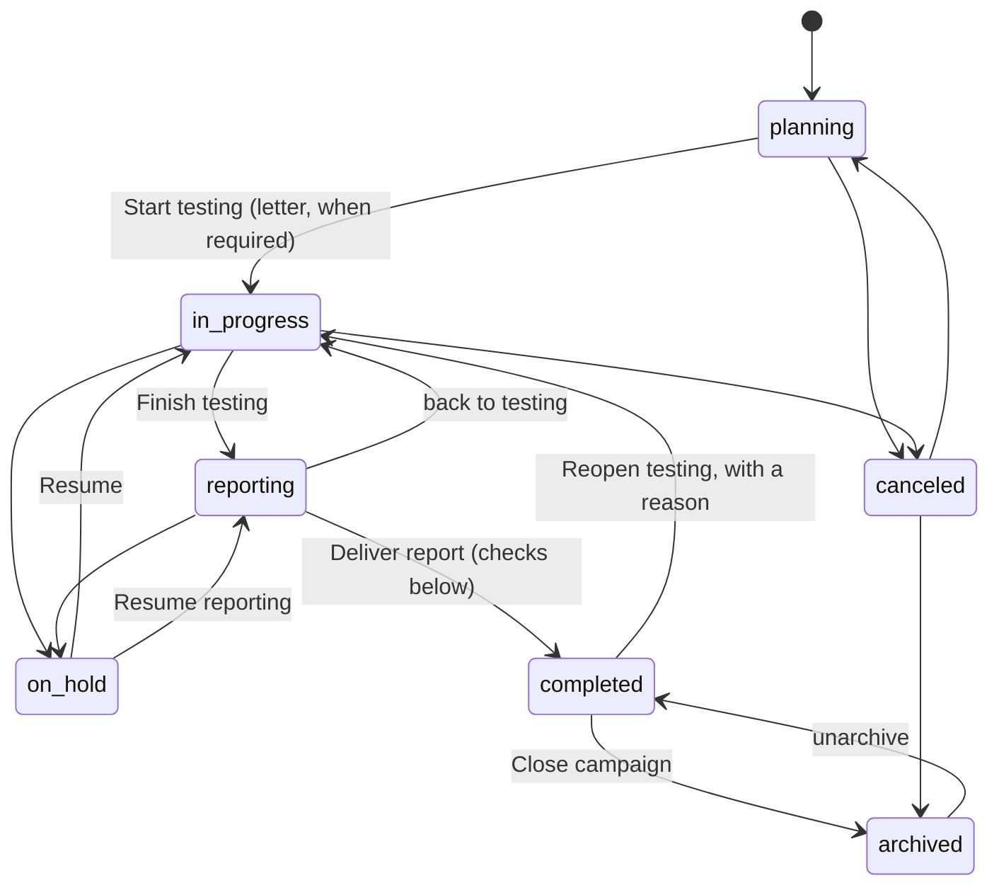
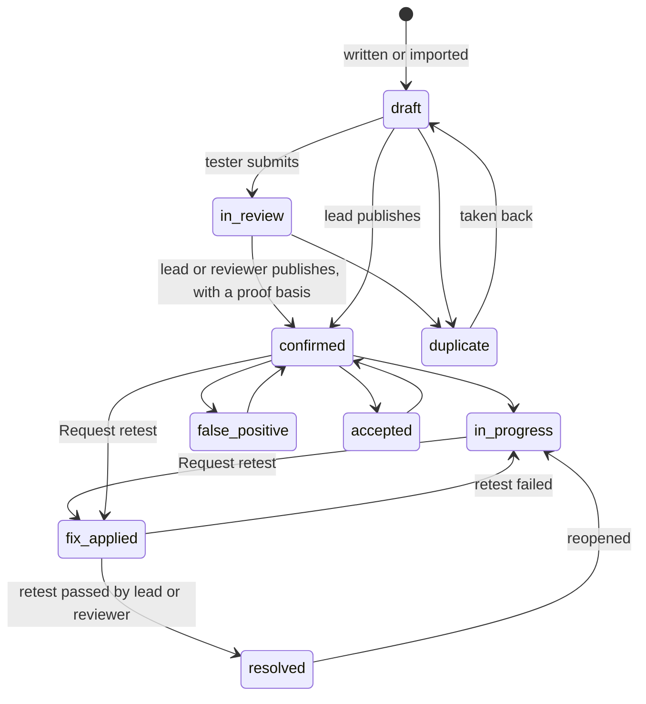
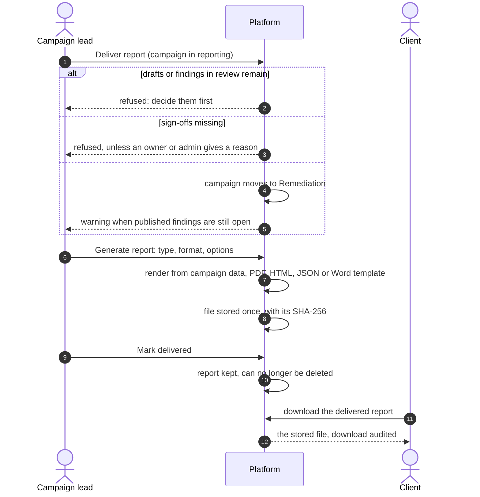

# Pentest campaigns and reports
{: .no_toc }

A pentest campaign is one engagement: a team, a scope, findings and a report.
The campaign lead moves it through its phases. Testers write findings,
reviewers publish them, and the client sees only published findings and
delivered reports. After the report is delivered, fixes and retests go on
until each finding is closed.

1. TOC
{:toc}

## The flow

### Campaign phases

| Phase (console) | Who adds findings | What else goes on |
|---|---|---|
| Planning | nobody | team, scope, authorization letter |
| Testing | lead, testers | writing, review, publishing |
| Reporting | lead, reviewers (audited as late additions) | review, publishing, sign-off |
| Remediation (completed) | nobody | fixes, retests, closing |
| On hold | nobody | edits to existing findings, fixes and retests |
| Canceled, Closed (archived) | nobody | nothing; read-only |

1. Only the campaign lead changes the phase, or an organization owner or
   admin who is a member of the campaign. Every change is audited and the
   campaign members are told.
2. **Start testing** needs the authorization letter when your organization
   requires one (**Settings › Pentest**).
3. Going back to testing clears the completion sign-offs. **Reopen testing**
   after delivery needs a reason of at least 10 characters.
4. **Close campaign** (archived) deletes the campaign's test credentials.

### A finding from draft to closed

1. A draft or a finding in review is the team's work in progress: clients
   never see it, and it is not in a report by default.
2. Publishing (confirmed) needs a proof basis (executed live, executed in a
   lab, or static), or a reason why it is confirmed without one. From that
   moment the finding has an SLA deadline from your SLA policy.
3. **Request retest** moves a published finding to fix applied: the lead, a
   reviewer, the client, or the tester who owns it. The assignee and the
   author are told.
4. A retest **passed** by the lead or a reviewer resolves the finding; passed
   by a tester, it waits in fix applied for a reviewer. **Failed** sends it
   back to in progress. **Inconclusive** needs a reason and changes nothing.
5. Pentest findings are fixed through their campaign: they never join a
   remediation group or a remediation task. Remediation moves and retests go
   on after the report is delivered, and stop when the campaign is canceled
   or closed.

### Delivering and generating the report

1. **Deliver report** is refused while findings are still in draft or in
   review. A sign-off policy, when the campaign has one, needs its sign-offs
   from members with the listed roles; an organization owner or admin can go
   past it with a reason, audited.
2. **Generate report** (campaign lead, Manage Pentest Reports
   `pentest:reports:write`) renders the report at once and stores the file.
   By default it holds published findings only; options narrow it by status
   or severity or leave out proofs of concept. A campaign above 2,000
   findings, or a file above 50 MiB, is refused: narrow it.
3. A Word report uses one of your organization's report templates
   (**Settings › Pentest › Report templates**), uploaded and checked by an
   owner or admin.
4. Downloads of a stored report return the same file, whatever changed in
   the campaign since. The team can also download a fresh report from the
   current data; the client cannot.
5. **Mark delivered** (campaign lead) lets the client download the report and
   keeps it from being deleted.

## When something fails

| What happens | What you see | What to do |
|---|---|---|
| Start testing without a required letter | Refused, with a dialog to upload it | Upload the authorization letter |
| A finding is added in the wrong phase | Refused with the reason | Ask the lead to start or reopen testing |
| Deliver report with drafts or findings in review | Refused with the counts | Publish, reject, mark as duplicate or delete them |
| Deliver report without the sign-offs | Refused with the count | Collect the sign-offs, or an owner or admin delivers with a reason |
| A report is too large | Generation refused | Narrow it by severity or status |
| A Word template is missing or broken | Generation refused | Check the template under Report templates |
| A retest on a canceled or closed campaign | Refused | Unarchive the campaign first |

## Security

- Campaign routes check your campaign role first. Someone outside the team
  gets "not found". Organization owners and admins act as the lead, but
  change a phase only after joining the team.
- Clients see published findings and delivered reports only, never drafts,
  findings in review, generation options or other reports.
- Test credentials are encrypted, shown once to a lead, tester or reviewer
  with an audit entry, and deleted when the campaign is closed.
- Report generation, delivery and every download are audited with the
  file's SHA-256.
- SLA notices name a pentest finding by its id, not its title.

## Related

- [Pentest campaigns](../../user-guide/07-validation.md#pentest-campaigns)
- [Deliver the report](../../user-guide/07-validation.md#deliver-the-report)
- [Reports](../../user-guide/07-validation.md#reports)
- [Retest queue](../../user-guide/07-validation.md#retest-queue)
- [Report templates](../../pentest/report-templates.md)
- [SLA deadlines and escalation](sla-escalation.md)
