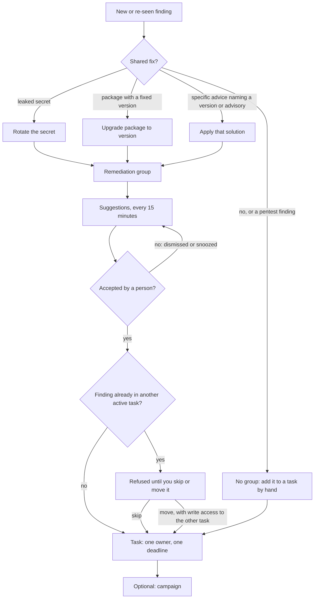
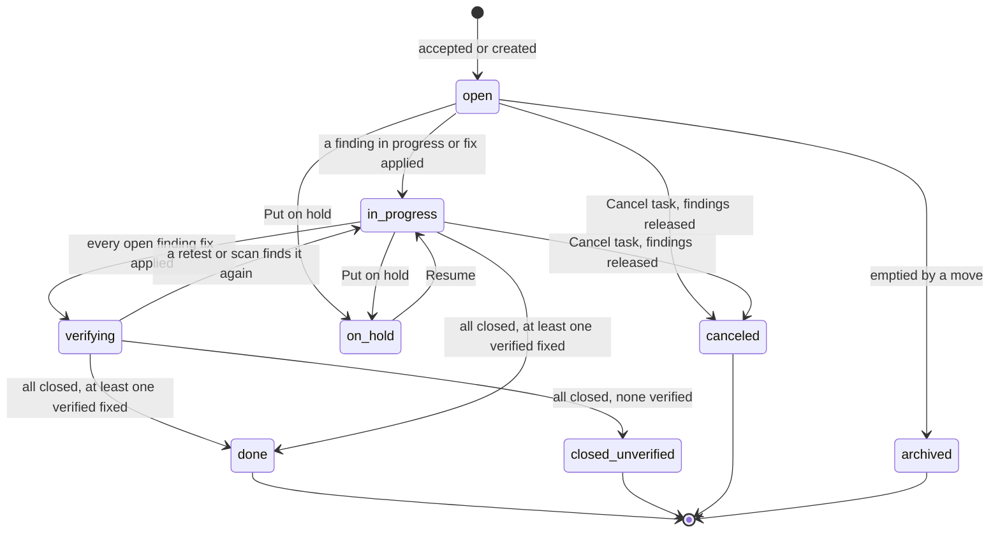
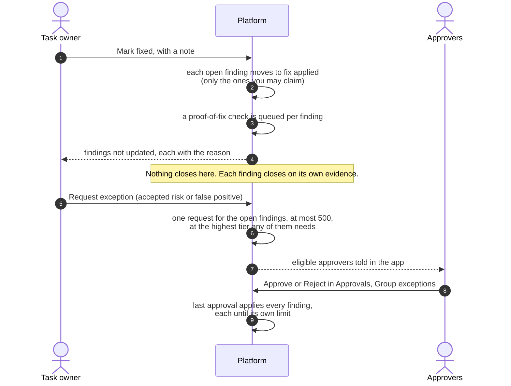
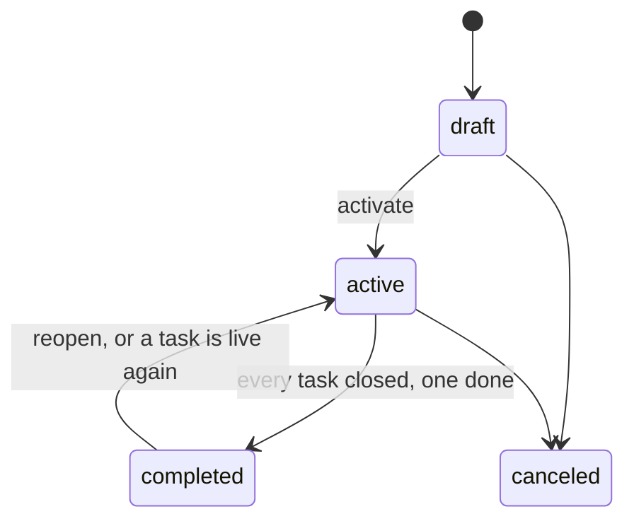

# Remediation groups, campaigns and tasks
{: .no_toc }

The platform groups open findings by the fix that closes them and suggests
remediation tasks. A person accepts a suggestion; the task then has one owner,
one deadline and the findings that fix closes. A finding belongs to at most one
active task. Campaigns collect tasks toward one goal and due date. Owners mark
a task fixed, and each finding closes on its own evidence.

1. TOC
{:toc}

## The flow

### From a finding to a task

1. **Remediation groups.** Each open finding gets a fix key: the same leaked
   secret value means "rotate this secret", a vulnerable package means
   "upgrade it to the version that fixes every open advisory of that
   version", and advice that names a version or an advisory id means "apply
   this fix". Boilerplate advice ("upgrade to the latest version") forms no
   group. Pentest findings are never grouped: they are fixed through their
   campaign.
2. **Suggestions.** Every 15 minutes the platform proposes a task per fix and
   per asset owner, or proposes adding findings to an owner's task that
   already has that fix. At most 50 new suggestions show per day; a daily
   notice tells you when new ones arrived. Nothing changes until a person
   accepts.
3. **Accept.** **Mobilization › Remediation › Suggestions**: **Accept**,
   **Edit, then accept**, **Dismiss** (with a reason) or **Snooze**. An asset
   owner who only views remediation can **Accept as owner** when the task and
   every asset are theirs.
4. **One active task per finding.** If another active task already holds a
   finding, the request is refused and the findings in the way are listed.
   Skip them, or move them when you can change the other task. Two people
   claiming the same finding at once cannot both win.
5. **The task.** A task's deadline is the earliest of its open findings' SLA
   deadlines, a deadline a person set and its campaign's due date: a person
   or a campaign can only make it earlier.

### Task states

The state comes from the findings; a person sets only **Put on hold**,
**Resume** and **Cancel task**.

- **Done** needs every finding closed and at least one closed as fixed with
  proof: a covering scan, a retest or a security review.
- A finding of a done task that reopens starts a new task named
  "Regression: ..." with the same fix, owner and campaign. The old task keeps
  its history.
- The platform recomputes changed tasks every 2 minutes.

### Mark fixed and exceptions

1. **Mark fixed** needs Manage Remediation (`findings:remediation:write`) and
   Mark Fix Applied (`findings:fix_apply`). Only findings you may claim move:
   ones assigned to you or your team, on an asset you own, or in a task you
   own.
2. **Request exception** asks for one decision about all the task's open
   findings, for example "no maintenance window until 1 December". It takes
   the strictest approval tier of any finding, and only approvers who may
   approve every finding. Each finding's acceptance ends at the requested date
   or its own limit, whichever is first. Findings that join the task later
   are not covered.

### Campaigns

A campaign holds tasks, never findings: its progress is the findings of its
tasks. A task is in at most one campaign. Every 30 minutes an active campaign
whose tasks are done completes, and a completed one with a live task again
reopens. The due date can only move earlier, and while the campaign is draft
or active it caps the deadline of each of its tasks.

### Who is told

- The new owner of a task (the person, and the owner team) gets an in-app
  notice when a task is created for them or given to them.
- The owners of both tasks are told when findings move from one task to
  another.
- Notices name the task and counts only, never a finding title, and show
  only to members who can see at least one finding of the task.

## When something fails

| What happens | What you see | What to do |
|---|---|---|
| A finding is already in another active task | "Some findings are already in another task" | Skip them, or move them if you can change that task |
| The owner you picked cannot see some findings | "Needs access to N findings on M assets" | Pick someone else, or confirm with the Assign Findings permission |
| You cannot see every finding of a task | The task is read-only for you | Ask someone with access to all its findings |
| A pentest finding is added to a task | Refused | Fix it in its pentest campaign |
| Mark fixed skips findings | Each skipped finding with its reason | Have the assignee or asset owner claim those |
| A campaign will not complete | Refused while a task is live | Finish or cancel the live tasks |

## Security

- Every read and change is limited to your organization. Another
  organization's task, campaign or finding answers "not found".
- Within your organization your data scope applies: you see a task through
  the findings you may see, others are only counted, and you can change a
  task only when you can see all its findings.
- Every change is in the audit log; changes the platform makes on its own
  (recompute, regression, automatic completion) are logged with the system as
  the actor.
- Changes carry the task's version, so two people editing at once cannot
  overwrite each other.

## Related

- [Remediation tasks](../../user-guide/08-mobilization.md#remediation-tasks)
- [Campaigns](../../user-guide/08-mobilization.md#campaigns)
- [Exceptions](../../user-guide/08-mobilization.md#exceptions)
- [Finding status lifecycle](../results/finding-lifecycle.md)
- [SLA deadlines and escalation](sla-escalation.md)
