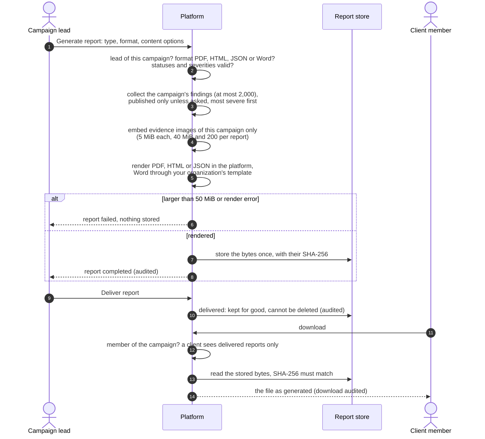
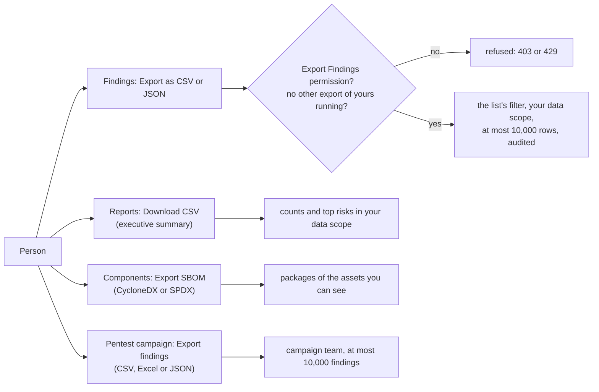

# Reports and exports
{: .no_toc }

Data leaves the platform as a file in three ways: a pentest report a campaign
lead generates for a client, a digest the platform mails on a schedule, and an
export a person downloads (findings, the executive summary, an SBOM). Every
path renders inside the platform from your organization's data, as you are
allowed to see it, and nothing calls an outside rendering service.

1. TOC
{:toc}

## The flow

### Pentest reports

1. Only the campaign lead (or an administrator) generates, delivers and
   deletes reports. It needs the **Manage Pentest Reports** permission
   (`pentest:reports:write`).
2. A report holds the campaign's published findings by default. Drafts,
   findings in review, false positives and duplicates are left out unless the
   lead ticks **Unpublished findings** or picks statuses. Proofs of concept
   and evidence images can be left out for a client copy. A campaign with
   more than 2,000 findings is refused: narrow it by severity or status.
3. Images are embedded only when they are evidence of that campaign's
   findings, retests or the campaign itself. A report never fetches a URL.
4. The file is stored once, in your organization's file storage, and its
   SHA-256 is checked on every download. Downloads return those bytes, so a
   delivered report never changes when the campaign does.
5. A team member (not a client) can also download a live copy. It renders
   current data and is not stored.

### Scheduled digests

```mermaid
sequenceDiagram
  autonumber
  participant T as Scheduler (every minute, each replica)
  participant DB as Schedules
  participant P as Platform
  participant M as Mail server
  T->>DB: schedules due now
  T->>T: Reports module on for the organization?
  T->>DB: claim this slot (one replica wins), set the next run
  T->>P: render the summary as the schedule's creator sees it now
  alt creator gone or render error
    T->>DB: last run failed
  else rendered
    T->>T: drop recipients that are not members<br/>or not in an allowed domain
    T->>M: e-mail the HTML digest
    T->>DB: last run completed, no recipients or failed
  end
```

1. A schedule needs the **Create Reports** permission (`reports:write`). It
   fires at most once an hour and mails up to 50 recipients.
2. Each run counts what the schedule's creator may see at that moment. A
   creator who left the organization gets no more digests sent.
3. The digest is an HTML e-mail with the finding summary. No file is kept.
   The three report types (executive summary, summary digest, findings
   digest) send the same summary today.

### Exports

1. **Findings export** (**Export** on the findings list) needs the **Export
   Findings** permission (`findings:export`). It streams the rows the list's
   filter selects, in the list's order, as you may see them. It holds at
   most 10,000 rows and says so when rows were left out. One export per
   person runs at a time. Each row carries a fixed set of columns: no
   evidence, code snippets, stack traces or secret details. Cells a
   spreadsheet would run as a formula are neutralized. Every export is in the
   audit log with the filter's field names, never its values.
2. **Executive summary** (**Insights > Reports**, **Program** tab,
   **Download CSV**) gives the window's risk score, finding counts, SLA and
   MTTR figures and the top risks, counted within your data scope.
3. **SBOM** (**Components**, **Export SBOM**) writes CycloneDX 1.6 or SPDX
   2.3 JSON for one asset or for every asset you can see.
4. **Campaign findings** (a pentest campaign's **Export**) writes the
   campaign's findings for its team (not clients) as CSV, Excel or JSON.

## When something fails

| What happens | What you see | What to do |
|---|---|---|
| The campaign has more than 2,000 findings | The report could not be generated | Pick statuses or severities to narrow it |
| The report is larger than 50 MiB | The report could not be generated | Leave out evidence images or narrow the content |
| A report made before reports were stored | Download answers 409 | Generate a new report |
| The report was delivered | Delete is refused | Nothing; a delivered report is the record of what the client got |
| You have no Export Findings permission | "You cannot export findings" | Ask an organization administrator |
| Another export of yours is running | "An export of yours is still running" | Wait for it to finish |
| The findings match more than 10,000 rows | "Exported the first 10000 of ..." | Narrow the filters and export the rest |
| All of a schedule's recipients are refused | Last run: no recipients | Use members' addresses or an allowed domain |
| E-mail is not set up on the installation | Last run: failed | Ask the platform administrator to set up e-mail |

## Security

- Every path reads only your organization's rows, and every export counts
  what you may see: your data scope and the pentest campaigns you belong to.
  A scheduled digest counts what its creator may see, never more.
- A campaign client downloads delivered reports only, and sees them without
  the generation options.
- Generating, delivering, deleting and downloading a pentest report are in
  the audit log; a stored download records the file's SHA-256. Findings
  exports and schedule changes (with their recipients) are audited too.
- Report text written in Markdown is escaped; raw HTML stays text and only
  http, https and mailto links are kept.
- The campaign findings export is not written to the audit log, and it stops
  at 10,000 findings without telling you.

## Related

- [Insights and reports: Reports](../../user-guide/09-insights-and-reports.md#reports)
- [Pentest reports](../../user-guide/07-validation.md#reports)
- [Deliver the report](../../user-guide/07-validation.md#deliver-the-report)
- [Report templates](../../pentest/report-templates.md)
- [The findings list](../../user-guide/05-exposures-and-findings.md#the-findings-list)
- [Audit log integrity](../operations/audit-chain.md)
