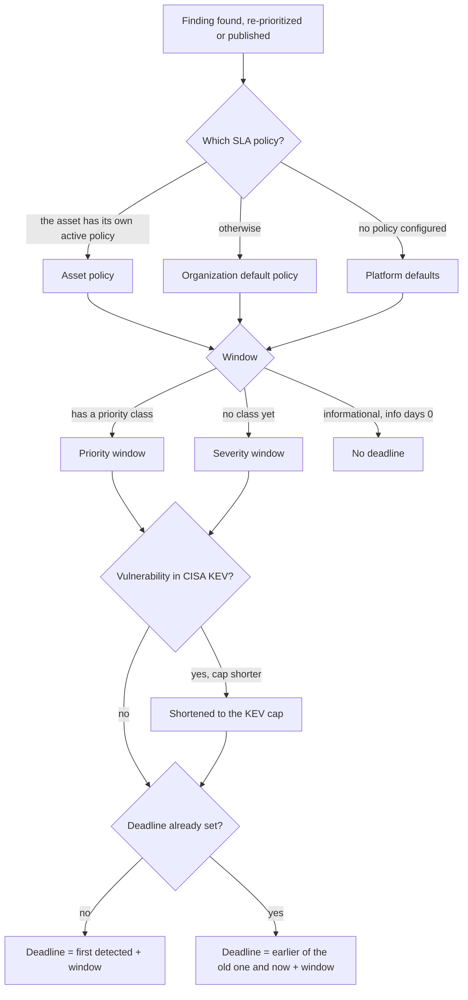
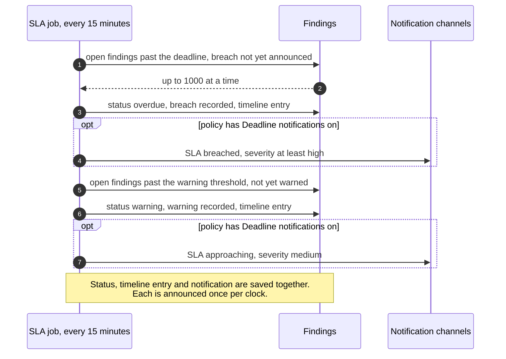

# SLA deadlines and escalation
{: .no_toc }

Every open finding that needs fixing gets a remediation deadline from your
SLA policy: by its priority class (P0 to P3), or by its severity while it has
no class. A deadline only ever moves earlier on its own. Before the deadline
the platform warns once; after it, it announces the breach once. Both go to
your notification channels and the finding's timeline.

1. TOC
{:toc}

## The flow

### How the deadline is set

1. The policy is the asset's own active policy, else your organization's
   default policy (**Settings › Findings & assets › SLA policies**). Without any policy the
   platform defaults apply: P0 2 days, P1 5, P2 15, P3 30, and by severity
   critical 2, high 15, medium 30, low 60. Informational findings get no
   deadline unless the policy sets info days.
2. A finding in CISA KEV is due at most **14 days** (the policy's **Known
   exploited (KEV) deadline cap**) after the platform first sees it as known
   exploited. 0 turns the cap off. The finding shows "Shortened because it is
   in CISA KEV".
3. **Only earlier.** When the priority goes up, the new window counts from
   now and the earlier date wins. A lower priority or a longer policy never
   moves a deadline later. Only an approved severity downgrade can, counted
   from first detection.
4. **A new clock** starts when a resolved finding comes back as a regression
   (a scan or a retest finds it again), when a risk acceptance ends, and when an approved false
   positive is withdrawn. The deadline is then counted from that moment.
5. A pentest finding gets its deadline when it is published, counted from
   then: until then the asset owner does not know about it.
6. The finding page explains the date: which policy, which window, the KEV
   cap and when the clock started.

### How the warning and the breach are announced

1. Every 15 minutes the job finds open findings whose deadline passed and
   whose breach was not announced on this clock. It sets the SLA status to
   **overdue**, adds an "SLA breach" entry to the timeline and sends a breach
   notice at the finding's severity, at least high.
2. It then finds findings that have used the policy's **Warning threshold
   (%)** of their window (80 by default), counted from the start of the
   current clock, and warns once.
3. Each warning and each breach is announced **once per clock**, whatever
   made the finding overdue: a reopen after the deadline, a status change, an
   un-suppression. A new clock or a reopen allows a new announcement.
4. With **Deadline notifications** off, the status and the timeline still
   change; nobody is notified.
5. Notices name the finding by its title. A pentest finding, which only its
   campaign members may see, is named by its id.

## When something fails

| What happens | What you see | What to do |
|---|---|---|
| Your SLA policy cannot be read | That finding gets no deadline until it is next recomputed (a scan or a priority change) | Nothing, unless it persists: then check the policy list |
| A finding has no deadline | "No SLA" | It is informational, or decided before it was created; set info days to give informational findings a deadline |
| A deadline looks too early | "Why this date" on the finding | A higher priority or the KEV cap set it; deadlines never move later on their own |
| No breach notice arrived | The finding is overdue, with an "SLA breach" timeline entry | Check **Deadline notifications** on the policy and your notification channels |
| A notice could not be queued | Nothing is announced yet | The job tries again on its next run; nothing is lost |

## Security

- The job runs for every organization; each status, timeline entry and
  notice carries the finding's own organization and goes only to that
  organization's channels.
- Pentest finding titles stay out of notices, because notification channels
  reach people outside the campaign.
- Announcements cannot be suppressed by moving a status back and forth: only
  a new clock or a reopen allows another one.
- Creating and changing SLA policies needs Manage SLA (`settings:sla:write`).

## Related

- [SLA policies](../../user-guide/08-mobilization.md#sla-policies)
- [SLA compliance](../../user-guide/08-mobilization.md#sla-compliance)
- [Priority](../vulnerability-intel/priority.md)
- [KEV and EPSS](../vulnerability-intel/kev-epss.md)
- [Remediation groups, campaigns and tasks](remediation-work.md)
