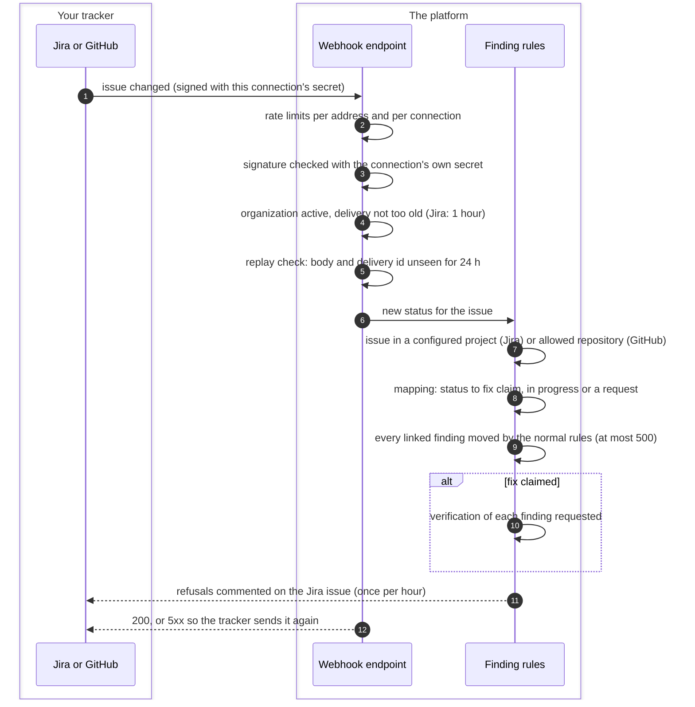
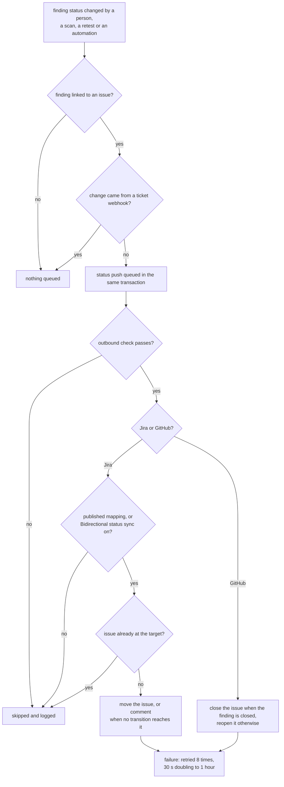

# Ticket two-way sync
{: .no_toc }

Once a finding is linked to an issue, the two stay in step. A signed webhook
from Jira or GitHub tells the platform that an issue moved, and the platform
moves the linked findings through the same rules as a person. In the other
direction, a finding's status change moves the linked issue, when your
connection allows it. A ticket can claim a fix, never close a finding: a
retest, a covered scan or a reviewer verifies.

1. TOC
{:toc}

## The flow

### From the tracker to the platform

1. **One URL per connection.** Each Jira or GitHub connection has its own
   webhook URL and secret. The URL names the connection and therefore the
   organization; a sender cannot choose another organization. For Jira,
   open **Settings > Integrations > Ticketing**, the connection's menu and
   **Inbound webhook** to copy the URL and generate or enter the secret. For
   GitHub the URL and secret are set through the API today.
2. **Checks before anything is read.** A missing or wrong signature, an
   unknown or disabled connection, all answer the same 401. A suspended
   organization takes no deliveries. A Jira delivery more than an hour old
   is refused.
3. **Replays.** The body hash and the tracker's delivery id are remembered
   for 24 hours. A delivery seen before is acknowledged and ignored. If
   processing fails, both are forgotten and the answer is 5xx, so the
   tracker's own retry is processed.
4. **Which findings.** For Jira, only the connection that signed the
   delivery is used: the findings linked to that issue on that site, matched
   by the issue's Jira id first (an issue moved to another project keeps its
   links), plus the open findings of a remediation task whose issue it is.
   For GitHub, the findings linked to the issue's address.
5. **What a status means.**

   | Tracker change | Linked findings |
   |---|---|
   | Jira Done, Resolved, Closed, Completed, Fixed, Verified | Fix claimed: moved to fix applied, then a retest or covered scan is requested |
   | Jira In Progress, In Review, In Development, Reviewing | In progress |
   | Jira Open, To Do, Backlog, Selected, Reopened | Confirmed |
   | Jira "Won't Do" (with a published field mapping that says so) | A pending risk acceptance or false-positive request, decided by an approver |
   | GitHub closed as completed | Fix claimed, as for Jira Done |
   | GitHub closed as not planned | A pending risk acceptance request per finding |
   | GitHub closed as duplicate | Nothing changes |
   | GitHub reopened | In progress |

   A published ticket field mapping for the issue's project and type
   replaces the Jira names above with its own. A status no rule maps is
   ignored.
6. **Same rules as a person.** Each finding moves through the legal steps
   of its lifecycle. A closed finding, a pentest finding or a move that
   needs approval is refused. Jira gets one comment listing the findings
   that did not move and why, at most once per hour for the same issue and
   status. GitHub refusals are only logged.
7. **The tracker side is recorded.** Every Jira delivery also records the
   issue's assignee and status category on the link. The assignee is a
   label: never a platform assignee, and it grants nothing.

### From the platform to the tracker

1. A status change on a linked finding queues a push in the same database
   transaction, so a push is never lost to a restart.
2. **Jira** moves only when the connection's **Bidirectional status sync**
   is on (off by default), or when a published ticket field mapping for the
   project covers the status. The default targets are To Do (new,
   confirmed), In Progress, and Done (fix applied, resolved). If the
   workflow has no transition to the target, the platform comments on the
   issue instead of failing.
3. **GitHub** closes the issue when the finding is closed and reopens it
   otherwise. There is no switch for it today: every status change of a
   finding with a linked GitHub issue is pushed.
4. Pushes for pentest findings stop when their campaign is above your
   tracker TLP limit.
5. A failed push is retried up to 8 times, from 30 seconds doubling to at
   most an hour. With a published ticket field mapping, a refusal a retry
   cannot fix (a 4xx from Jira, a workflow path that does not exist) is not
   retried.

### Remediation campaigns and their Jira epic

**Create Jira Epic** on a campaign (`remediation:write`) files one epic in
the project you choose, with the campaign's description and progress, using
your default Jira connection. Asking again returns the same epic.

- When the campaign completes, the epic is moved to Done (or commented when
  no transition reaches it).
- When the epic is moved to Done, Resolved, Closed, Complete or Completed in
  Jira, each live task of the campaign is marked fixed: a fix claim for its
  open findings. The campaign itself completes only when its tasks are done.
  Findings the rules refuse are commented on the epic.

### Why the two directions never loop

- A finding change made by a ticket webhook is marked as such, and no push
  is queued for it.
- Before moving a Jira issue, the platform reads its status and does
  nothing when it is already at the target.
- An epic moved to Done marks tasks fixed but does not change the
  campaign, so no epic move is sent back.

## When something fails

| What happens | What you see | What to do |
|---|---|---|
| Wrong or missing secret in the tracker | The tracker reports 401; nothing changes | Copy the secret again from **Inbound webhook** (Jira) or rotate it (GitHub) |
| No secret generated yet | Every delivery is refused | Generate a secret and set it in the tracker |
| Jira delivery older than an hour | 401 "too old" | Check the clocks; Jira resends recent deliveries |
| Replay store (Redis) unavailable | 503; the tracker retries | Restore Redis |
| GitHub event for a repository outside the connection's organization | 403 | Send events only from that organization's repositories |
| A linked finding is closed or a pentest finding | A comment on the Jira issue lists it | Change the finding in the platform |
| No Jira transition reaches the target | A comment asks to move the issue | Move it by hand, or map the workflow |
| Bidirectional status sync is off | Jira issues do not follow finding changes | Turn it on under **Configure** |

## Security

- **Signed deliveries.** Jira sends `X-Hub-Signature` and GitHub
  `X-Hub-Signature-256`: an HMAC-SHA256 of the raw body with the
  connection's own secret, compared in constant time. The secret is stored
  encrypted, shown once, never returned, and changing it needs the
  Manage integrations permission (`integrations:manage`) and a recent
  sign-in. Each change is a critical audit event.
- **Organization isolation.** The URL names one connection, and the
  connection names its organization. There is no platform-wide secret and
  no search across organizations' secrets.
- **A ticket never closes a finding.** The most a tracker can do is claim a
  fix or ask for a decision; verification and approvals stay in the
  platform.
- **Bounded.** Bodies over 2 MiB (Jira) or 5 MiB (GitHub) are refused, and
  each endpoint is rate limited per client address (50 a second) and per
  connection (20 a second).

## Related

- [Inbound webhooks API](../../api/webhooks.md#inbound-webhooks)
- [Ticketing settings](../../user-guide/10-settings-and-integrations.md#ticketing)
- [Campaigns](../../user-guide/08-mobilization.md#campaigns)
- [Finding status lifecycle](../results/finding-lifecycle.md)
- [Retesting a finding](../results/retest.md)
- [Creating tickets](tickets.md)
