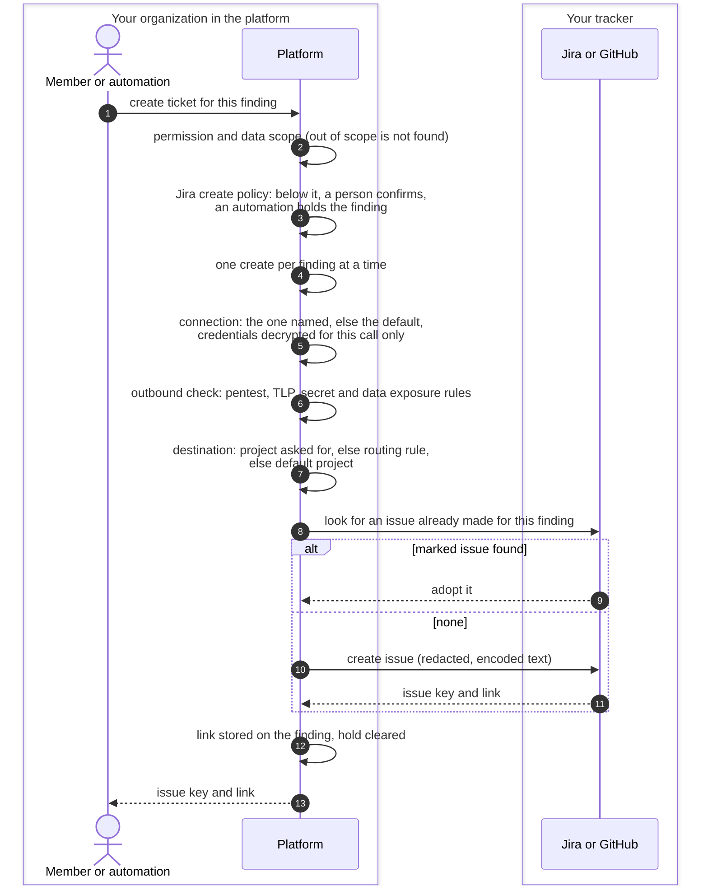
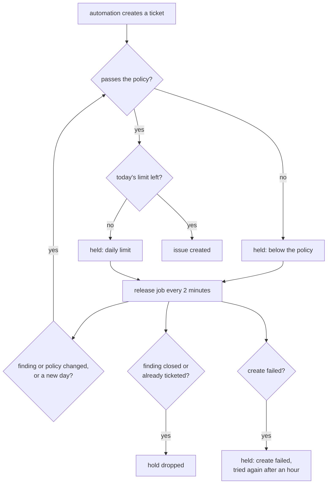

# Creating tickets
{: .no_toc }

A ticket hands a finding to the team that fixes it, in the tracker that team
already uses. A person creates one from a finding, an automation creates one
in a workflow step, and the platform creates held findings later when they
pass the create policy. The result is one issue per finding and tracker
project, linked back to the finding.

1. TOC
{:toc}

## The flow

1. **Who may create.** Creating a ticket needs the `findings:write`
   permission, and the finding must be in your data scope (out of scope
   answers as not found). An automation runs as the member it runs for.
2. **Create policy (Jira).** Each Jira connection has a policy under
   **When to create issues**: a minimum severity, a minimum priority class,
   findings in the KEV catalog always pass, and a daily limit. A finding
   passes when any one of these signals passes. A person's create below the
   policy asks for confirmation, and the confirmed create is audited. An
   automation's create below the policy, or over today's limit, holds the
   finding instead of filing it. GitHub issues have no create policy yet.
3. **One at a time.** Every create of the same finding on the same
   connection waits for the one before it, so a workflow and the hold
   release job never file two issues.
4. **The connection.** A request may name one of your Jira connections;
   otherwise the newest connected one is used. GitHub issues use your first
   connected GitHub source-control connection. Credentials are decrypted
   only for the call.
5. **What may leave.** One outbound check runs for Jira and GitHub alike:
   - pentest findings go out only from their campaign, never from the
     finding, a remediation task or an automation;
   - a campaign at TLP:RED is never sent, and one above your tracker TLP
     limit (the pentest setting, `amber` by default) is refused;
   - a leaked secret sends its title and location only, never the value,
     its masked preview, the snippet or the fingerprint;
   - a finding that exposes data sends severity, status and location only,
     under the title "Data exposure finding".
6. **Where it goes (Jira).** The project named in the request, else the
   first routing rule that matches the finding (severity, tag, asset scope,
   asset criticality), else the connection's default project. With none of
   these, the create is refused: the platform never guesses.
7. **No duplicates.** A finding already linked to an issue in that project
   (or that GitHub repository) returns the existing issue. Each issue the
   platform files carries a marker: a Jira issue property and the label
   `openctem-ref-<id>`, or a hidden last line in a GitHub issue body. Before
   creating, the platform looks for that marker and adopts the issue it
   finds, so a create whose answer was lost is not filed twice.
8. **What is sent.** A published ticket field mapping for the project and
   issue type fills the issue's fields. Without one, the built-in fields are
   used: summary, description, priority from severity (Critical to Highest
   by default), and the labels `openctem`, `security` and the severity.
9. **The link.** The issue is linked to the finding and shown under its
   tickets. Status changes then flow both ways; see
   [Ticket two-way sync](ticket-sync.md).

### Held findings

- A held finding shows **Not sent to Jira** with the reason next to its
  tickets, and people who may create tickets can choose **Create anyway**.
- The release job re-checks at most 200 holds per run, most severe first,
  and never creates more than the daily limit. Loosening the policy
  therefore files the backlog over the following days; the policy preview
  shows how many findings it would release.
- Tightening the policy never closes or changes issues that already exist.

## When something fails

| What happens | What you see | What to do |
|---|---|---|
| No connected Jira or GitHub connection | The create is refused (400) | Connect the tracker and test the connection |
| The finding is below the create policy | You are asked to confirm | Confirm, or leave it held |
| The outbound check refuses the finding | 403 `TICKET_EGRESS_REFUSED` with the reason | Pentest findings: create tickets from the campaign. TLP: change the campaign or the tracker limit |
| No project, routing rule or default project | The create is refused | Set a default project on the connection |
| Jira refuses the issue (a required field) | An error naming the fields; the issue type row shows them | Map the fields in a ticket field mapping, or pick another issue type |
| The tracker is unreachable or times out (30 s) | The create fails; an automation step fails | Try again: the marker prevents a second issue |
| The duplicate lookup fails | The create is refused | Try again later |
| An automatic create from a held finding fails | Held: create failed | Fix the cause; it is tried again after an hour |

## Security

- **Credentials.** The API token is stored encrypted (AES-256-GCM with the
  install's encryption key) and never returned. Changing the base URL to
  another host needs the credentials again, so a stored token never follows
  a new destination.
- **Outbound address checks.** The tracker URL is checked when saved, and
  every connection refuses loopback, private, link-local and cloud metadata
  addresses, also after a DNS change. Calls time out after 30 seconds.
- **Untrusted text.** Finding text often comes from the scanned system.
  Secrets are redacted first, then the text is encoded for the tracker's
  format: Jira descriptions go into a block the text cannot close, GitHub
  bodies into code blocks, links are defanged, control and bidi characters
  are removed and lengths are capped. Scanner text cannot add links,
  mentions or images to a ticket.
- **Organization isolation.** The connection, the finding, the policy and
  every hold belong to your organization; another organization's
  connection is never used, even by id.

## Related

- [Ticketing settings](../../user-guide/10-settings-and-integrations.md#ticketing)
- [What a ticket may contain](../../user-guide/10-settings-and-integrations.md#what-a-ticket-may-contain)
- [Which findings become Jira issues automatically](../../user-guide/08-mobilization.md#which-findings-become-jira-issues-automatically)
- [Jira issue types](../../user-guide/08-mobilization.md#jira-issue-types-for-findings-tasks-and-campaigns)
- [Outbound ticketing API](../../api/webhooks.md#outbound-ticketing)
- [Ticket two-way sync](ticket-sync.md)
