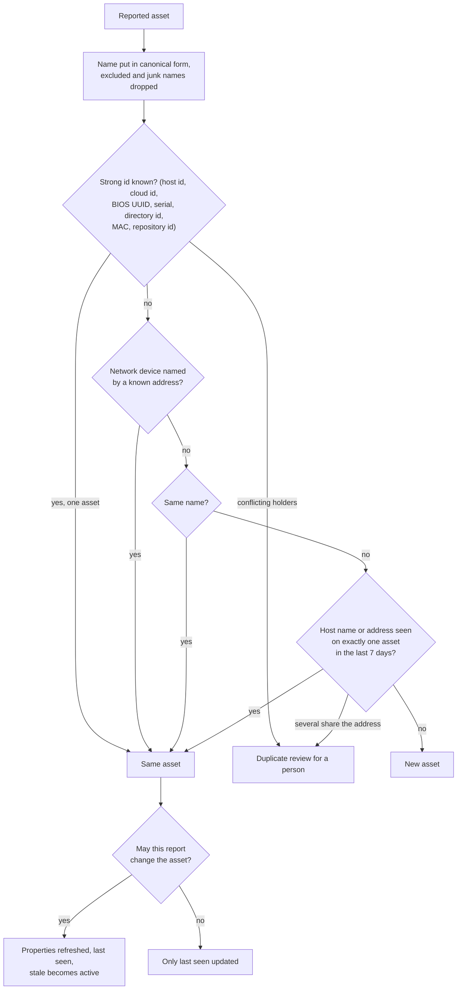
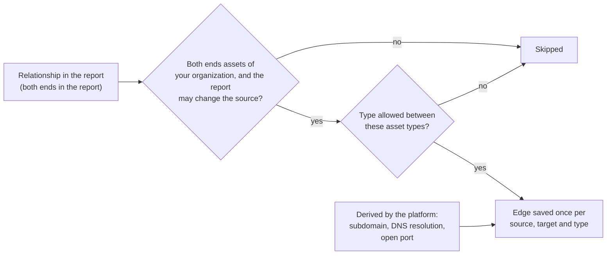

# Asset identity and relationships
{: .no_toc }

One server can be reported as an address by one tool, a host name by another
and a cloud instance id by a third. The platform matches each reported asset
to the asset you already have, so findings and history stay in one place. It
never merges two assets you already have on its own: when it is not sure, it
asks a person.

1. TOC
{:toc}

## The flow

### Matching an asset

1. The name is put in its canonical form (lower case, no trailing dot) and
   names that cannot be real hosts are dropped. Excluded assets are skipped.
2. A strong identifier such as a cloud instance id or a host id wins. When
   two assets claim the same identifier, the platform keeps both and opens a
   duplicate review.
3. Otherwise the same name, then a host name or address seen on exactly one
   asset in the last 7 days (your organization can change both limits).
4. Nothing matches: a new asset is created.
5. A report that may not change the asset (for example a tool outside its
   contract) only updates when it was last seen.

### Recording relationships

1. A report can state relationships between its own assets (a subdomain of a
   domain, a service on a host). Both ends must be assets of the report.
2. The platform also derives edges itself: a subdomain is contained in its
   domain, a name resolves to its addresses, a host exposes a port.
3. An edge is stored once, in one direction, and refreshed when seen again.

{: .note }
> From v0.20.0: the derived port and name-to-address edges also need the
> report to be allowed to change the source asset.

## When something fails

| What happens | What you see | What to do |
|---|---|---|
| Two assets claim the same strong identifier | A duplicate review | Merge or keep apart in the review |
| Several hosts share one address | A shared address review | Decide which asset it is, or keep apart |
| A host was renamed | The asset keeps its history; the old name is in its state history | Nothing |

## Security

- Matching only looks at assets of your organization. The database refuses a
  relationship whose two ends belong to different organizations.
- A report changes only assets its task and tool may change.

## Related

- [Discovery](../../user-guide/04-discovery.md)
- [From sensor result to findings](result-ingest.md)
