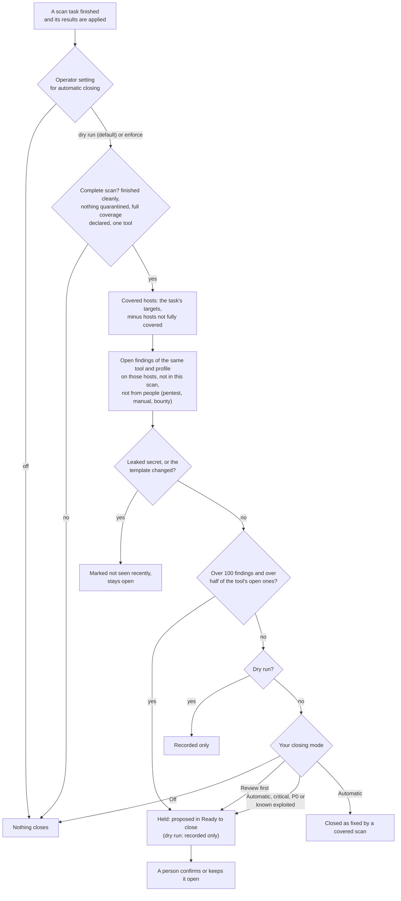

# Automatic closing
{: .no_toc }

A finding closes by itself only when the same check looked again at the same
target, over a healthy path, and the issue was gone. The platform checks that
the scan really covered the host, then your organization's closing mode
decides whether it closes, waits for a person in **Ready to close**, or stays
open.

1. TOC
{:toc}

## The flow

1. The operator's setting comes first. With the default dry run, nothing
   closes; the platform records what it would have closed.
2. The scan must be complete: finished cleanly, nothing quarantined, full
   coverage declared, one tool. A partial or blocked scan proves nothing.
3. Only hosts the task really covered count. A host that blocked the scan,
   rate limited it or did not answer is not covered.
4. Candidates are open findings last seen by the same tool and scan profile
   on those hosts, that this scan did not report. Findings from people and
   leaked secrets never close this way.
5. One clean look is enough; there is no waiting period.
6. If a scan would close more than 100 findings and more than half of the
   tool's open findings on those hosts, it is held for review: something may
   have blinded the scanner.
7. Your closing mode decides: **Automatic** closes (critical, P0 and known
   exploited findings wait for review unless the owner allows them),
   **Review first** proposes every close, **Off** closes nothing.
8. A closed finding that a later scan reports again reopens.

{: .note }
> A held scan proposes its findings in **Ready to close** even when your
> closing mode is **Off**. A passing retest (with the retest setting
> `auto_resolve`) and a source that reports an issue as mitigated close
> findings without reading the closing mode.

## When something fails

| What happens | What you see | What to do |
|---|---|---|
| Nothing closes after a clean scan | The run's receipt says why (dry run, partial, another tool) | Check the operator setting and the scan's coverage |
| Many findings held | Entries in **Ready to close** marked as held | Check that the scan really saw the hosts, then confirm or keep |
| A finding closed wrongly | **Recently auto-closed** | Reopen it within 7 days with one click |

## Security

- Every step is limited to your organization's findings and hosts.
- Confirming a proposed close needs the verify permission and a fresh
  sign-in, and is checked again when it applies.
- Every close and proposal is recorded in the audit log.

## Related

- [Closing findings](../../user-guide/closing-findings.md)
- [What counts as a covered scan](../../user-guide/closing-findings.md#what-counts-as-a-covered-scan)
- [Ready to close](../../user-guide/closing-findings.md#ready-to-close)
- [Skipped steps and coverage gaps](../scans/partial-runs.md)
