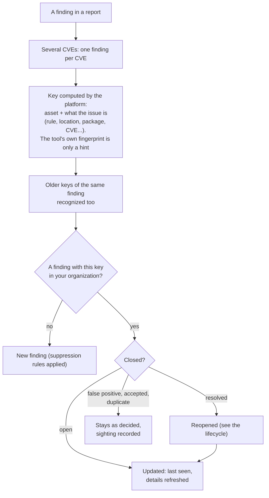

# Finding deduplication
{: .no_toc }

The same issue is reported again and again: by every scan, by two tools, by a
CI pipeline and an import. The platform computes its own key for each
finding, so each issue on each asset is one finding with one history. A new
sighting updates that finding; it never creates a second one.

1. TOC
{:toc}

## The flow

1. A finding that names several CVEs becomes one finding per CVE.
2. The platform computes the key from the asset and what the issue is. The
   tool is not part of it, so two tools that find the same issue on the same
   asset report one finding.
3. Keys from older versions of the platform are still recognized, so an
   upgrade does not duplicate findings.
4. A new key creates a finding, with your suppression rules applied.
5. A known key updates the finding: last seen, scan, branch and commit always;
   title and description take the latest text; severity and score keep the
   highest unless you overrode them; status, assignee and resolution never
   change. A resolved finding reopens; a false positive, accepted risk or
   duplicate stays as decided.

## When something fails

| What happens | What you see | What to do |
|---|---|---|
| Two reports send the same new finding at once | One finding, sighted twice | Nothing |
| The same issue at a new location (for example a moved line of code) | A new finding | Mark the old one a duplicate of the new one |
| A finding you resolved by hand is seen again on an asset the report may not change | It stays resolved | Check the asset's owner and the sensor's scope |

## Security

- Keys are unique per organization; the same issue in two organizations is
  two separate findings.
- Leaked secrets are keyed with a value private to your organization, so the
  key reveals nothing about the secret.
- A report cannot choose which stored finding it updates: the tool's
  fingerprint is only a hint.

## Related

- [Status workflow](../../user-guide/05-exposures-and-findings.md#status-workflow)
- [Finding status lifecycle](finding-lifecycle.md)
- [Known false positives](../../user-guide/known-false-positives.md)
