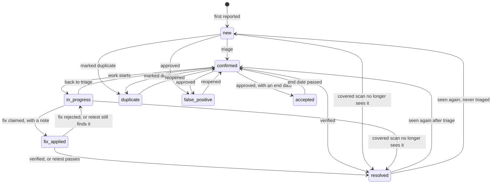
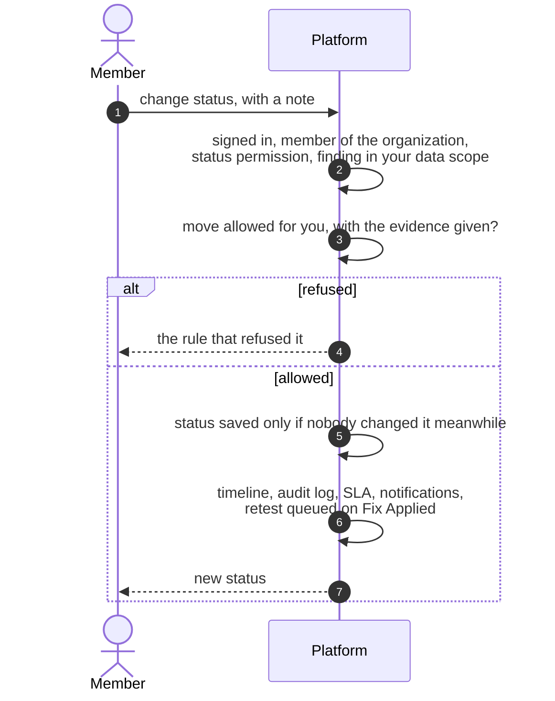

# Finding status lifecycle
{: .no_toc }

A finding's status says what should happen next. People move it through
triage, work and verification. The platform moves it only on evidence: a
covered scan that no longer sees it, a passing retest, a sighting after a
close, or the end of an accepted risk. Every move is checked against the same
rules, whatever page, API or integration makes it.

1. TOC
{:toc}

## The flow

1. **New**: the first report from a scan, an import or an integration.
2. **Confirmed, In Progress, Fix Applied**: moved by people with the
   status permission. Claiming a fix needs the fix permission, a note, and
   being someone who owns the fix (assignee, assigned group or asset owner).
3. **Resolved** by a person needs the verify permission and evidence that
   grows with the risk: a note for a standard finding, a completed checklist
   or a passing retest for a high one, and for a critical one a passing
   retest or a checklist completed by another person.
4. **Resolved** by the platform: a covered scan of the same tool no longer
   sees it ([Automatic closing](auto-close.md)), the source says it is
   mitigated, or a retest passes when your retest setting allows it.
5. **False Positive** and **Risk Accepted** need an approved request (unless
   your approval levels let the request apply at once) or an approved
   suppression rule. An accepted risk has an end date and comes back as
   Confirmed when it passes.
6. **Seen again**: a resolved finding reopens as Confirmed, or as New when
   nobody had triaged it. A false positive, accepted risk or duplicate stays
   as decided.

Not drawn: suppression rules can also move findings that are in progress,
and lifting a rule returns them to New. Ticket integrations can only set
Confirmed, In Progress or Fix Applied; automations cannot reopen a closed
finding.

## When something fails

| What happens | What you see | What to do |
|---|---|---|
| A move the lifecycle does not allow | An error naming the rule | Take the allowed steps, or ask someone with the permission |
| Not enough evidence to resolve | Resolve refused for the risk tier | Complete the checklist or run a retest |
| Someone changed the finding meanwhile | A conflict | Reload and try again |
| **Verify** on a standard finding without a checklist | Refused, while a status change with a note works | Use the status change, or complete the checklist |

## Security

- Every move checks your organization, your membership, the permission and
  your data scope; a finding outside it is answered as not found.
- Approvals need a second person unless your organization's approval levels
  say otherwise; the requester cannot approve their own request.
- Every status move a person or the platform makes writes the timeline and
  an audit log entry. A move made by a retest writes only the timeline today.

## Related

- [Status workflow](../../user-guide/05-exposures-and-findings.md#status-workflow)
- [Closing findings](../../user-guide/closing-findings.md)
- [Known false positives](../../user-guide/known-false-positives.md)
