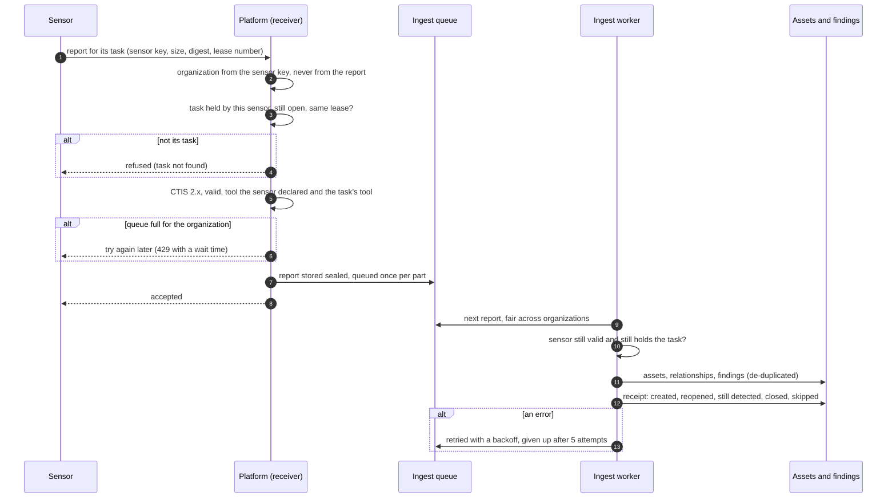

# From sensor result to findings
{: .no_toc }

Every result enters the platform as a CTIS 2.0 report: from a sensor that
finished a task, a CI pipeline, a file you import or a connector. The platform
checks who sent it and what it may change, stores it, answers at once, and
applies it in the background. A **receipt** then says what the report did to
your findings.

1. TOC
{:toc}

## The flow

1. The sensor sends the report for its task, with a digest of the bytes and
   the lease number it holds. Reports over 16 MiB are split into parts.
2. The platform takes your organization from the sensor's key. The report
   names no organization, and the platform never uses ids from it.
3. The report must be for a task this sensor holds (or finished within 15
   minutes), under the current lease. A report for a task that was taken back
   and handed out again is refused.
4. The report must be CTIS 2.x and valid, from a tool the sensor declared. A
   report from a sensor with no task goes through the
   [results quarantine](../../sensors/security.md).
5. When your organization already has a lot queued, the sensor is asked to
   try again later; it keeps the report and retries.
6. The worker applies the report: [assets](asset-identity.md), then
   relationships, then [findings](deduplication.md). It checks again that the
   sensor still holds the task, so an older run never overwrites a newer one.
7. The receipt is written at the end. On a scan run page, **What this run did
   to findings** reads it.

**Other ways in.** A CI pipeline uploads to its run (`POST
/api/v1/ci/runs/{id}/results`, up to 50 MiB) and an import goes through
**Import results** (`POST /api/v1/findings/imports`). Both join the same
queue and get the same checks and receipt.

## When something fails

| What happens | What you see | What to do |
|---|---|---|
| The report is not valid CTIS 2.x | The sensor logs `schema-invalid` or `version-mismatch`; the task fails | Upgrade the sensor, connector or CI integration |
| The queue is full | The sensor retries later; results arrive late | Nothing; if it persists, the operator adds ingest workers |
| The task was taken back | The report is refused or dropped; the run shows the newer task's results | Nothing |
| Applying keeps failing | The import or run shows the report as failed | Read the receipt errors; contact the operator |
| A tool reports asset types it should not | The report waits in the results quarantine | Review it under the sensor's quarantine |

## Security

- The organization always comes from the sender's credential. Every row the
  worker writes carries the organization of the stored report.
- Reports are stored sealed and bound to their organization, task and part.
- Size, depth and count limits are checked before anything is parsed.
- A sensor can only change what its task's tool and targets allow.

## Related

- [Results of a scan](../../scanning/scans-and-runs.md#results)
- [Import results](../../user-guide/05-exposures-and-findings.md#import-results)
- [CI upload](../../scanning/ci-upload.md)
- [Sensor security](../../sensors/security.md)
