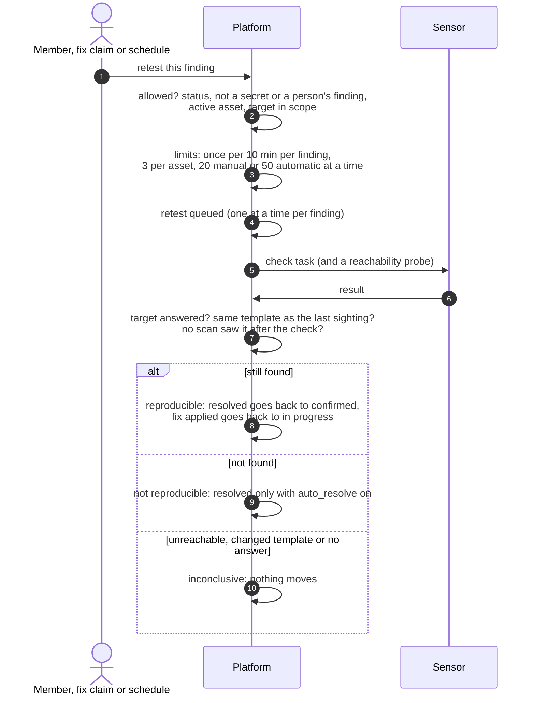

# Retesting a finding
{: .no_toc }

A retest runs the check that found an issue again, against the same target,
to see whether it is still there. You can request one on a finding, the
platform queues one when a fix is claimed, and continuous retest re-checks
findings on a schedule. A passing retest records the finding as not
reproducible; it closes the finding only when your retest settings allow it.

1. TOC
{:toc}

## The flow

1. A retest needs the verify permission. The finding must be open or
   resolved, not a leaked secret or a finding from a person, on an active
   asset whose target passes the scope gate. A scanner's report you imported
   from a file (a Nessus export, for example) is not a person's finding: it is
   re-checked by importing a newer report of the same scan (the
   **Verification** panel offers **Import newer results**), or by a retest
   check you attach.
2. Limits keep retests from flooding a host: one per finding every 10
   minutes, 3 in flight per asset, and per organization 20 manual and 50
   automatic at a time.
3. The platform queues a task for a sensor, with a reachability probe for
   template checks. The task is taken and signed like any scan task.
4. A retest that does not settle within 30 minutes (2 hours for a version
   check) is inconclusive.
5. **Still found** moves the finding back to work. **Not found** stamps it
   not reproducible and resolves it only when the retest setting
   `auto_resolve` is on. **Inconclusive** moves nothing.
6. Continuous retest picks findings every day by default (6 hours to 7
   days), up to your organization's daily budget.

## When something fails

| What happens | What you see | What to do |
|---|---|---|
| The retest cannot be sent | Retest inconclusive at once | Check that a sensor with the tool is online |
| The target does not answer | Inconclusive: unreachable | Check the target and the sensor's network |
| The template changed since the finding | Inconclusive: template changed | Wait for the next scan to re-baseline |
| A scan saw the finding after the check | Inconclusive | Nothing; the newer sighting wins |

## Security

- A retest is limited to your organization and your data scope, and its
  target passes the scope gate when queued and again when a sensor takes it.
- A custom retest check that probes intrusively needs another person's
  approval before it can run.
- Retest moves are on the finding's timeline. They do not write an audit log
  entry today.

## Related

- [Re-verify a finding](../../user-guide/07-validation.md#re-verify-a-finding)
- [Retest queue](../../user-guide/07-validation.md#retest-queue)
- [Finding status lifecycle](finding-lifecycle.md)
