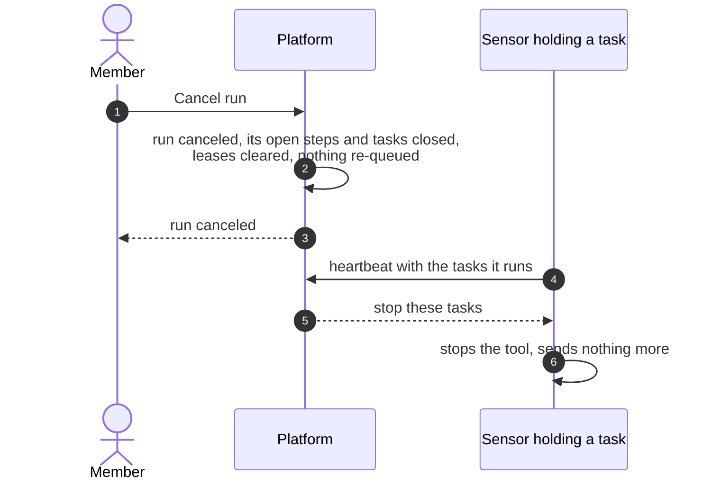
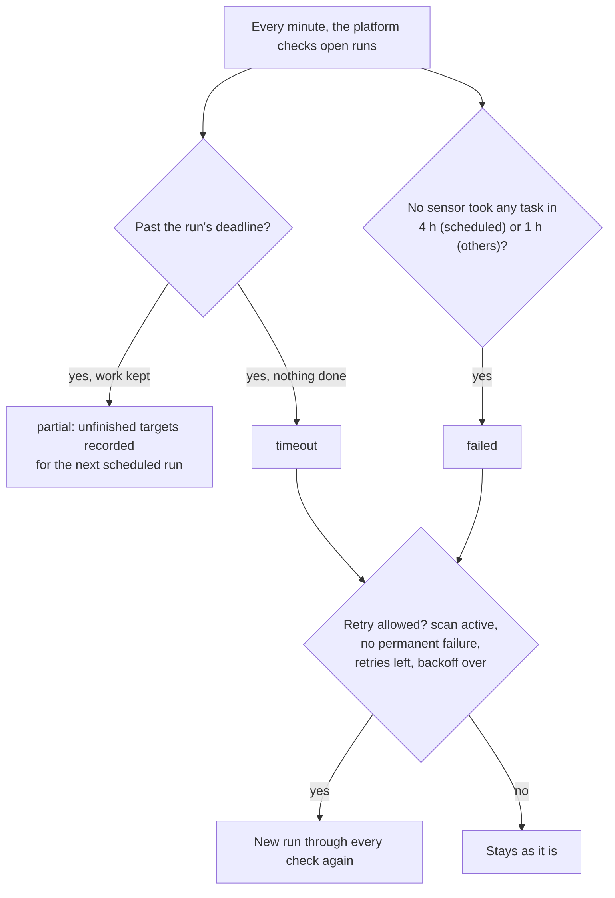

# Cancel, retry and deadlines
{: .no_toc }

A run can end before all of its work is done: you cancel it, its deadline
passes, or no sensor takes its work. Failed runs can be retried by the
platform. This page shows each of these paths and what happens to tasks that
sensors are still running.

1. TOC
{:toc}

## The flow

### Cancel

1. **Cancel run** needs `scans:write` and works only on a run that has not
   finished. The run is `canceled` at once.
2. The sensor hears about it on its next heartbeat (within about 5 seconds
   while it works) and stops the tool. An offline sensor hears it when it
   reports the task again.
3. Results that arrived before the cancel stay. Late results are ignored.
   Cancelling again does nothing.

### Deadline, unclaimed runs and retries

1. A run's deadline is the scan's **Max duration**, else the workflow's
   timeout, else 24 hours. Time spent waiting in the queue does not count,
   and a claim can extend it to the time the work needs.
2. At the deadline, open tasks fail and the sensor is told to stop. The run
   ends `partial` when it kept results, else `timeout`.
3. A run whose open tasks wait for a busy sensor of your organization, for
   their hosts or for their scan window is not failed or timed out.
4. The platform retries `failed` and `timeout` runs (a timed-out run at most
   twice), with a backoff, when the scan is still active and no step failed
   for a permanent reason (scope, invalid settings, missing tools). `partial`,
   `canceled` and `blocked` runs are never retried. There is no manual retry
   button: run the scan again.

## When something fails

| What happens | What you see | What to do |
|---|---|---|
| A sensor is offline when you cancel | Its task shows canceled; the sensor stops when it reconnects | Nothing |
| Runs keep timing out | Runs `timeout` or `partial` with unfinished targets | Raise **Max duration**, add sensors, or reduce targets per run |
| Nobody takes the run | Run `failed`, "not picked up by a sensor" | See [Why a task waits](../../scanning/why-waiting.md) |
| Retries keep failing | Several `failed` runs with the same step code | Fix the cause the code names; permanent codes are not retried |

## Security

- Cancel works only on runs of your organization that you may read.
- A canceled task loses its lease, so its sensor can no longer send results
  for it.

## Related

- [Cancel a run](../../scanning/scans-and-runs.md#cancel-a-run)
- [Run deadline](../../scanning/scans-and-runs.md#run-deadline)
- [Failures and retries](../../scanning/scans-and-runs.md#failures-and-retries)
