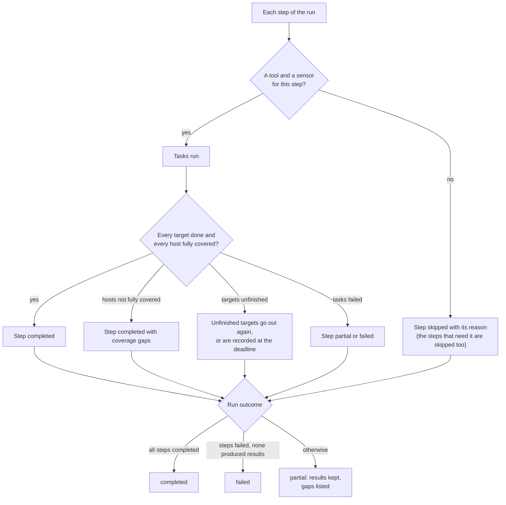

# Skipped steps and coverage gaps
{: .no_toc }

A run reports exactly what it covered. When part of the work could not be
done, the run ends `partial`, keeps every result it got, and says what is
missing and why: a step that was skipped, targets that did not finish, or
hosts the sensor could not fully cover. Nothing missing is ever counted as
fixed.

1. TOC
{:toc}

## The flow

1. **Coverage gaps.** A host that blocked the scan, kept rate limiting it or
   stopped answering is a coverage gap of its task. The task completes, the
   step says **Completed with N hosts not fully covered**, and the run is
   `partial`. See [Host politeness and rate](politeness.md).
2. **Unfinished targets.** When a task stops with some targets done, only
   the unfinished ones run again as a new task. At the run's deadline they
   are recorded, and the next scheduled run plans them first.
3. **Zone gaps.** Targets that no scan zone can place make a completed run
   `partial`.
4. **Skipped steps.** A step skipped because of the scan's intensity, its
   depth or a condition does not change the outcome.

{: .note }
> From v0.20.0: a scan runs as far as your tools and sensors support. A step
> whose tool is not installed (`TOOL_NOT_INSTALLED`), is turned off
> (`TOOL_DISABLED`), has no sensor (`NO_SENSOR_FOR_TOOL`) or whose capability
> no tool implements (`NO_MATCHING_TOOL`) is skipped with that reason, the
> steps that need its results are skipped as `DEPENDENCY_SKIPPED`, and the run
> ends `partial`. Only a run in which no step can run is refused, with
> `NO_RUNNABLE_STEPS`. Before v0.20.0, a missing tool for a required step
> refused the run.

## When something fails

| What happens | What you see | What to do |
|---|---|---|
| A step is skipped for a missing tool (from v0.20.0) | The step's card reads **Skipped** with the reason and code | Install or enable the tool, or pair a sensor that has it |
| Hosts not fully covered | **Coverage gaps** in the task panel, with each host's reason | Allow the scanner addresses, or lower the rate |
| Targets unfinished at the deadline | Run `partial`, **unfinished targets** | Raise **Max duration**; the next scheduled run starts with them |
| A partial run | The run counts as a success with coverage gaps | Read the gaps; findings on those hosts stay open |

## Security

- A partial look never closes a finding: only a complete scan by the same
  tool that covered the host can. See [Automatic closing](../results/auto-close.md).
- Coverage gaps name hosts of your organization only, and only to people who
  may read the run.

## Related

- [Scans and scan runs](../../scanning/scans-and-runs.md)
- [Hosts not fully covered](../../scanning/scans-and-runs.md#hosts-not-fully-covered)
- [Closing findings](../../user-guide/closing-findings.md)
