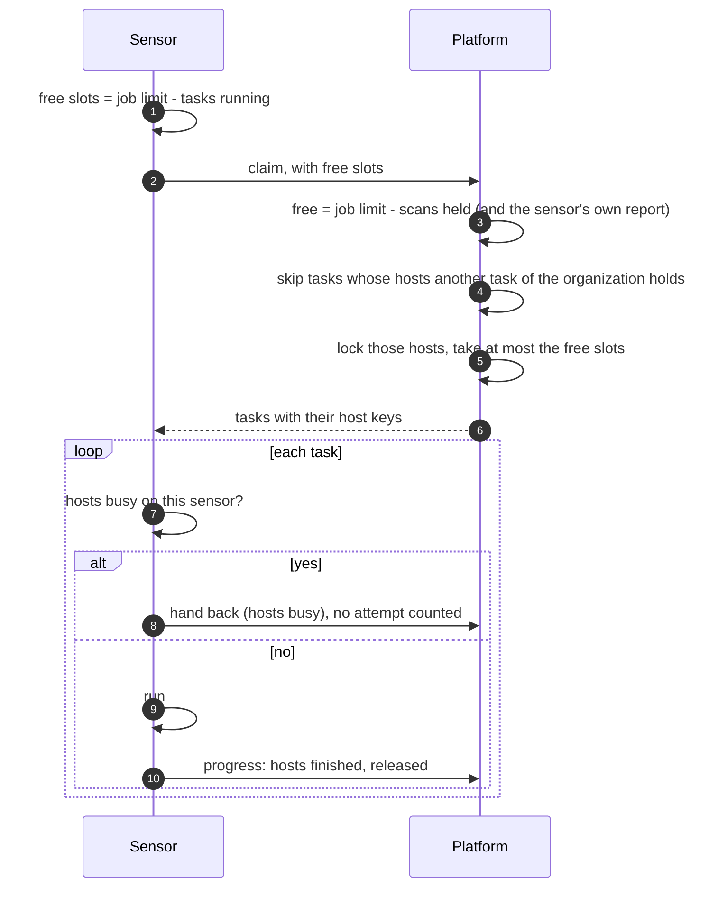
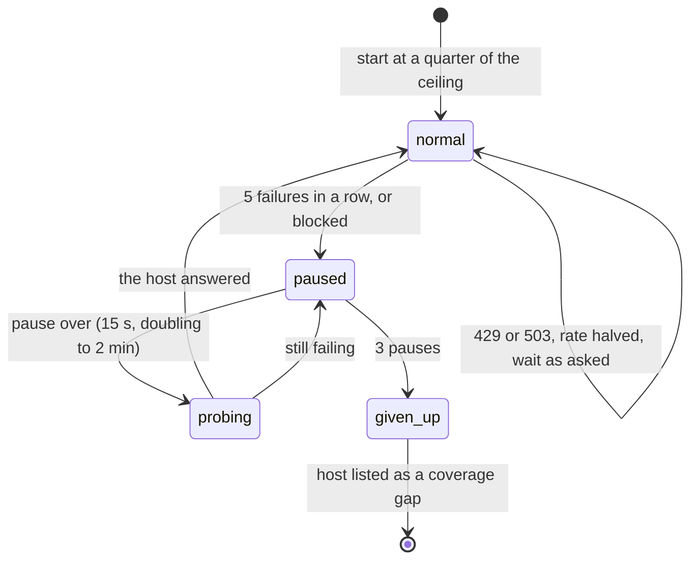

# Host politeness and rate
{: .no_toc }

Scans must not overload the hosts they check. Three things keep them polite:
the platform never lets two tasks of your organization scan the same host at
once, each sensor only takes as many tasks as it has free **slots**, and the
sensor adapts its request rate to each host and stops sending to a host that
keeps failing.

1. TOC
{:toc}

## The flow

### One task per host, as many tasks as slots

1. Each task carries **host keys**: the host name, or the address and its
   /24 range. A range scan and an address in it count as the same host.
2. The platform skips a task while another task of your organization holds
   one of its hosts, and locks the hosts while it hands tasks out.
3. It hands out no more tasks than the sensor has free slots. The job limit
   is the lowest of the sensor's own limit, the limit an administrator set (1
   to 100) and what the sensor reports free; an overloaded sensor gets at
   most one task, and only when it runs none.
4. As targets finish, the sensor releases their hosts, so a waiting task can
   start before the whole task ends.
5. Passive tasks (DNS, subdomain discovery, lookups) touch no target host and
   hold no host.

### The rate for each host

1. When the tool's network is confined, the sensor paces every host. It
   starts at a quarter of the ceiling and raises the rate while the host
   answers.
2. The ceiling is the lowest of the scan's rate limit, the scan window,
   program rules, the sensor's local policy and the sensor setting.
3. A `429` or `503` halves the rate and the sensor waits as long as the host
   asks (at most 5 minutes). It does not stop the host.
4. Five failures in a row (timeouts, refused connections, TLS failures), 20
   blocks or resets in a row, or an edge protection page pause the host. After
   3 pauses the sensor gives the host up.
5. The task still completes. The host appears as a **coverage gap** with its
   reason, and no finding on it closes because of this scan.

## When something fails

| What happens | What you see | What to do |
|---|---|---|
| Another task scans the same host | **Waiting for its hosts** | Nothing; it starts when the host is released |
| The sensor has no free slot | **Waiting for a sensor** | Add sensors or raise the sensor's job limit |
| A host keeps pushing back | Step **Completed with N hosts not fully covered**, reason **kept rate-limiting the scan** | Lower the scan's rate or allow the scanner addresses |
| A host blocks the scanner | Reason **blocked the scan** or **blocked or challenged by edge protection** | Allow the scanner addresses at the host or its firewall |

## Security

- Host keys and locks are per organization. Across organizations, shared
  sensors hold a host for at most 2 shared tasks (1 when intrusive), and the
  lock never reveals who holds it.
- Host keys travel inside the signed job, so they cannot be changed on the
  way.

## Related

- [Why a task waits: waiting for its hosts](../../scanning/why-waiting.md#waiting-for-its-hosts)
- [Hosts not fully covered](../../scanning/scans-and-runs.md#hosts-not-fully-covered)
- [Chunks and politeness](../../scanning/scan-workflows.md#chunks-and-politeness)
- [Sensor network](../../sensors/network.md)
