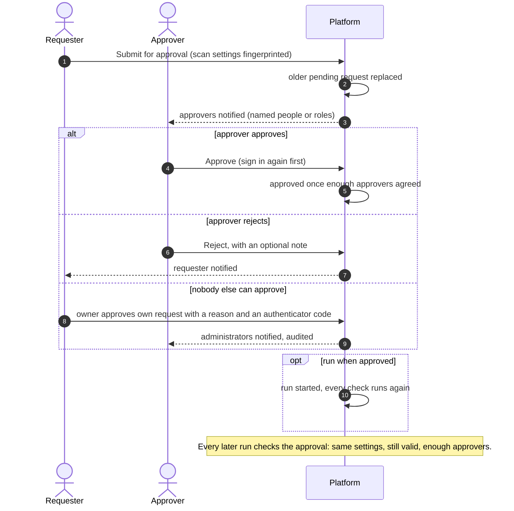

# Scan approvals
{: .no_toc }

When your organization turns on scan approval, its rules decide which scans
need a second person before they run, for example intrusive scans or scans of
crown jewels. The requester submits the scan; named approvers or roles decide.
An approval is tied to the scan's settings: change them and the next run
needs a new approval.

1. TOC
{:toc}

## The flow

1. On the scan page, **Submit for approval** creates a request that records a
   fingerprint of the scan's settings.
2. The approvers the matching rule names (people or roles) are notified. You
   can never approve your own request as an ordinary approver.
3. **Approve** asks you to sign in again. When enough approvers agreed, the
   request is approved; with **run when approved**, the run starts and passes
   every check again.
4. When nobody else can approve, the organization owner can approve their
   own request with a reason and a code from their authenticator app. This is
   audited and the administrators are told.
5. Each run checks for an approval that matches the scan's current settings,
   is still valid and has enough approvals. An approval for one run is used up
   by that run.

## When something fails

| What happens | What you see | What to do |
|---|---|---|
| The scan runs without a valid approval | A `blocked` run with `SCAN_APPROVAL_REQUIRED` or `SCAN_APPROVAL_PENDING` | Submit the scan, or remind the approvers |
| The scan changed after the approval | **Changed since the last approval** on the scan page | Submit again; the request shows what changed |
| The approved run cannot start | The request is approved, no run appears | The run hit another check (scope, sensors, windows); run it again to see the reason |
| An emergency | No approver available | An owner or administrator can start an emergency run (1 to 24 hours), audited as critical |

## Security

- Requests and approvals are read and written only within your organization.
- Approving needs `scans:approve` and a fresh sign-in; self-approval needs a
  fresh authenticator code and is only possible for the owner when nobody
  else can approve.
- Approving a run is separate from approving scope: approved scope entries
  are also recorded by the job signer, which refuses to sign a job outside
  them. See [Signed jobs](signed-jobs.md).

## Related

- [Scan approvals in Discovery](../../user-guide/04-discovery.md#scan-approvals)
- [Scan approval settings](../../user-guide/10-settings-and-integrations.md#scan-approval)
- [Scope approvals](../../user-guide/03-scoping.md#approvals)
