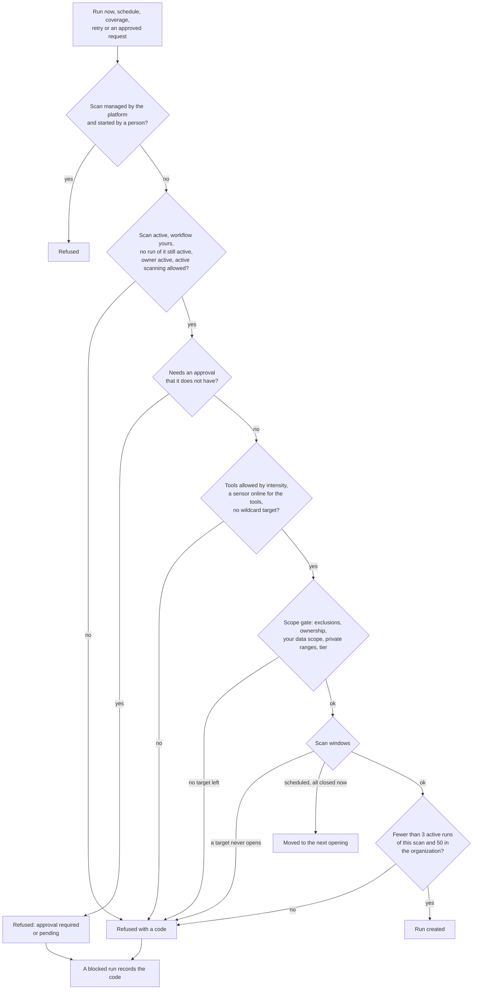
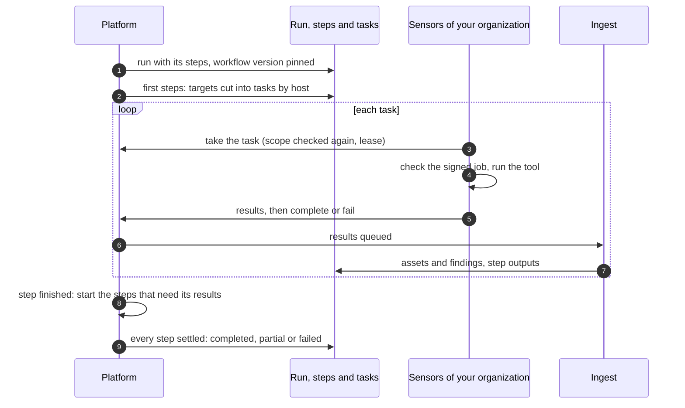

# From scan to results
{: .no_toc }

A scan runs when someone clicks **Run now**, when its schedule fires, when
continuous coverage starts it, or when a failed run is retried. Every one of
these goes through the same checks. If they pass, the platform creates a
**scan run**, cuts it into **steps** and **tasks**, and sensors run the tasks.
The run ends `completed`, `partial`, `failed`, `timeout`, `canceled` or
`blocked`.

1. TOC
{:toc}

## The flow

### The checks before a run exists

1. A scan the platform manages (continuous coverage) only runs on the
   platform's own schedule.
2. The scan must be active (a paused scan can still be run by hand), its
   workflow must belong to your organization or be a starter workflow, and
   a scheduled occurrence is skipped while the previous run is still active.
3. When [scan approvals](scan-approvals.md) are on and a rule catches the
   scan, it needs a valid approval for its current settings.
4. Every target passes the [scope gate](../../scanning/scope.md). Targets
   that are refused are left out; if none is left, the run is refused.
5. [Scan windows](scan-windows.md) can move a scheduled run to the next
   opening, or refuse a target whose windows never open.
6. A refused trigger leaves a `blocked` run with the code, so you see why on
   the Runs tab. **Run now** shows the reason and a fix.

{: .note }
> From v0.20.0: a workflow step whose tool is not installed, is turned off or
> has no sensor no longer refuses the run. The step is skipped with its
> reason, and only a trigger in which no step can run is refused
> (`NO_RUNNABLE_STEPS`). See [Skipped steps and coverage gaps](partial-runs.md).

### The run

1. The run is created with the workflow version it will use; editing the
   workflow later changes only the next run.
2. The first steps are cut into tasks. Tasks of one step never share a host.
3. A sensor takes a task under a lease. See
   [How a sensor takes a task](task-claim-and-lease.md).
4. The sensor returns results bound to its task. See
   [From sensor result to findings](../results/result-ingest.md).
5. When a step finishes, the steps that need its results start, with the new
   targets checked by the scope gate again. With stage streaming, the next
   step can start on the first finished task.
6. The run ends `completed` when every step completed, `failed` when steps
   failed and none produced results, and `partial` otherwise.

## When something fails

| What happens | What you see | What to do |
|---|---|---|
| A check refuses the trigger | A `blocked` run with a code such as `NO_TARGETS`, `TARGET_OUT_OF_SCOPE`, `SCAN_WINDOW_NEVER_OPENS` or `MAX_CONCURRENT_RUNS` | Open the run; the message says what to fix (scope, sensors, windows, tools) |
| No sensor takes any task | The run fails after 4 hours (scheduled) or 1 hour (others) | Check that a sensor with the tool is online in the right zone; see [Why a task waits](../../scanning/why-waiting.md) |
| Some steps fail, others produce results | Run `partial` | Open the failed step's tasks and logs |
| The deadline passes | Run `partial` (work kept) or `timeout` | Raise **Max duration**, or split the targets |

## Security

- Every query uses the organization of the person or sensor that is signed
  in; a run of another organization is answered as not found.
- Running a scan needs `scans:write` and `scans:execute`; reading runs needs
  `scans:read`.
- The scope gate runs at trigger, again for each new target a step finds,
  and again when a sensor takes a task.
- The sensor only runs what the platform's job signer signed. See
  [Signed jobs](signed-jobs.md).

## Related

- [Scans and scan runs](../../scanning/scans-and-runs.md)
- [Scan workflows](../../scanning/scan-workflows.md)
- [Stage streaming](../../scanning/stage-streaming.md)
- [Scope and authorization to scan](../../scanning/scope.md)
