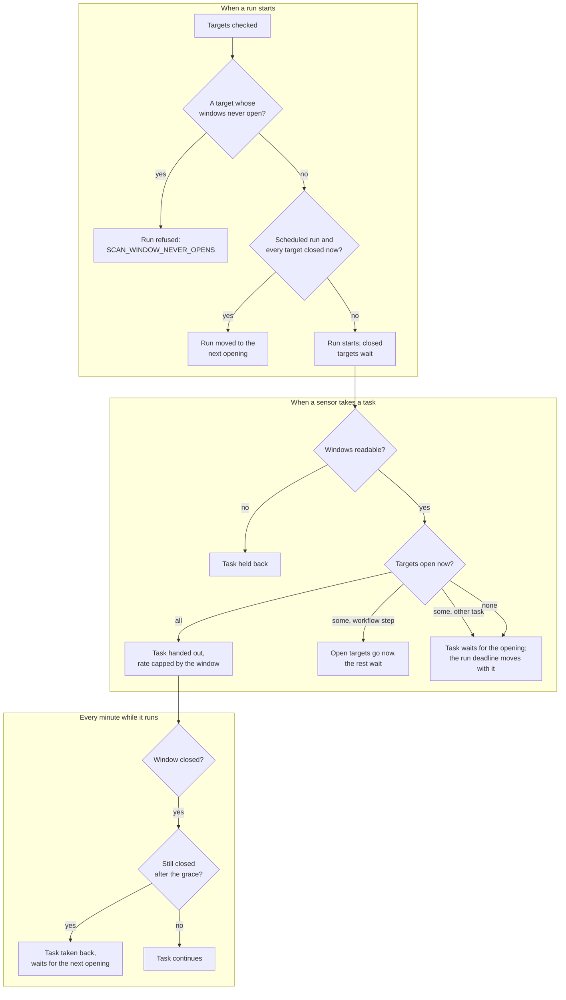

# Scan windows at work
{: .no_toc }

Scan window policies say when targets may be scanned (allow windows) or never
(blackouts). The platform applies them at three points: when a run starts,
when a sensor takes a task, and every minute while a task runs.

1. TOC
{:toc}

## The flow

1. When a run starts, a target whose windows never open refuses the run. A
   scheduled run whose targets are all closed now moves to the next opening.
   A run started by hand starts, and its closed targets wait.
2. When a sensor asks for a task, open targets go out and closed ones wait.
   Waiting does not use up the run's deadline.
3. When a window closes during a task, the task gets the policy's grace
   period, then the platform takes it back. It waits for the next opening,
   without counting an attempt. The sensor stops it on its next heartbeat,
   and any late results are refused.
4. An override (**Settings > Scanning > Scan windows**) needs a code from
   your authenticator app, and releases waiting tasks at once.

{: .note }
> When a run starts, every target is checked at the most intrusive tier of
> the run's steps, including steps that are skipped. A window that allows
> only passive or active scanning can therefore hold a run whose runnable
> steps it would allow.

## When something fails

| What happens | What you see | What to do |
|---|---|---|
| A target's windows never open | Blocked run `SCAN_WINDOW_NEVER_OPENS` naming targets and policies | Fix the policy, or remove the target |
| A task waits for its window | **Why waiting?** names the window and the opening | Wait, or add an override |
| A window closes mid-task | The task returns to the queue | Nothing; it resumes at the next opening |

## Security

- Policies, holds and overrides belong to your organization only.
- A failure to read the windows holds the task back; it never sends work
  outside a window.
- Bug-bounty program windows cannot be overridden.

## Related

- [Scan windows settings](../../user-guide/10-settings-and-integrations.md#scan-windows)
- [Scans and scan runs](../../scanning/scans-and-runs.md)
- [Why a task waits](../../scanning/why-waiting.md)
