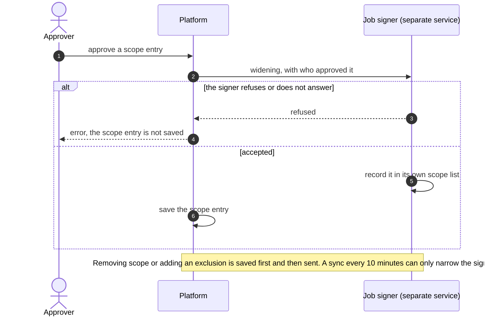
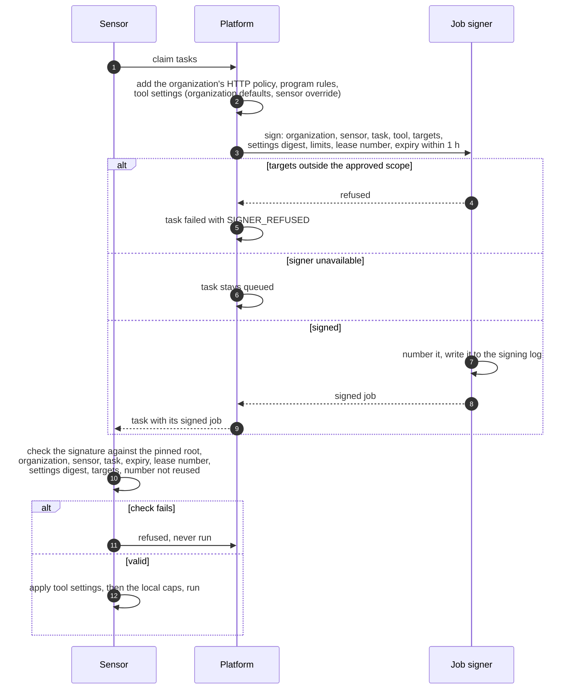

# Signed jobs
{: .no_toc }

A sensor runs only what a separate **job signer** signed. The signer keeps
its own copy of the scope people approved and refuses to sign a job outside
it. So even someone who could change the platform's database could not aim
your sensors at new targets. The sensor checks the signature against a root
key it pinned when it was paired.

1. TOC
{:toc}

## The flow

### Approved scope reaches the signer

1. A widening of scope is sent to the signer before it is saved. If the
   signer refuses (for example the operator requires two approvers for
   intrusive scope) or is unreachable, nothing changes.
2. A narrowing is saved at once and sent to the signer; the periodic sync
   catches up if sending failed.

### A task is signed and checked

1. Before signing, the platform adds the settings the task runs with: the
   organization's tool defaults (sent only to your own sensors) and the
   sensor's own override. Because they are inside the signed job, nobody on
   the path can change them.
2. The signer checks the targets against its scope list and the sensor's
   zone, numbers the job, and writes it to its signing log before it answers.
3. If the signer refuses, the task fails with `SIGNER_REFUSED`. If it is
   down, tasks wait in the queue; they never leave unsigned.
4. The sensor checks the signature and every bound field. A job signed for
   another sensor, another task, an older lease or an earlier number is
   refused and never runs.
5. The sensor applies the settings in order: organization defaults, the
   sensor's override, the scan's own values, then its local caps (for example
   a maximum request rate). A later layer can only lower a limit.

## When something fails

| What happens | What you see | What to do |
|---|---|---|
| Targets outside the signer's scope | Task failed `SIGNER_REFUSED` | Approve the scope entry; check the signer's approval floors |
| Signer down or slow | Tasks wait; no task leaves unsigned | Restore the signer service |
| Sensor refuses the signature | Task failed with a signature reason | Check the sensor's pinned root and the clock on both sides |
| A tool setting the sensor does not accept | Task failed `TOOL_SETTINGS_INVALID` | Fix the value under **Tool defaults** or the sensor's tool settings |

## Security

- The signer holds its own key and scope list; the platform never sees the
  key. The signer refuses statements outside its list.
- Each job is bound to one organization, one sensor, one task and one lease,
  expires within an hour, and carries a number the sensor never accepts
  twice.
- The tool settings and limits are covered by the signature.

## Related

- [Sensor security](../../sensors/security.md)
- [Tool settings](../../sensors/tool-settings.md)
- [Scope and authorization to scan](../../scanning/scope.md)
