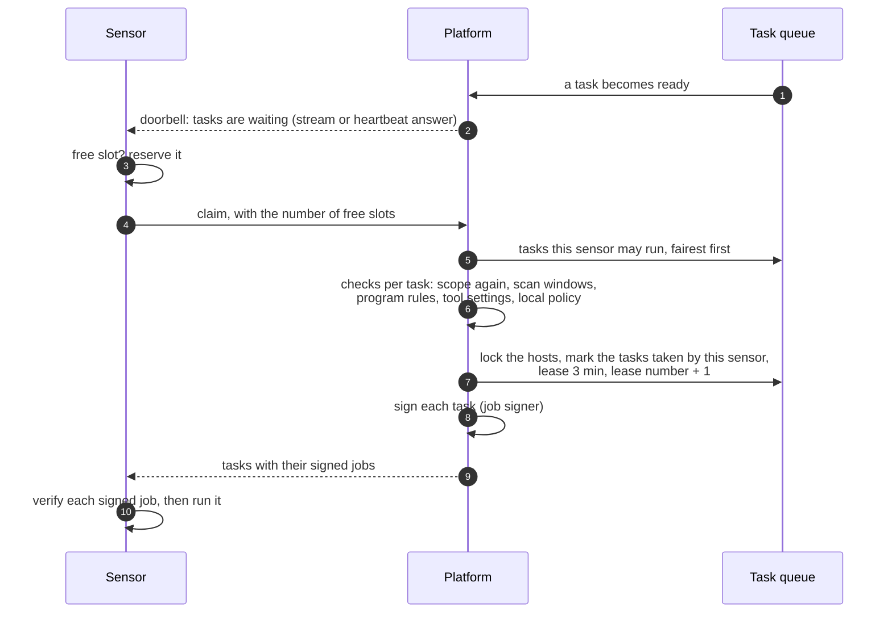
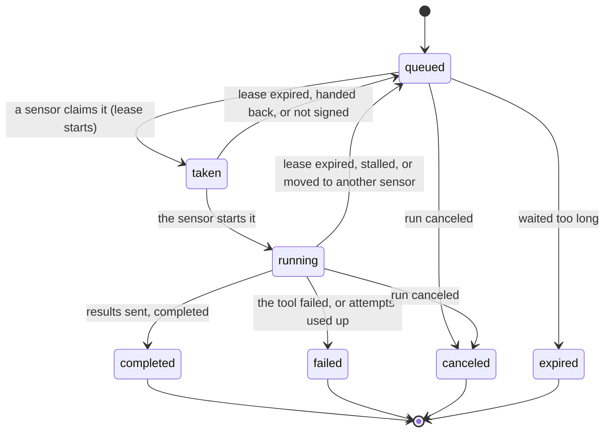

# How a sensor takes a task
{: .no_toc }

Sensors never receive work they did not ask for: they always call out to the
platform. The platform decides which tasks a sensor may take, hands them out
under a short **lease**, and takes them back when the sensor stops renewing
it. This page shows that cycle for a sensor of your organization.

1. TOC
{:toc}

## The flow

### Wake-up and claim

1. When a task is ready, the platform rings the sensor's **doorbell**: on the
   live stream (within about a second), or in the answer to its next
   heartbeat (every 5 seconds while work waits). The sensor also checks every
   5 minutes in case a wake-up was lost.
2. The sensor reserves a free slot and asks for as many tasks as it has free
   slots.
3. The platform picks the tasks. A sensor only gets tasks of its own
   organization, for tools it reported as installed, in its scan zone, and
   not refused by its local policy. Higher priority goes first, waiting tasks
   move up one class every 30 minutes, and runs take turns so one big run does
   not starve a small one.
4. A task is not handed out while another task of your organization is
   scanning one of its hosts. See [Host politeness and rate](politeness.md).
5. The tasks are marked taken in one step, so two sensors never get the same
   task. Each claim starts a lease and increases the task's lease number.
6. Each task is signed by the job signer before it leaves; the sensor checks
   the signature before it runs anything. See [Signed jobs](signed-jobs.md).

### Holding and losing a task

1. Each heartbeat lists the tasks the sensor runs and their progress; the
   platform renews their leases (3 minutes by default).
2. If heartbeats stop, the lease runs out and the task returns to the queue
   within about a minute, for another sensor of the zone.
3. A task that makes no progress for its stall window is asked to stop and
   hand back what it finished; only the unfinished targets run again.
4. Every action of the sensor on a task (start, complete, fail, results) must
   carry the current lease. A sensor that lost the task cannot finish it.
5. A task has 3 attempts in all. A task that fails because of the sensor
   (the tool crashed, out of memory, its own network) moves to another
   sensor.

## When something fails

| What happens | What you see | What to do |
|---|---|---|
| No sensor may take the task | **Waiting for a sensor** with **Why waiting?** | Read the reason: tool not installed, zone, local policy, scan window, slots |
| The task waits for its hosts | **Waiting for its hosts** | Nothing: it starts when the other task releases the host |
| The job signer is down | Tasks stay queued; nothing leaves unsigned | Restore the signer service |
| The sensor goes silent | The task returns to the queue after its lease | Check the sensor's heartbeat on the Sensors page |
| 3 attempts are used up | Task `failed` with each cause named, or "Max dispatch attempts exceeded" | Fix the sensor or tool named in the causes |

## Security

- The sensor authenticates every call with its key; the organization comes
  from the key, never from the request. A task of another organization is
  answered as not found.
- The platform picks the tasks; a sensor that asks for a task by its id gets
  the same checks.
- Leases and lease numbers stop a sensor that lost a task from finishing it
  or sending results for it.

## Related

- [Why a task waits](../../scanning/why-waiting.md)
- [Liveness and stalls](../../scanning/scans-and-runs.md#liveness-and-stalls)
- [Failures and retries](../../scanning/scans-and-runs.md#failures-and-retries)
- [How a sensor works](../../sensors/how-it-works.md)
