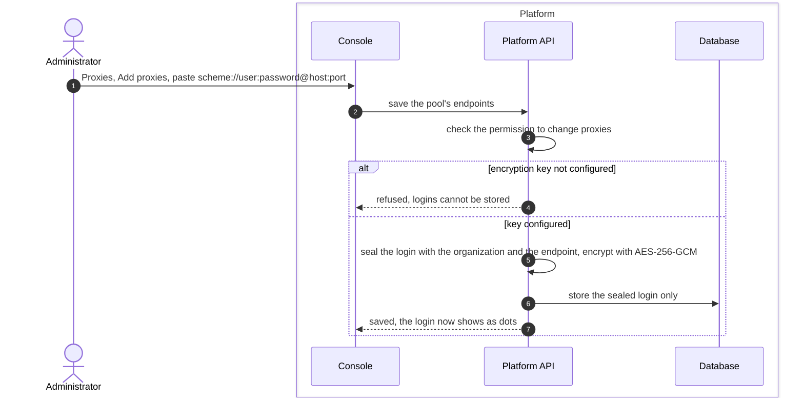
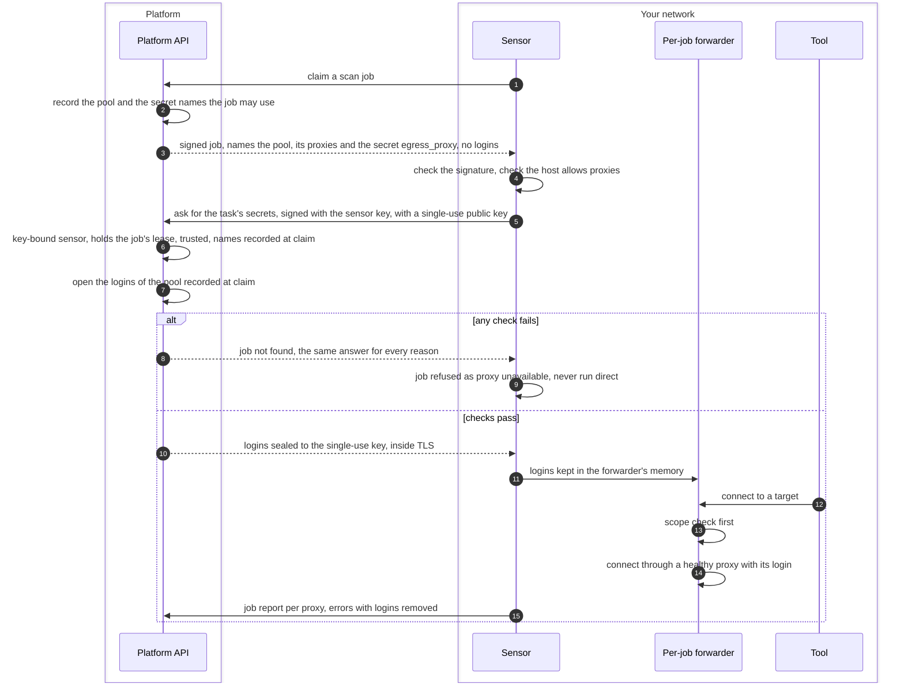

# Proxy credentials
{: .no_toc }

An administrator pastes the organization's scan proxies, with their logins,
in **Settings > Scanning > Proxies**. The platform stores each login
encrypted. When one of your sensors runs a job through a pool, it receives
that pool's logins as a sealed secret of that one task, keeps them in memory,
and uses them only in its own forwarder.

{: .note }
> This is the delivery of platform v0.21.0 and later with sensor v0.38.0 and later
> (sealed task secrets). The earlier route that answered pool logins in clear
> inside TLS (`egress-credentials`) is removed, so a sensor older than v0.38.0 gets
> no pool logins from v0.21.0: upgrade it before you use a pool with logins.

1. TOC
{:toc}

## The flow

### Saving a login

1. You paste one proxy per line. A line can carry a user name and a
   password. The console warns when the login would travel to the proxy
   without encryption (plain `http` or `socks5`).
2. The platform seals each login together with the organization and the
   proxy entry it belongs to, then encrypts it with the installation's
   encryption key. Only the sealed value is stored.
3. The console never shows a stored login again. It shows dots. A line that
   keeps the dots keeps the stored login.

### A job that uses the pool

1. The signed job names the pool, its proxies and the secret it may use
   (`egress_proxy`). It does not carry any login. The platform records, at
   claim time, which pool and which secret names the job may use.
2. The sensor asks for the task's secrets (`POST /api/v2/sensor/commands/{id}/secrets`)
   with a request signed by its own key, carrying a single-use public key. The
   platform answers only to a key-bound sensor that holds that job's lease now,
   only to a trusted sensor, only for the names recorded at claim, and a bounded
   number of times. The logins are those of the pool recorded at claim, not the
   sensor's current pool.
3. The answer is sealed (HPKE) to the single-use key, inside the TLS connection.
   A sensor that authenticates with a bearer key, or an untrusted one, gets no
   logins.
4. The logins stay in the memory of the job's forwarder. Tools never see
   them: they connect to the forwarder, which checks the scope and then uses
   the proxy.
5. Error messages that go back to the platform have the logins removed.

## When something fails

| What happens | What you see | What to do |
|---|---|---|
| The installation has no encryption key | Saving a proxy with a login is refused | Set the encryption key in the platform configuration. |
| A stored login cannot be opened, for example after a wrong key change | The proxy fails with an authentication error and is set aside | Paste the login again, or restore the right key. |
| The sensor cannot get the logins | The job is refused as "proxy unavailable". It never runs without the proxy | Check the sensor runs v0.38.0 or later, is paired with a key (not a bearer key), is trusted and still holds the job. |
| The proxy rejects the login | The proxy's health drops and it is set aside after repeated failures | Correct the login in **Proxies**. |
| The host is set to run scans direct only | Jobs that carry a pool are refused on that sensor | Remove the setting on the host, or assign the sensor no pool. |

## Security

- **At rest.** Logins are encrypted with AES-256-GCM and the installation's
  encryption key. Each sealed value names its organization and proxy entry,
  so a value copied to another row or organization does not open.
- **In transit.** The logins are not in the signed job. They travel sealed to
  a single-use key of the sensor, inside its TLS connection, so a device that
  inspects TLS on the sensor's path cannot read them.
- **Organization isolation.** The sensor's organization comes from its own
  signed identity, never from the request. Shared sensors never receive an
  organization's proxy logins.
- **Audit.** Creating a pool, changing logins, testing and setting a proxy
  aside are audited, and so is every delivery and refusal of a task secret
  (`secret.delivered`, `secret.refused`). No login is ever written to the audit
  log or the job.

## Related

- [Proxies for scans](../../sensors/proxies.md)
- [Egress check on every connection](../sensor-execution/egress.md)
- [Network requirements and egress](../../sensors/network.md)
