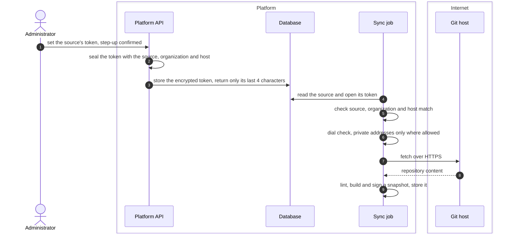

# Rule source credentials
{: .no_toc }

A rule source is a Git repository of your own rules, templates or wordlists.
When the repository is private, an administrator gives the platform a read
token for it through the API. The platform alone uses the token to fetch the
repository. What it fetches is stored as a signed snapshot. The token never
leaves the platform.

{: .note }
> Secret delivery to sensors is being redesigned. This page describes what the
> current release does.

1. TOC
{:toc}

## The flow

1. Setting a token needs the right to change rule sources and a fresh
   step-up. The answer shows only whether a token is set and its last four
   characters.
2. The token is sealed with the source, the organization and the Git host,
   and encrypted with the installation's key.
3. A sync opens the token only for that same source, organization and host.
   Changing the host of a source clears its token.
4. The platform fetches over HTTPS only. It refuses loopback, metadata and
   private addresses, unless the installation opened a private range and your
   organization may use private Git hosts. It never sends the token to
   another host on a redirect.
5. The snapshot is signed and stored as a content pack. Sensors only ever
   receive content packs by digest, so the token is never sent to a sensor.
   Scans do not run rule source snapshots yet.

## When something fails

| What happens | What you see | What to do |
|---|---|---|
| The token is wrong or expired | The sync of the source fails | Set a new token. |
| The host of the source changed | The stored token is cleared | Set the token again for the new host. |
| No step-up | Setting the token is refused | Confirm your identity and retry. |

## Security

- **At rest.** AES-256-GCM with the installation's encryption key, bound to
  the source, organization and host.
- **In transit.** Only between the platform and the Git host, over HTTPS.
  The token never travels to a sensor.
- **Audit.** Setting and clearing a token are audited.

## Related

- [Scanner content and content packs](../../sensors/content-delivery.md)
- [Proxy credentials](proxy-credentials.md)
