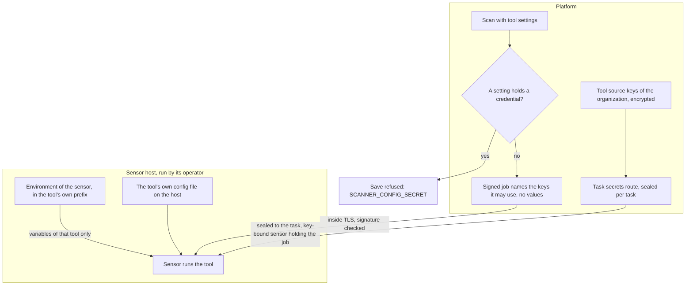

# Tool keys and scan settings
{: .no_toc }

Some tools use keys of their own, for example a key for a passive subdomain
data source. From platform v0.21.0 an organization stores them in
**Settings > Scanning > Tool source keys**, and a key reaches a sensor only as a
sealed secret of one of that organization's tasks. A credential typed into a
scan's tool settings is refused.

{: .note }
> Platform v0.21.0 and later with sensor v0.38.0 and later. On such a sensor,
> subfinder no longer reads the provider configuration in the sensor user's home
> directory: its keys come from the task or, on an organization's own sensor, from
> keys its operator configured for the sensor. Sensor v0.37.x still reads keys on
> the host.

1. TOC
{:toc}

## The flow

1. **Keys on the host.** The operator of the sensor host sets a tool's keys
   in the sensor's environment or in the tool's own config file. The sensor
   passes a variable with a tool's prefix only to that tool, so one tool
   does not receive another tool's keys.
2. **Keys of the organization.** An administrator stores the keys of the data
   sources tools query (subfinder's passive sources and others) in
   **Settings > Scanning > Tool source keys**. They are encrypted with the
   installation's encryption key and bound to their organization and source,
   shown only by their last four characters, and every change needs a fresh
   step-up and is audited. A job lists the keys it may use by name; the sensor
   fetches the values sealed for that one task. A key that names where the tool
   connects is accepted only for the provider's own service.
3. **Values in a scan's settings.** A scan or workflow step whose tool settings
   hold a credential is refused on save, update and clone with
   `SCANNER_CONFIG_SECRET` (the message names the keys, never the values), and a
   scan stored with one before v0.21.0 is blocked at trigger until you edit it.
   Values that only look random stay warnings.

## When something fails

| What happens | What you see | What to do |
|---|---|---|
| A tool has no key on the host | The tool runs with its free sources only, or reports that it needs a key | Set the key on the sensor host. |
| You typed a secret into a scan's settings | Save refused, or the stored scan blocked at trigger, with `SCANNER_CONFIG_SECRET` | Remove it from the settings and store it under Tool source keys (or on the sensor host). |
| A shared sensor runs your scan | It uses only what its operator set on its host | Use your own sensor for scans that need your keys. |

## Security

- **At rest.** Keys on the host are protected by the host. Tool source keys are
  encrypted with AES-256-GCM and bound to their organization and source; scan
  settings cannot hold credentials.
- **In transit.** Host keys never leave the host. Tool source keys travel
  sealed to a single-use key of the sensor that holds the task, inside TLS.
- **Organization isolation.** A job reaches only sensors that may run the
  organization's scans.

## Related

- [Tool settings](../../sensors/tool-settings.md)
- [Proxy credentials](proxy-credentials.md)
- [Running a tool](../sensor-execution/tool-command-line.md)
