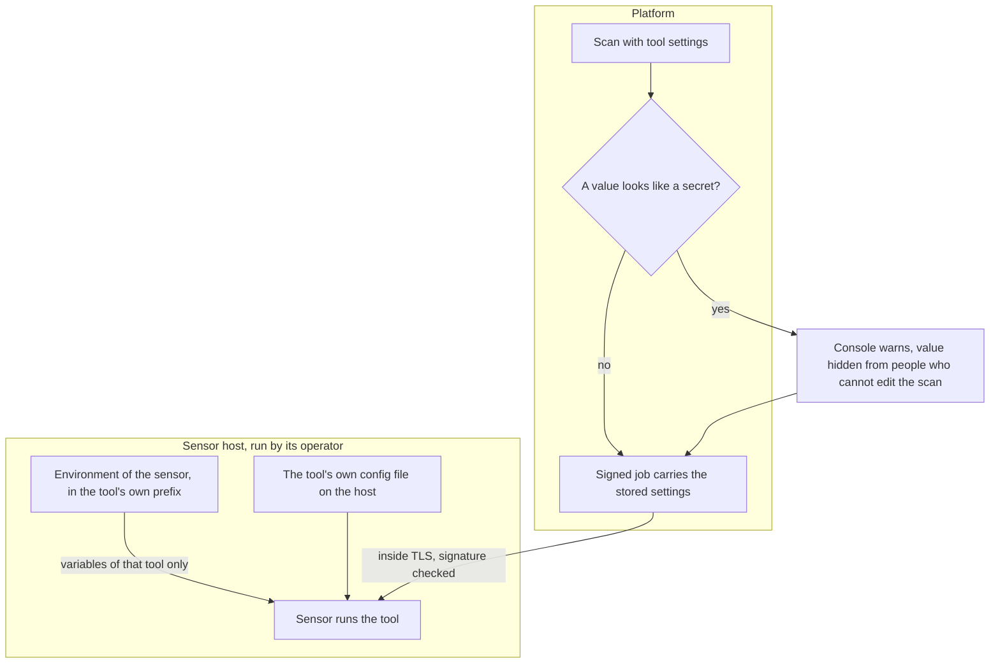

# Tool keys and scan settings
{: .no_toc }

Some tools use keys of their own, for example a key for a passive subdomain
data source. Today the platform does not store such keys: the tool reads them
on the sensor's host. A value that looks like a secret and is typed into a
scan's tool settings is kept with the scan and travels in the signed job, and
the console warns about it.

{: .note }
> Secret delivery to sensors is being redesigned. This page describes what the
> current release does.

1. TOC
{:toc}

## The flow

1. **Keys on the host.** The operator of the sensor host sets a tool's keys
   in the sensor's environment or in the tool's own config file. The sensor
   passes a variable with a tool's prefix only to that tool, so one tool
   does not receive another tool's keys.
2. **Values in a scan's settings.** When you save a scan whose tool settings
   contain a value that looks like a password or a token, the console warns
   you. People who may read the scan but not edit it see the value masked.
3. The stored settings are copied into the job the sensor claims. The job is
   signed, so it cannot be changed on the way, but the value itself is not
   encrypted beyond the TLS connection.

## When something fails

| What happens | What you see | What to do |
|---|---|---|
| A tool has no key on the host | The tool runs with its free sources only, or reports that it needs a key | Set the key on the sensor host. |
| You typed a secret into a scan's settings | A warning on save | Prefer keys set on the sensor host. |
| A shared sensor runs your scan | It uses only what its operator set on its host | Use your own sensor for scans that need your keys. |

## Security

- **At rest.** Keys on the host are protected by the host. Secrets typed into
  scan settings are stored with the scan, not in an encrypted store.
- **In transit.** Host keys never leave the host. Scan settings travel in the
  signed job inside TLS.
- **Organization isolation.** A job reaches only sensors that may run the
  organization's scans.

## Related

- [Tool settings](../../sensors/tool-settings.md)
- [Proxy credentials](proxy-credentials.md)
- [Running a tool](../sensor-execution/tool-command-line.md)
