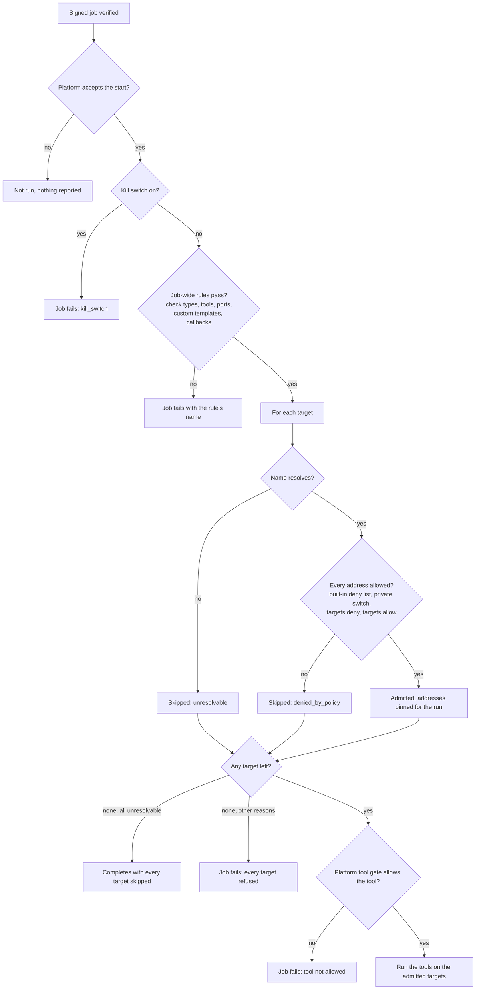

# Target admission on the sensor
{: .no_toc }

After the sensor has verified a signed job, it checks the job against its own
rules before any tool sees it. Targets it may not scan are removed with a
reason. A job-wide rule can refuse the whole job. The result tells the
platform exactly what was skipped and why, so a skipped target is never
counted as clean.

1. TOC
{:toc}

## The flow

1. The sensor tells the platform it starts the job. If the platform refuses
   (the job was taken back), nothing runs.
2. The kill switch and the job-wide rules of the local policy come first:
   the kinds of checks, the tools, the ports, custom templates and
   out-of-band callbacks.
3. Each target name is resolved once. A name that does not resolve is
   skipped. Every address it resolves to must pass the built-in deny list
   (loopback, cloud metadata and similar), the private-address switch and the
   policy's deny and allow lists.
4. The addresses that passed are pinned for the run. A tool can reach that
   name only at those addresses, so a DNS change during the scan cannot
   redirect it.
5. The platform's own tool policy for the organization is checked last. Each
   tool task is admitted again just before it starts.

## When something fails

| What happens | What you see | What to do |
|---|---|---|
| Some targets are refused | The task completes as partial: "Completed with N targets skipped", each with a reason | Fix the DNS record, or widen the local policy if the target should be scanned. |
| Every target is refused | The task fails, naming the targets and reasons | As above. |
| A job-wide rule refuses the job | The task fails, naming the rule, for example `tools.allow` | Change that rule on the host, or let another sensor run it. |
| The kill switch is on | The task fails with `kill_switch` | Remove the STOP file when the host may scan again. |

## Security

- **Fail closed.** A name the sensor cannot resolve, or an address it cannot
  check, is never scanned.
- **No DNS rebinding.** Addresses are pinned at admission. The tool's
  connections go only to them.
- **The platform cannot widen it.** Admission runs on the sensor host, after
  the job signature, with the host owner's rules.
- **Reports are bounded.** At most 100 refused targets are listed, with the
  total.

## Related

- [Host local policy](../sensors/local-policy.md)
- [Network requirements and egress](../../sensors/network.md#sensor-local-policy)
- [Confined tool run](sandbox.md)
- [Egress check on every connection](egress.md)
