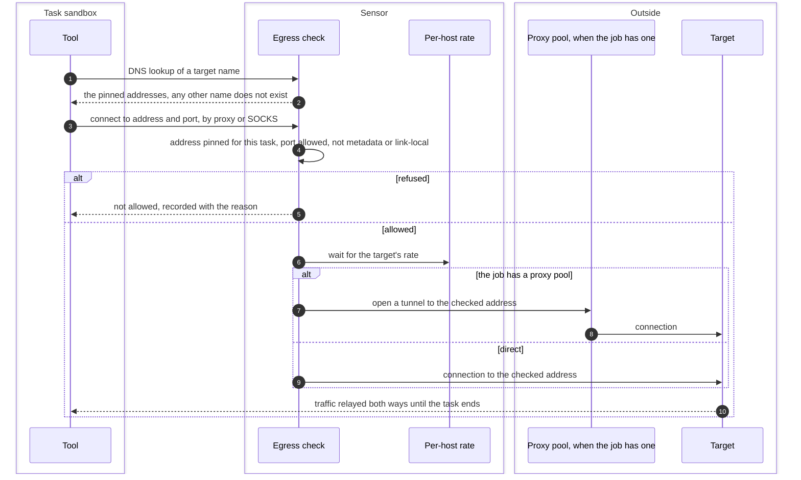

# Egress check on every connection
{: .no_toc }

A confined tool has no network of its own. Every connection and every DNS
lookup it makes goes to the egress check the sensor started for its task. The
check lets through only the targets that were admitted, at the addresses that
were pinned, at a rate the target can bear. A refused connection is recorded,
and a target the tool could never reach is reported as not scanned, never as
clean.

1. TOC
{:toc}

## The flow

1. A DNS lookup of an admitted name gets the addresses pinned at admission.
   Any other name gets "does not exist". Names are never looked up with a
   search domain added.
2. Each connection is checked: the address must be one pinned for this task
   (or inside an admitted range), the port must be allowed, and cloud
   metadata, link-local, multicast and unspecified addresses are always
   refused. A name is never resolved a second time.
3. The per-host rate slows down when a target pushes back (errors, resets,
   `Retry-After`) and speeds up again while it answers cleanly. A host that
   keeps failing is backed off.
4. When the job carries the organization's proxy pool, the tunnel is opened
   to the checked address through the pool, after the scope check. An
   out-of-scope target never reaches a proxy.
5. When the task ends, every connection it opened is closed.

What a task may reach depends on the network class in the tool's descriptor:

| Network class | May reach |
|---|---|
| `targets` | The admitted targets only, at their pinned addresses |
| `vendor` | The tool vendor's hosts named in the descriptor, at public addresses |
| `resolver` | No connection. DNS answers for the admitted targets only |
| `egress-proxy` | Any public address |
| `none` | Nothing. No egress check is started |

## When something fails

| What happens | What you see | What to do |
|---|---|---|
| A tool tries a host outside its targets | A warning line in the task log, the connection is refused | Nothing, unless the tool needs that host. |
| Every connection toward a target was refused | The target is reported failed with `egress_refused`, the task is partial | Check the target's addresses against the scope and the local policy. |
| The target pushes back hard | The rate drops, then the host is backed off. It shows as a coverage gap | Lower the scan's rate, or scan the target in a quieter window. |
| The proxy pool cannot carry a connection | The host is a `proxy_unavailable` coverage gap. No direct fallback | Check the pool's health under the organization's proxy settings. |

## Security

- **Scope before any packet.** The check runs before a connection is made,
  and before a proxy is asked.
- **No DNS rebinding.** A name is resolved once at admission. The tool only
  ever gets those addresses.
- **No secrets to the tool.** Proxy credentials stay in the sensor's memory.
  The tool never sees them.
- **Silence is not clean.** A target the confinement kept the tool from
  reaching is never reported done.

## Related

- [Network requirements and egress](../../sensors/network.md)
- [Proxies for scans](../../sensors/proxies.md)
- [Confined tool run](sandbox.md)
- [Target admission on the sensor](admission.md)
