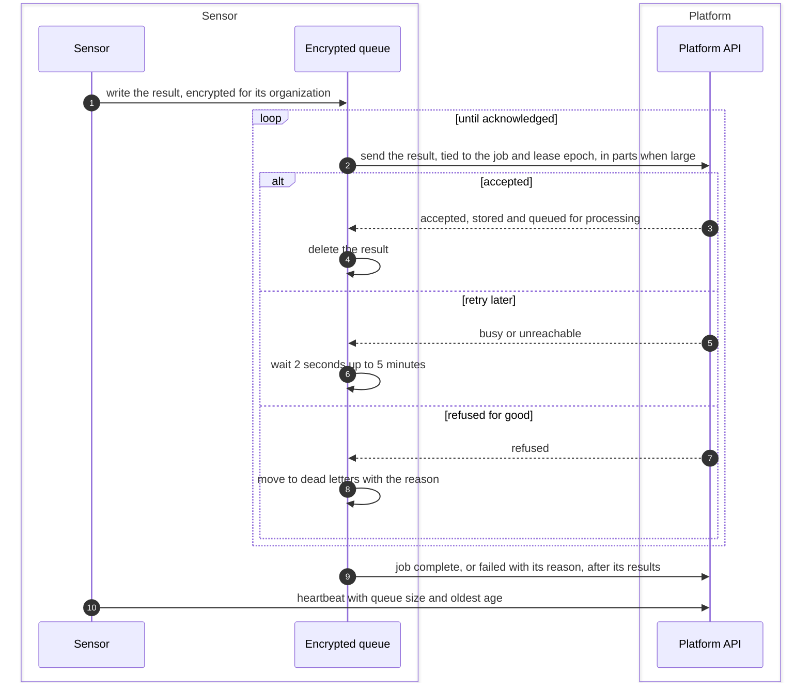
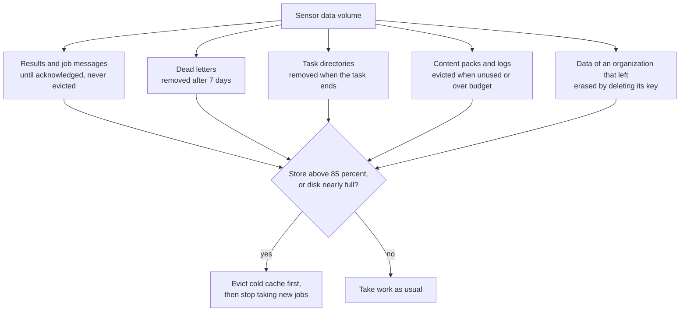

# Result delivery and local retention
{: .no_toc }

The sensor writes every result to an encrypted queue on its data volume
before it sends anything. It deletes a result only when the platform has
acknowledged it. Then it reports the job complete or failed. A network outage
or a restart therefore loses nothing, and the sensor keeps only what it still
needs on disk.

1. TOC
{:toc}

## The flow

1. The result is written to the queue first, encrypted with a key for the
   job's organization. If writing fails, the sensor sends it directly.
2. The queue sends the result. A large result goes in parts, and parts the
   platform already has are not sent again after a restart.
3. When the platform answers that it stored the result, the sensor deletes
   it. That answer means stored and queued, not yet processed.
4. Busy or unreachable: the queue waits with growing, randomized delays
   between 2 seconds and 5 minutes, or as long as the platform asks.
5. A result the platform refuses for good is kept aside as a dead letter
   with the reason, and the job is reported failed.
6. The job's complete or fail message waits behind its results, so the
   platform never sees a job done before its results.
7. Each heartbeat carries the queue's size, the age of its oldest item and
   the dead letters, shown on the Sensors page.

### What stays on disk

A housekeeping sweep runs at start, shortly after results are acknowledged,
and every 10 minutes.

## When something fails

| What happens | What you see | What to do |
|---|---|---|
| The platform is unreachable for a while | The queue grows. The Sensors page shows queued results and their age | Fix the network path. The queue sends everything when it is back. |
| The sensor's key is refused | Delivery pauses until a heartbeat is accepted again | Re-pair the sensor if its key was revoked. |
| The disk fills up | The sensor stops taking jobs and says so on its heartbeat | Free disk space or give the volume more room. |
| A result is refused for good | The job fails. The result stays in dead letters for 7 days | Read the reason in the sensor log. |

## Security

- **Encrypted at rest.** The queue is encrypted, with a separate key per
  organization on a shared sensor, so one organization's data can be erased
  by deleting its key.
- **Tied to the job.** Every result names its job and lease epoch. The
  platform drops a result for a job the sensor no longer holds, or of a
  sensor revoked since.
- **Out of the tools' reach.** Tools cannot read the queue or its key.

## Related

- [Run the sensor: what lives in /var/lib/openctem](../../sensors/run-the-sensor.md#what-lives-in-varlibopenctem)
- [Troubleshooting: results do not arrive](../../sensors/troubleshooting.md#results-do-not-arrive)
- [Tool output to results](tool-output.md)
