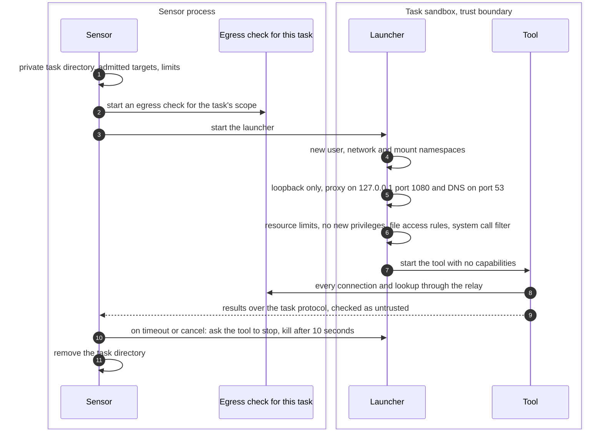
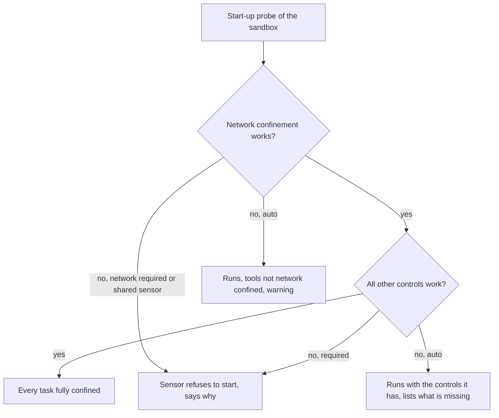

# Confined tool run
{: .no_toc }

Every tool runs as its own task, inside a sandbox the sensor builds for that
task alone. The task gets a private directory, its own network with only a
local relay to the sensor's egress check, and limits on memory, CPU and
processes. It cannot read the sensor's key, its queued results or its policy.
When the task ends, its directory is removed.

1. TOC
{:toc}

## The flow

1. The sensor prepares a private directory for the task (its home and temp
   folders) and the limits from the tool's profile: light, standard or heavy
   (1, 2 or 4 CPUs, 512 MiB, 2 GiB or 4 GiB memory).
2. It starts an egress check for this task only, scoped to the targets that
   were admitted.
3. A launcher creates new namespaces. Inside, the network has only loopback,
   with a proxy relay on 127.0.0.1 port 1080 and a DNS relay on port 53, both
   connected to the task's egress check.
4. The launcher sets resource limits, forbids gaining privileges, applies
   file access rules (no reads of the sensor's key, outbox, local store,
   policy or configuration, writes only in the task directory) and a system
   call filter, then starts the tool with no capabilities.
5. The tool's results come back over the task protocol and are checked as
   untrusted input.
6. On a timeout or a cancel the sensor asks the tool to stop, then kills its
   whole process group after a grace period. The task directory is removed.

### What the sensor does when the host cannot confine

`SENSOR_SANDBOX` and `SENSOR_SANDBOX_NETWORK` take `auto` (the default),
`required` or `off`. A shared sensor always requires both. Jobs that need a
proxy pool run only on a sensor whose tasks are network confined.

## When something fails

| What happens | What you see | What to do |
|---|---|---|
| The host blocks user namespaces | The sensor log and setup checklist say network confinement is unavailable | Allow user namespaces for the sensor (seccomp profile or AppArmor), see [Run the sensor](../../sensors/run-the-sensor.md#capabilities-and-seccomp). |
| A tool runs past its time limit | The task stops, the job ends partial with the targets not finished | Raise the scan's timeout if the target needs it. |
| The host is under memory or CPU pressure | New tasks wait before they start | Give the host more resources or lower the sensor's concurrency. |
| A tool fails to start | The start is retried once, then the task fails | Check the sensor log for the tool's error. |

## Security

- **Trust boundary.** A tool and the targets it talks to are untrusted. The
  sandbox keeps a compromised tool away from the sensor's key, its queued
  results of other jobs, and the host's network.
- **No inbound port.** The relays listen on loopback inside the task's own
  network only.
- **Organization isolation.** On a shared sensor each job of each
  organization runs in its own directory, and no writable cache is shared
  between jobs.
- **Recorded.** Each result records what the run was confined by.

## Related

- [Security notes: tool confinement](../../sensors/security.md#tool-confinement)
- [Run the sensor](../../sensors/run-the-sensor.md)
- [Egress check on every connection](egress.md)
- [Target admission on the sensor](admission.md)
