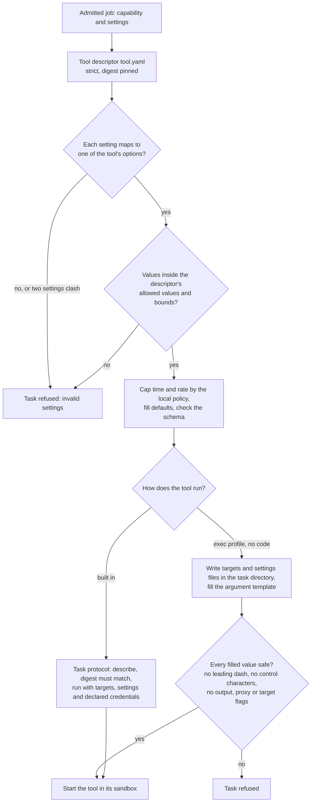

# Tool settings to command line
{: .no_toc }

A scan names what it wants in terms of capabilities (for example a port scan
of the top 100 ports at a given rate), not tool flags. Each tool ships a
descriptor, `tool.yaml`, that maps those settings to its own options. The
sensor validates the settings, caps them by the host's policy, and either
hands them to the tool over the task protocol or builds its command line from
the descriptor's template. No shell is ever involved.

1. TOC
{:toc}

## The flow

1. The descriptor is read strictly: an unknown key or a file over 256 KiB is
   refused.
2. Each standard setting of the job is mapped to the tool's own option. A
   value outside the allowed values or bounds, or two settings that set the
   same option, refuse the task.
3. The host's local policy caps the time limit and the rate. Defaults are
   filled and the result is checked against the tool's schema.
4. A built-in tool receives the task over the task protocol. Before it runs,
   the tool's descriptor digest must match the one the sensor has.
5. A tool added by the operator with an exec profile gets its targets and
   settings as files in its task directory, and its command line from the
   descriptor's template. Every value placed in the command line is checked,
   and flags that set output, proxy or target lists are refused.

## When something fails

| What happens | What you see | What to do |
|---|---|---|
| A setting is outside the tool's bounds | The task fails as invalid settings, naming the setting | Change the scan's settings. |
| The descriptor changed since the sensor loaded it | The task fails before the tool starts | Restart the sensor after replacing a tool. |
| A filled value looks like a flag | The task is refused | Check the target or setting that holds it. |
| A required credential is missing | The task fails as invalid | Add the credential the tool declares. |

## Security

- **No shell, no free text flags.** Values are placed as separate arguments
  and checked. A target cannot become an option.
- **The host narrows.** The local policy's time and rate limits always win
  over the job.
- **Credentials only where declared.** A tool gets only the credentials its
  descriptor names, and their values are removed from logs.

## Related

- [Tool settings](../../sensors/tool-settings.md)
- [Confined tool run](sandbox.md)
- [Tool output to results](tool-output.md)
