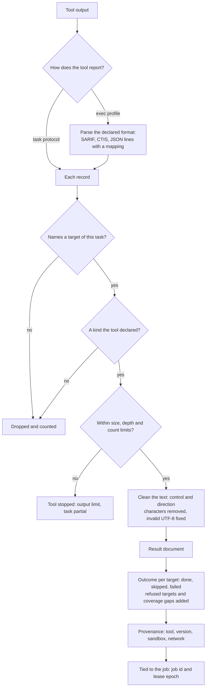

# Tool output to results
{: .no_toc }

A tool's output is untrusted. The sensor reads it record by record, drops
what the tool was not allowed to say, caps its size, and builds one result
document in the CTIS format. The document names the job it belongs to and
says, for every target, whether it was scanned, skipped or failed.

1. TOC
{:toc}

## The flow

1. A built-in tool sends records over the task protocol. A tool with an exec
   profile writes a file or standard output in a declared format, which the
   sensor parses. An output no parser accepts fails the task. It is never
   read as "no findings".
2. Each record must name a target of this task and be a kind the tool
   declared. Anything else is dropped.
3. Output size, record count, string size and nesting depth are capped. A
   tool that goes over the output limit is stopped and the task is partial.
4. Text is cleaned of control and direction characters.
5. The result lists an outcome for every target, adds the targets refused at
   admission and the coverage gaps (for example targets the egress check
   kept the tool from reaching), and records what the run was confined by.
6. The result is tied to the job by its id and the lease epoch the sensor
   holds. The platform refuses a result for a job the sensor no longer holds.

## When something fails

| What happens | What you see | What to do |
|---|---|---|
| The tool's output cannot be parsed | The task fails, never "0 findings" | Check the tool's version against the supported one. |
| The output is over the limit | The task is partial, with a warning in its log | Narrow the scan, or split the targets. |
| A tool reports a host outside its targets | The record is dropped | Nothing. |
| The job was taken back during the run | The platform refuses the result | Nothing. The job runs again elsewhere. |

## Security

- **Untrusted input.** Tool output comes from scanned systems. It is checked
  on the sensor and again on the platform.
- **Bound to its job.** A result names the job and the lease epoch, so a
  late or stray result cannot land in another job or organization.
- **Missing is not clean.** A target without an outcome is not reported
  done, and a finding is never closed because of a skipped target.

## Related

- [How sensors work: progress, stalls and per-target outcomes](../../sensors/how-it-works.md#progress-stalls-and-per-target-outcomes)
- [Tool settings to command line](tool-command-line.md)
- [Result delivery and local retention](result-delivery.md)
