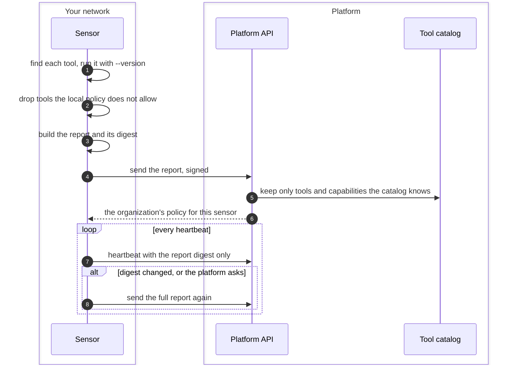
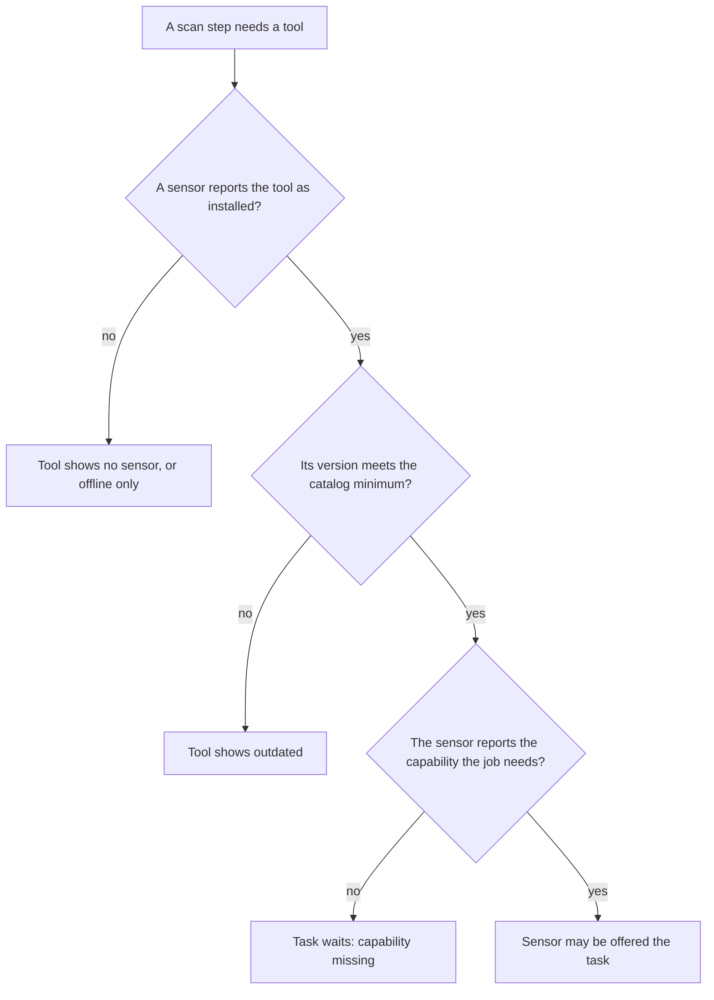

# Tool and capability report
{: .no_toc }

At start, and whenever something changes, the sensor reports what it is: its
version, the tools it found and their versions, what it can do, its resources
and a summary of its local policy. The platform keeps only tools and
capabilities it knows, and offers a sensor only work its report covers. The
tool list on **Scanning > Tools** and the setup checklist read from the same
report.

1. TOC
{:toc}

## The flow

1. The sensor looks for each tool it supports and asks it for its version. A
   tool that is missing or does not answer is reported as such.
2. Tools the host's local policy does not allow are left out of the report
   and never run.
3. The report holds the tools with versions, what the sensor can do (for
   example confined tool runs, proxy pools, validation), its resources and
   the local policy summary. Its digest is a hash of the content.
4. The platform stores tools and capabilities its catalog knows and ignores
   the rest. Later heartbeats carry only the digest.
5. When the catalog learns a tool a sensor had already reported, the
   platform asks that sensor for its report again, once, after the platform
   starts.

### How the report decides what a sensor is offered

## When something fails

| What happens | What you see | What to do |
|---|---|---|
| A tool is not installed on the sensor | **Tools** shows no sensor for it, and tasks for it wait with "tool missing" | Use an image that ships the tool, or install it on the host. |
| A tool's version is below the catalog minimum | **Tools** shows outdated | Upgrade the sensor or the tool. |
| The local policy leaves a tool out | The tool is not in the sensor's report | Change the host's local policy if the tool should run. |
| The report could not be sent | The sensor retries after about a minute | Nothing, unless it persists. Check the sensor log. |

## Security

- The report is signed like every other sensor request. Its organization
  comes from the sensor's key.
- A sensor's report can only narrow what it is offered. The platform still
  decides placement with the grant, the scope and the organization's policy.
- The report summarizes the local policy (counts, switches, tool names). It
  never carries the host's address ranges.

## Related

- [How sensors work](../../sensors/how-it-works.md)
- [Tool settings](../../sensors/tool-settings.md)
- [Troubleshooting](../../sensors/troubleshooting.md)
- [Sensor upgrade](upgrade.md)
