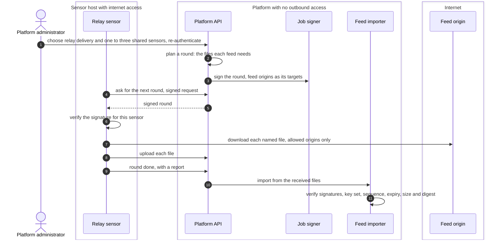

# Feed relay sensors
{: .no_toc }

A platform without outbound internet access still needs its signed feeds: the
vulnerability feed with KEV and EPSS data, and the release feed. A platform
administrator designates one to three shared sensors as feed relays. The
platform plans which files it needs, a relay downloads exactly those files
from the feed origins, and the platform checks every file with the feed's own
pinned key. A relay can delay a feed. It cannot change one.

1. TOC
{:toc}

## The flow

1. In the admin console a platform administrator turns on relay delivery for
   feeds and picks one to three shared sensors that report the feed relay
   role.
2. The platform plans a round: the exact files each feed needs. The job
   signer signs the round, with the feed origins as its targets, and checks
   them against its own allowlist.
3. A designated relay asks for the next round, verifies the signature, and
   downloads each file from the official feed origins (and any extra origins
   the sensor's operator allowed) through its guarded HTTP client.
4. The relay uploads the files and reports the round done. Any designated
   relay can take the oldest open round, so a second relay takes over when
   one goes away.
5. The feed importer reads the received files as its only source and runs
   every check it runs on a direct download.

## When something fails

| What happens | What you see | What to do |
|---|---|---|
| No relay is online | The feed stops updating | Bring a designated relay back online, or designate another. |
| A sensor is not allowed to relay | It is refused and waits 15 minutes before it asks again | Designate it in the console, or turn its relay role off. |
| A file fails a check | The import refuses it. The feed's last good data stays | Check the relay's network path. Report it if it persists. |
| The relay cannot reach the origin | The round is reported failed | Allow the sensor's host to reach the feed origins. |

## Security

- **The relay adds no trust.** Each feed is signed by its publisher's pinned
  key. The platform checks every file exactly as on a direct download.
- **Signed rounds.** A relay only downloads what a round signed by the job
  signer names, from allowlisted origins.
- **Only designated shared sensors.** Organization sensors never relay. A
  relay must be a shared sensor with pinned job signing keys.
- **Zero platform egress.** The platform makes no outbound connection for
  feeds in this mode. Only the relay sensor does.

## Related

- [Shared sensors](../../sensors/shared-sensors.md)
- [Shared sensors and zones](shared-sensors-zones.md)
- [Air-gapped sensors](../../airgap/sensors.md)
