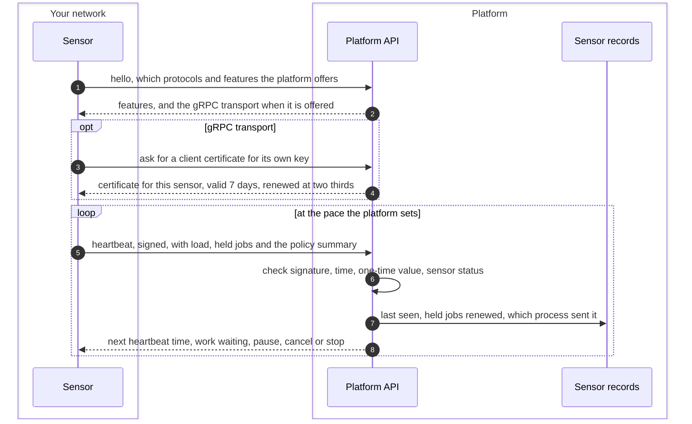
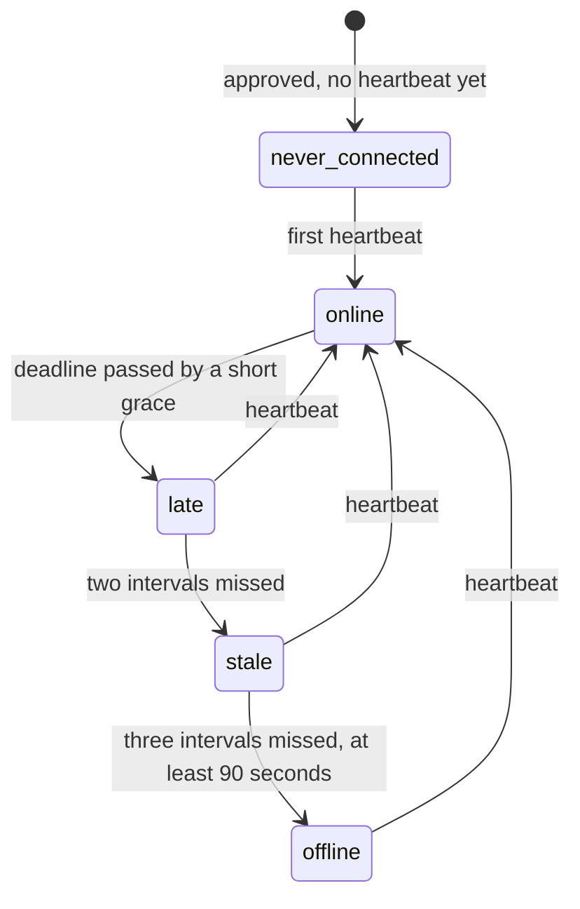

# Sensor identity and heartbeat
{: .no_toc }

Once paired, a sensor signs every request with its own key and sends a
heartbeat on a pace the platform sets. The heartbeat answer tells the sensor
whether work waits, whether to pause, and what to cancel. The Sensors page
shows the result as online, late, stale or offline.

1. TOC
{:toc}

## The flow

1. The sensor asks the platform which protocols it speaks. When the platform
   offers gRPC, the sensor gets a short-lived client certificate for the key
   it already has. No new secret is created.
2. Each heartbeat is signed with the sensor's key. It carries the sensor's
   load, the jobs it holds, its host pressure and a summary of its local
   policy.
3. The platform checks the signature, the clock window and that the request
   was never seen before, then looks up the sensor. The organization comes
   from the sensor's key, never from the request.
4. The answer sets the next heartbeat: about 30 seconds when idle, 5 seconds
   when work waits for a free slot, never below 5 seconds or above 5 minutes.
   It may say that work waits, ask the sensor to pause, or name jobs to
   cancel or stop.
5. With gRPC, the platform also pushes the "work waits" signal over a
   control stream. The heartbeat still runs.

### Online, late, stale, offline

A late sensor still gets work. A stale or offline sensor gets none, and an
offline sensor's jobs go back to the queue. Right after a platform restart, or
while the platform itself is slow, the platform holds back offline verdicts so
that the whole fleet does not drop at once.

## When something fails

| What happens | What you see | What to do |
|---|---|---|
| The host clock is more than 2 minutes off | The sensor log names the clock offset. The sensor gets no work | Sync the host with NTP. |
| The key is revoked, unknown, or the sensor was deleted | The sensor log says the key was revoked or replaced and to pair again. The sensor stays up and retries, slower each time, up to every 10 minutes | Pair the sensor again, or remove it from the host. |
| The sensor is disabled | Sensors page shows it disabled. The heartbeat is answered with pause | Activate it from the sensor's menu. |
| The same identity runs on two hosts | Health reason: cloned identity. No new work is given | Stop the copy and re-pair the sensor you keep. |
| Too many requests from one sensor | The sensor waits as told and continues | Nothing. |
| The platform cannot be reached | The sensor retries the next heartbeat after about 10 seconds. The Sensors page moves it to late, then stale, then offline | Check the network path to the platform URL. |
| The gRPC certificate cannot be renewed | The sensor falls back to HTTPS | See [Transport](../../sensors/transport.md). |

## Security

- **Trust boundary.** The sensor host is outside the platform's control.
  Every request is signed with an Ed25519 key that never leaves the host,
  covering the method, the path, the query and a digest of the body.
- **Replay.** Each signature carries a one-time value and a short validity
  window. A replayed request is refused.
- **Encryption.** All traffic is TLS. The gRPC transport uses TLS 1.3 with a
  client certificate that names the sensor and its organization. The
  platform checks that the certificate's key is the sensor's registered key.
- **Organization isolation.** The organization is taken from the sensor's
  key only. A shared sensor gets no organization at all on this path.
- **Refusals say little.** A revoked, unknown or wrong key gets the same
  refusal, so a caller learns nothing about which keys exist.

## Related

- [Transport (gRPC and HTTPS)](../../sensors/transport.md)
- [How sensors work](../../sensors/how-it-works.md)
- [Troubleshooting](../../sensors/troubleshooting.md)
- [Sensor pairing](pairing.md)
- [Disable, revoke and delete a sensor](revoke.md)
