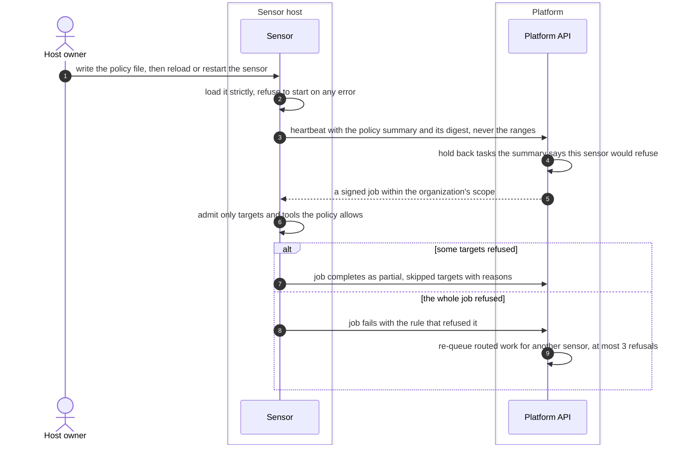
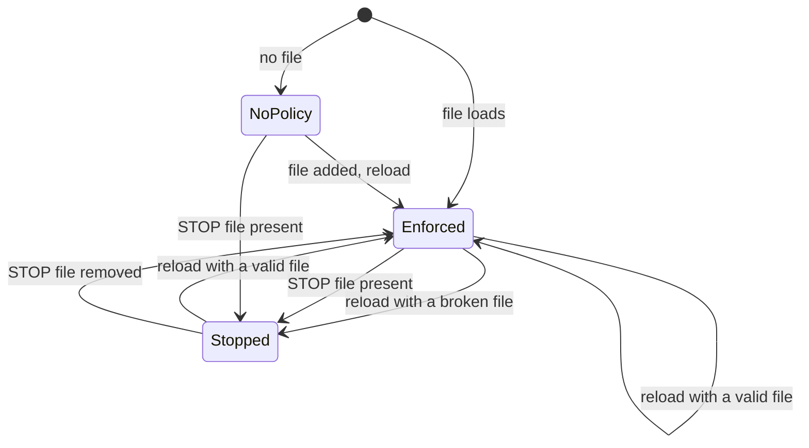

# Host local policy
{: .no_toc }

The owner of the sensor's host can add a policy file that narrows what the
sensor will scan, whatever the platform sends. The policy is optional: without
one the sensor follows the scope the platform signs. The platform never writes
the file. It only reads a summary of it from the sensor, and uses that summary
to send work to sensors that will accept it.

1. TOC
{:toc}

## The flow

1. The host owner writes `/etc/openctem/sensor-policy.yaml` (or the file named
   by `SENSOR_LOCAL_POLICY`), then sends the sensor a reload signal or
   restarts it. The sensor refuses to start on a file with an unknown key, a
   malformed range or loose file permissions.
2. Each heartbeat carries the policy's state, digest and a summary: counts,
   switches and tool names. The address ranges never leave the host.
3. The platform uses the summary when it places work: a task the sensor would
   refuse waits for another sensor and says why.
4. When a signed job arrives, the sensor removes every target the policy does
   not allow and runs the rest. If a job-wide rule refuses it, nothing runs
   and the job fails with the rule's name.
5. A routed task that a sensor refused goes back to the queue without that
   sensor. After 3 refusals, or 6 hours, it fails with every reason.

{: .note }
> From v0.20.0: the platform remembers which policy version refused a task.
> A sensor that refused under the same policy is not offered the task again,
> and a refusal where every target name did not resolve completes the task
> with skipped targets instead of re-queuing it.

### Reload and kill switch

- **No policy.** The sensor runs any job the platform signed, within the
  built-in deny list (loopback, cloud metadata and similar). Set
  `SENSOR_REQUIRE_LOCAL_POLICY=true` to refuse network jobs until a policy
  exists.
- **Kill switch.** The sensor checks the `STOP` file every 2 seconds. While
  it is there, running jobs are stopped and reported failed with
  `kill_switch`, nothing new is claimed, and the heartbeat says
  "paused by local policy". A file that cannot be checked counts as present.
- **Broken reload.** The sensor never keeps running on the previous, possibly
  looser policy. It stops all work until a valid file loads.

## When something fails

| What happens | What you see | What to do |
|---|---|---|
| The file does not load at start | The sensor exits with code 2 and names the problem | Fix the file. `openctemio-sensor policy validate` tests it. |
| A reload fails | The sensor stops all work. The platform shows "local policy reload failed" | Fix the file and reload again. |
| A target is outside the policy | The job completes with targets skipped, each with a reason | Widen `targets.allow` if the target should be scanned. |
| A tool or a port is not allowed | The job fails, naming the rule | Change the rule named in the message, or run the scan elsewhere. |
| No sensor accepts the task | The task waits with "local policy refuses" | Change a sensor's policy or add a sensor that may scan it. |

## Security

- **The host owner has the last word.** A compromised platform cannot widen
  what a sensor scans beyond its policy. The policy only narrows the
  platform's signed scope.
- **Fail closed.** A broken file, an unreadable kill switch or a target name
  that does not resolve stops the work instead of running it.
- **Nothing sensitive leaves the host.** The platform sees only the summary
  and the digest.
- **Organization isolation.** The summary belongs to the sensor that sent
  it, in that sensor's organization.

## Related

- [Network requirements and egress](../../sensors/network.md#sensor-local-policy)
- [Security notes](../../sensors/security.md)
- [Target admission on the sensor](../sensor-execution/admission.md)
- [Sensor and platform trust](trust.md)
