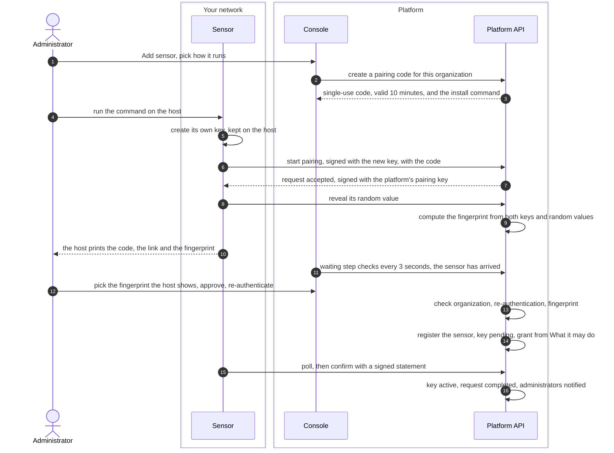
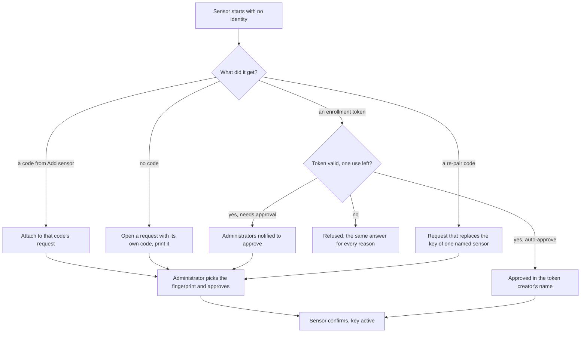

# Sensor pairing
{: .no_toc }

An administrator adds a sensor from **Discovery > Sensors > Add sensor** and
runs the command the console shows on the sensor's host. The sensor makes its
own key, the administrator picks the fingerprint the host shows and approves,
and the sensor confirms. The outcome is a sensor registered in the
organization, with a key that never left its host.

1. TOC
{:toc}

## The flow

1. In **Add sensor** you pick Docker, Docker Compose, Kubernetes or a Linux
   service. The console asks the platform for a pairing code. The code is
   single use and lasts 10 minutes.
2. You run the command on the host. The sensor creates an Ed25519 key. The
   private key stays in the sensor's data volume.
3. The sensor starts a pairing request. The request is signed with the new
   key and carries the code and a commitment to a random value. The platform
   answers with its own random value and signs the answer with its pairing
   key, so the sensor knows which platform it talks to.
4. The sensor reveals its random value. Both sides now compute the same
   fingerprint from the two keys and the two random values. The host prints
   it.
5. The console's waiting step finds the request and moves to the review. You
   pick, out of three, the fingerprint the host shows, check the host facts
   and the address the request came from, and approve with your
   authenticator code or password.
6. The platform registers the sensor with trust level **New** and the grant
   you chose under **What it may do**. The key stays pending.
7. The sensor reads its identity, signs a confirmation, and its key becomes
   active. From then on every request it sends is signed with that key.

### Other ways to start

- **No code.** The sensor prints a code and a link to **/activate**. An
  administrator enters the code, reviews and approves as above.
- **Enrollment token** (**Sensors > Enrollment tokens**). Creating a token
  needs the approve permission and a fresh re-authentication. Each start
  spends one use. A token can approve by itself, with its profile and labels,
  or leave the request for an administrator.
- **Re-pair.** Only a code made by **Re-pair...** on a sensor replaces that
  sensor's key. The sensor keeps its name, zones, grant and history, returns
  to trust level **New**, and its earlier keys are revoked.

## When something fails

| What happens | What you see | What to do |
|---|---|---|
| The host clock is more than 2 minutes off | The waiting step says the sensor's clock is ahead or behind | Sync the host with NTP. The sensor retries by itself. |
| You pick the wrong fingerprint | The request closes, every administrator is notified, the host shows a new code | Check the host again and approve the new request. |
| You switched organization after the review | The approval is refused as another organization | Enter the code again in the right organization. |
| The sensor's key is already registered | The waiting step says the key belongs to a sensor | Use **Re-pair...** on that sensor, or remove the old identity and run the command again. |
| Nobody approves within 10 minutes | The request expires, the code is never used again | The sensor falls back to its own code. Approve that one, or make a new command. |
| The sensor stops after approval and does not confirm within 10 minutes | The pending key is revoked and the unconfirmed sensor removed, with an audit entry | Run the command again. |
| Too many open requests on the platform | The sensor waits and retries | Nothing. It retries with growing waits up to 5 minutes. |
| The platform's answer is not signed, or was changed on the way | The sensor stops with `pairing_answer_unsigned` and names the step (`approval answer` or `confirm answer`); nothing is saved | A platform older than the sensor: upgrade the platform, then pair again. Otherwise something between the sensor and the platform changes its answers (a TLS-inspecting proxy): remove it, or pin the CA with `SENSOR_CA_FINGERPRINT`. |

## Security

- **Trust boundary.** The sensor runs in your network, the platform does
  not. Each side proves itself: the sensor signs with its own key, the
  platform signs its answers with its pairing key, and the fingerprint you
  compare ties the two keys together. A machine in the middle would produce
  a different fingerprint.
- **What the sensor keeps is signed.** The identity, the content keys, the
  job signer's keys and, when the platform uses a private CA, its TLS roots
  reach the sensor in one statement the platform signs with the same pairing
  key, made for this sensor's key and this request only. A machine in the
  middle that passes the first answer through untouched still cannot change
  what the sensor keeps: the sensor refuses the changed answer and saves
  nothing.
- **No secret is copied.** A code or token only says which organization and
  which approval a key belongs to. It never authenticates anything alone.
  Codes are stored as keyed hashes, never in clear.
- **Organization isolation.** A code made in one organization attaches its
  request to that organization only. Another organization cannot read,
  approve or reject it. The approval must name the organization of your
  session.
- **Audit.** Approval, rejection, a wrong fingerprint, confirmation and
  removal of an unconfirmed sensor are audited.

## Related

- [Pairing and enrollment](../../sensors/pairing.md)
- [Run the sensor](../../sensors/run-the-sensor.md)
- [Shared sensors](../../sensors/shared-sensors.md)
- [Sensor identity and heartbeat](identity-heartbeat.md)
