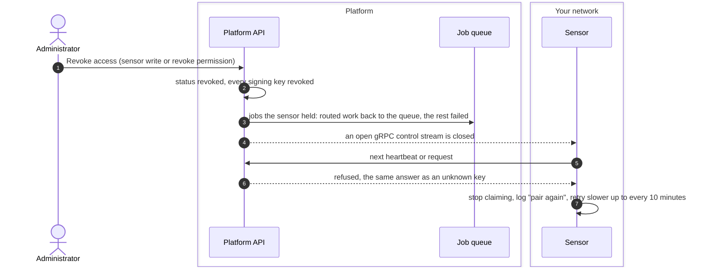
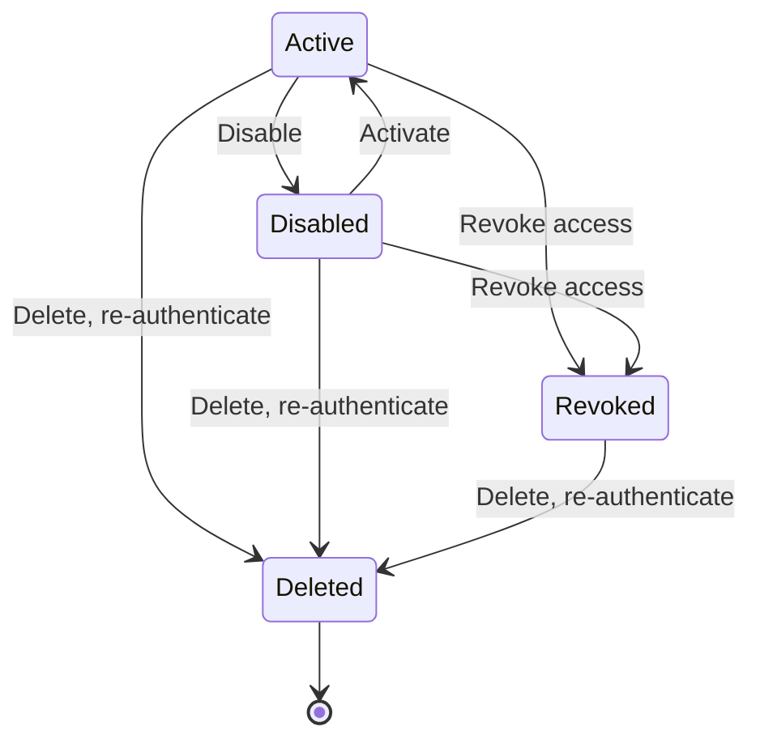

# Disable, revoke and delete a sensor
{: .no_toc }

An administrator stops a sensor from the menu of its sheet under
**Discovery > Sensors**. **Disable** pauses it and can be undone. **Revoke
access** is final: the sensor can no longer authenticate. **Delete** removes
the sensor's record. Use revoke when a host or key may be compromised.

1. TOC
{:toc}

## The flow

1. Revoke marks the sensor revoked and revokes all its signing keys. Revoked
   is final: the sensor cannot be activated again.
2. Jobs the sensor held are taken back. Work that may run on another sensor
   returns to the queue; the rest fails with the reason.
3. The sensor's next request is refused with the same answer an unknown key
   gets. The sensor stops taking work and keeps retrying with growing waits.
   It keeps its identity files; remove them on the host.

### The three actions

| Action | Its jobs | Its keys | The sensor |
|---|---|---|---|
| Disable | Released: routed work re-queued, the rest failed | Kept | Heartbeat answered with pause, no work |
| Revoke access | Released the same way | All revoked | Refused on every request, final |
| Delete | Not released at once: they wait for their lease to end | Removed with the record | Refused on every request |
| Revoke one key | Not released at once | That key only | Refused when it signs with that key |

## When something fails

| What happens | What you see | What to do |
|---|---|---|
| You deleted a sensor that still held jobs | The jobs stay running until their lease ends, then go back to the queue | Nothing, or revoke before you delete to release them at once. |
| You need the sensor back after a revoke | Activate is refused | Pair it again as a new sensor. |
| The sensor still runs on the host | Its log repeats that the key was revoked | Stop it and remove its data volume. |

## Security

- Revocation takes effect on the sensor's next request. A gRPC stream is
  checked again when the sensor's status changes.
- A revoked sensor's results that were queued before the revoke are dropped
  and audited when the platform processes them.
- Every action is audited. Delete needs a fresh re-authentication.
- Only administrators of the sensor's organization can act on it. Shared
  sensors are managed by platform administrators.

## Related

- [Pairing and enrollment: revoke a sensor or a key](../../sensors/pairing.md#revoke-a-sensor-or-a-key)
- [Upgrade, back up and remove](../../sensors/operate.md)
- [Security notes: respond to a compromise](../../sensors/security.md#respond-to-a-compromise)
- [Sensor identity and heartbeat](identity-heartbeat.md)
