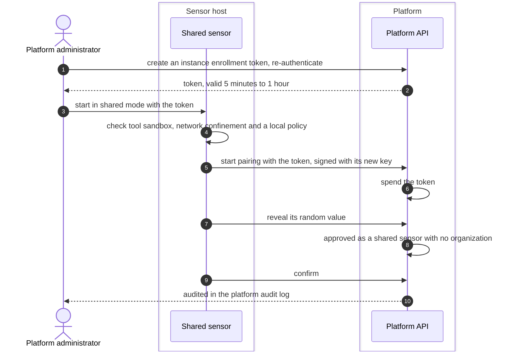
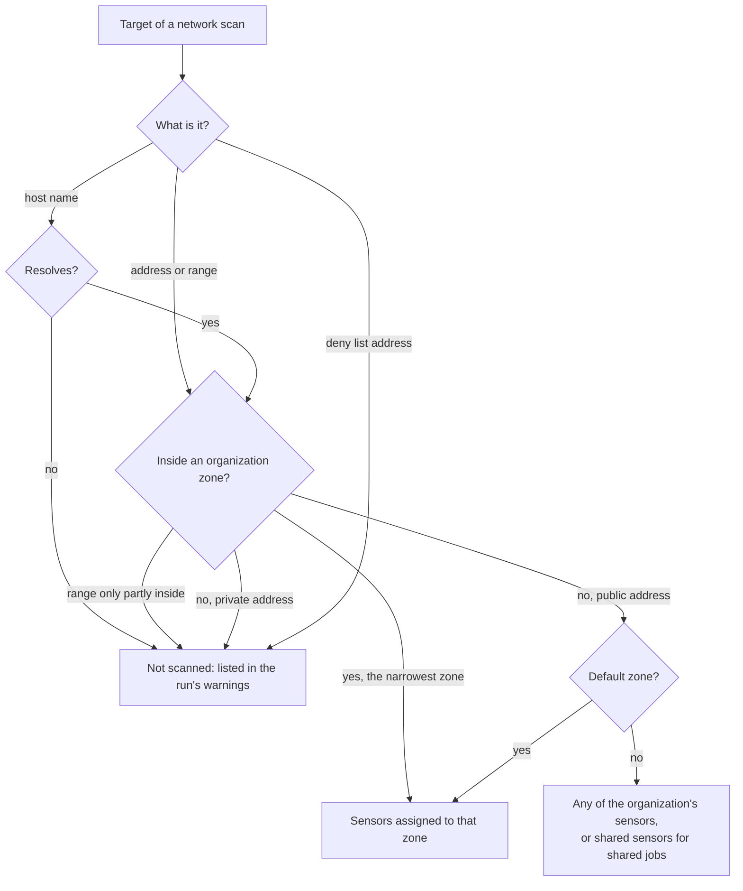

# Shared sensors and zones
{: .no_toc }

Most sensors belong to one organization. A platform administrator can also
enroll **shared sensors** that scan public targets for every organization
that takes part. **Scan zones** group an organization's network ranges with
the sensors that may scan them. This page draws how a shared sensor joins, and
how a target is matched to a zone before any sensor sees it.

1. TOC
{:toc}

## The flow

### Enroll a shared sensor

1. Only a platform administrator can create an instance enrollment token,
   with a fresh re-authentication. The token lasts 5 minutes to 1 hour.
2. The sensor starts in shared mode. It refuses to start, before pairing,
   without the tool sandbox, network confinement and a local policy. It runs
   only jobs the platform signed for it.
3. The token approves the sensor when it reveals its random value. The
   sensor belongs to no organization.
4. A shared sensor takes only jobs the platform marked as shared, and each
   job runs in the organization that owns it. Organizations see that a task
   runs on shared sensors, never which one.

### Which sensors may take a target

- An organization assigns its own sensors to its zones under **Scanning >
  Scan zones**.
- A platform administrator can assign **instance scan zones** (private
  ranges) to shared sensors and to the organizations allowed to use them.
  Each change is recorded by the job signer first, and the zone's ranges
  reach the sensor only inside a signed job.

## When something fails

| What happens | What you see | What to do |
|---|---|---|
| The token expired or was used | The sensor is refused, with the same answer for every reason | Create a new token. |
| The host cannot confine tools | The shared sensor refuses to start and says why | Allow user namespaces for the sensor, see [Run the sensor](../../sensors/run-the-sensor.md). |
| A target is in no zone and private | Not scanned, listed in the run's warnings | Add the range to a zone with a sensor. |
| A zone's sensors are all offline | The tasks wait, with a warning on the run | Bring a sensor of the zone back online. |

## Security

- A shared sensor has no organization. It never gets an organization
  context on the platform, and it cannot use the gRPC transport.
- Shared jobs carry their organization in the signed job. The sensor keeps
  each job's files apart and never uses an organization's own content or
  credentials.
- An organization's zones and ranges are visible only to that organization.
  Overlapping ranges of different organizations stay apart.

## Related

- [Shared sensors](../../sensors/shared-sensors.md)
- [Scan zones and pools](../../sensors/zones.md)
- [Sensor pairing](pairing.md)
- [Feed relay sensors](feed-relay.md)
