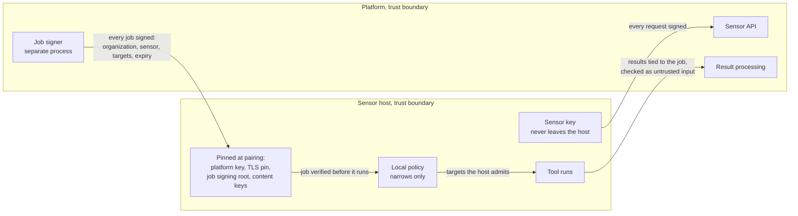
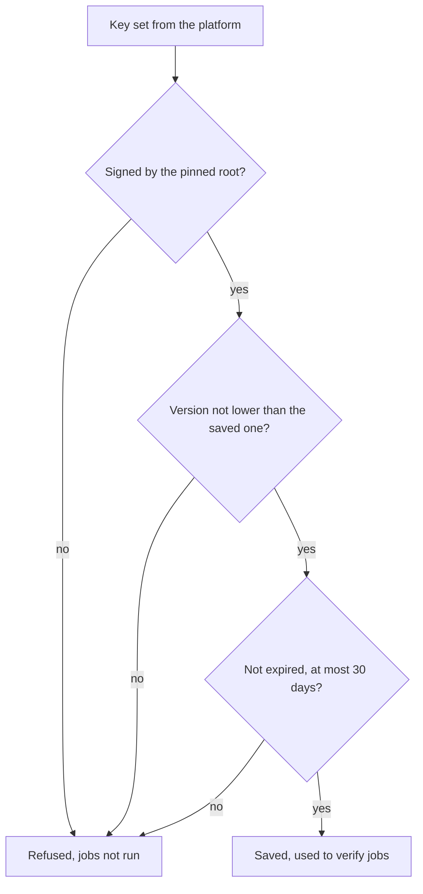

# Sensor and platform trust
{: .no_toc }

The sensor and the platform do not trust each other blindly. A stolen sensor
key must not reach other organizations, and a compromised platform must not
be able to aim a sensor at networks its owner did not allow. This page draws
what each side signs and checks. It is for administrators and security
reviewers.

1. TOC
{:toc}

## The flow

1. **Sensor to platform.** Every request is signed with the sensor's key. The
   platform takes the organization from that key and refuses anything else.
2. **Platform to sensor.** Jobs are signed by a job signer that runs as its
   own process. The sensor checks the signature against a key set that an
   offline root key signs, and refuses an unsigned job once it has a key
   set.
3. **Pinned at pairing.** The sensor saves the platform's pairing key, the
   platform's TLS certificate pin, the job signing root and the content
   signing keys. A different platform, or a man in the middle, does not
   match.
4. **The host owner's last word.** A local policy file on the host narrows
   what any signed job may reach. The platform cannot write it.
5. **Results.** The platform accepts a result only for a job the same sensor
   holds, and treats its content as untrusted input.

### What the sensor checks on a job key set

The sensor fetches the key set at start, when the platform's configuration
version changes, and when a job names a key it does not know (at most every
30 seconds). It warns 7 days before the key set expires.

## When something fails

| What happens | What you see | What to do |
|---|---|---|
| A job's signature does not verify | The job is refused and fails with the reason | Check that the platform's job signer runs. Report it if it persists. |
| The key set does not match the pinned root | The sensor refuses jobs and logs the mismatch | Check the job signing root in the install command. A new root needs a re-pair. |
| The platform's TLS certificate no longer matches the pin | The sensor cannot connect | Re-pair after a planned certificate authority change. |
| Content signing keys change on the platform | Content packs fail to verify | Re-pair the sensor. Content keys are pinned only at pairing. |

## Security

- **What is signed.** Sensor requests: the method, path, query and body
  digest, with the sensor's Ed25519 key. Jobs: a statement naming the
  organization, the sensor, the job, its targets and limits, with at most
  one hour of validity. Content packs: a statement naming the pack's digest
  and organization.
- **What is encrypted.** All traffic is TLS. Results waiting on the sensor
  are kept in an encrypted local queue.
- **Organization isolation.** The organization of a request comes from the
  key. A signed job names its organization and its sensor, so a job for
  another sensor or organization does not verify.
- **Outbound only.** Sensors only connect out. The platform never connects
  to a sensor.

## Related

- [Security notes](../../sensors/security.md)
- [Pairing and enrollment](../../sensors/pairing.md)
- [Network requirements and egress](../../sensors/network.md)
- [Host local policy](local-policy.md)
- [Sensor identity and heartbeat](identity-heartbeat.md)
