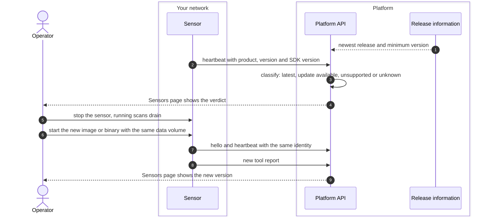

# Sensor upgrade
{: .no_toc }

The platform never updates a sensor by itself. It compares the version each
sensor reports with the release line it knows and tells you when a sensor is
behind. An operator upgrades the image or the binary on the host. The
sensor's identity and queued results live in its data volume, so they
survive the upgrade.

1. TOC
{:toc}

## The flow

1. The platform knows the newest release from its signed release feed,
   checked about once a day, and the minimum supported version from its own
   release. An air-gapped platform uses the versions it shipped with.
2. Each heartbeat carries the sensor's product, version and SDK version. The
   Sensors page shows **latest**, **update available**, **unsupported** or
   unknown. An unsupported version is a critical health reason. The sensor
   still works.
3. The operator replaces the image or binary and starts it with the same
   data volume. No new pairing is needed.
4. The sensor sends a new tool report. Tools that ship in the sensor image
   are upgraded with it. Scanner content (templates, rules) updates on its
   own schedule, separately from sensor releases.

## When something fails

| What happens | What you see | What to do |
|---|---|---|
| The new container did not get the old volume | The sensor prints a pairing code instead of its identity | Stop it and start it again with the old volume. |
| The version is below the minimum | Health reason: unsupported version | Upgrade the sensor. |
| A new feature needs a newer sensor | Tasks that need it wait with "capability missing" or "features" | Upgrade the sensor. Older sensors keep running other work. |
| The upgrade goes wrong | The sensor does not come back online | Start the previous image with the same volume. |

## Security

- The heartbeat answer has an update action, but the sensor never downloads
  or runs anything because of it. Only the operator changes what runs on the
  host.
- Verify the image or binary signature before you upgrade (see
  [Upgrade, back up and remove](../../sensors/operate.md)).
- The identity key stays in the data volume. Keep the volume as private as
  a credential.

## Related

- [Upgrade, back up and remove](../../sensors/operate.md)
- [Deploy with Docker](../../sensors/deploy-docker.md)
- [Deploy as a binary](../../sensors/deploy-binary.md)
- [Scanner content and content packs](../../sensors/content-delivery.md)
- [Tool and capability report](capabilities.md)
