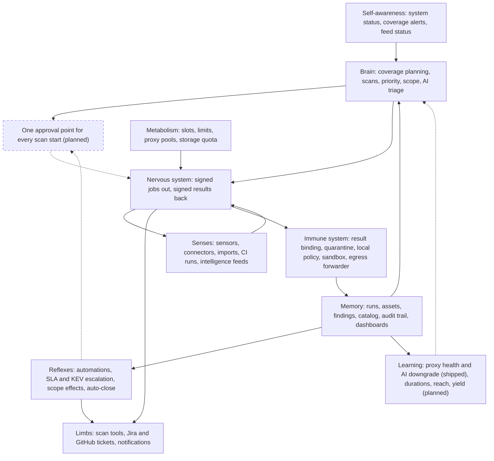
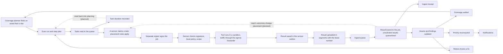
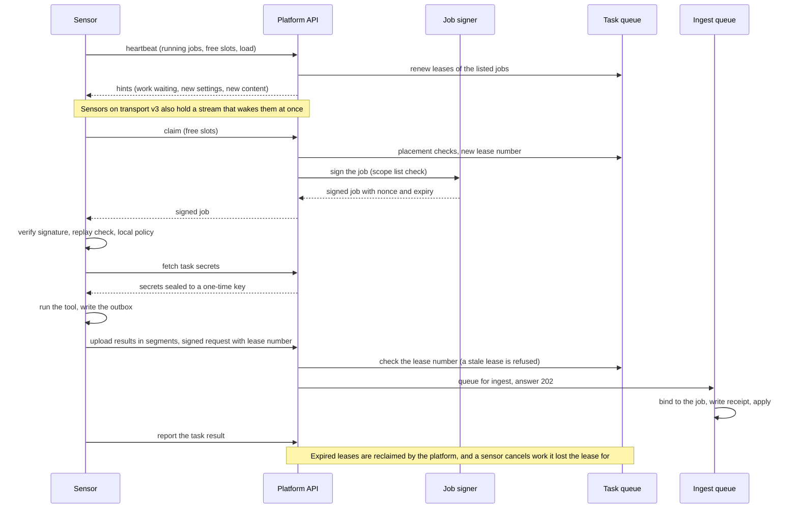
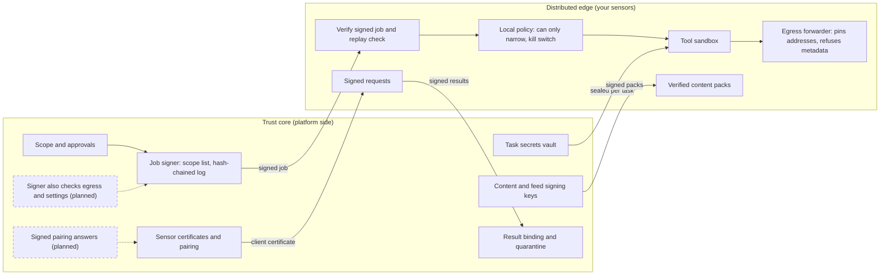
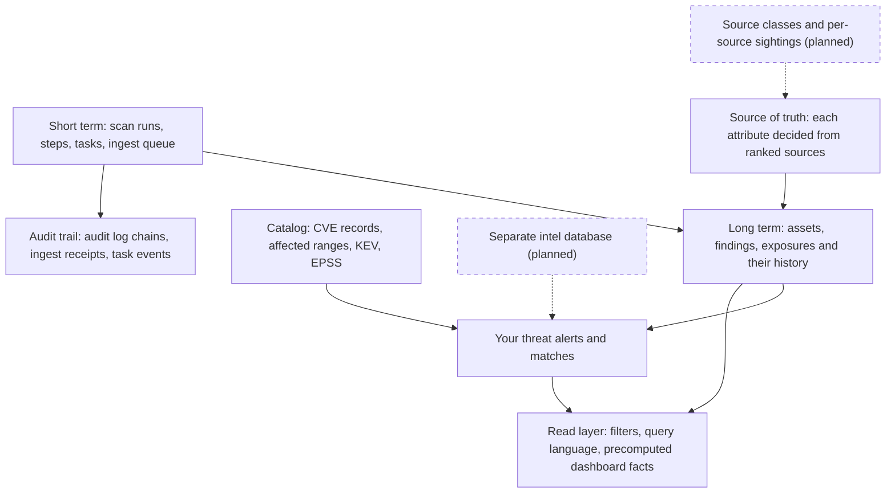
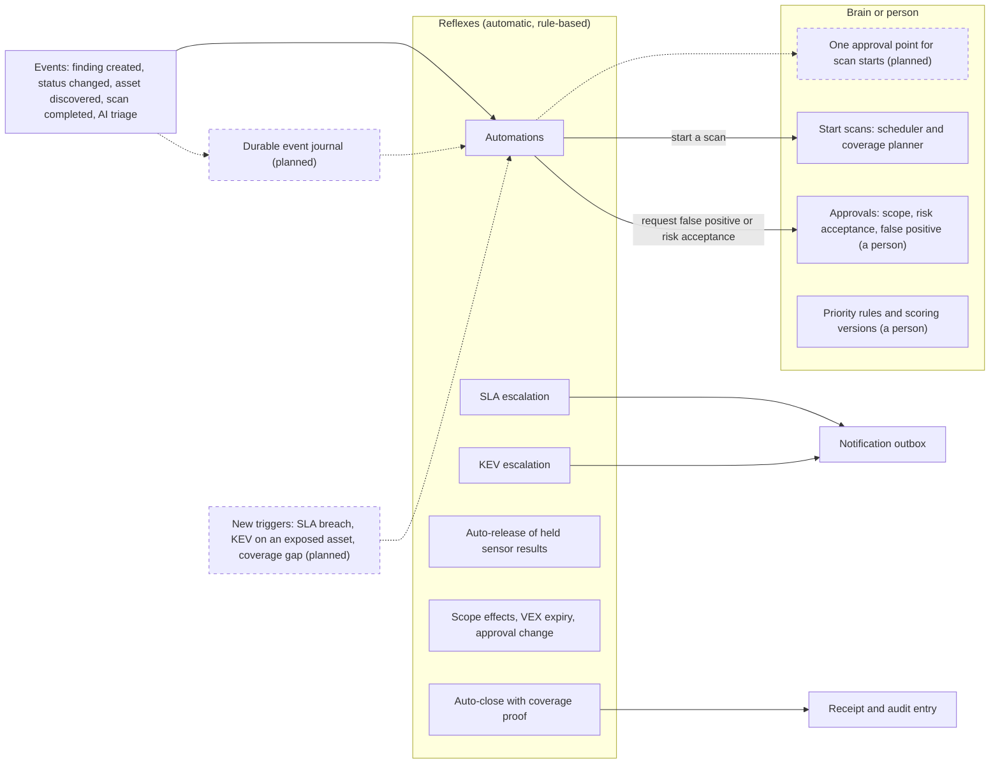
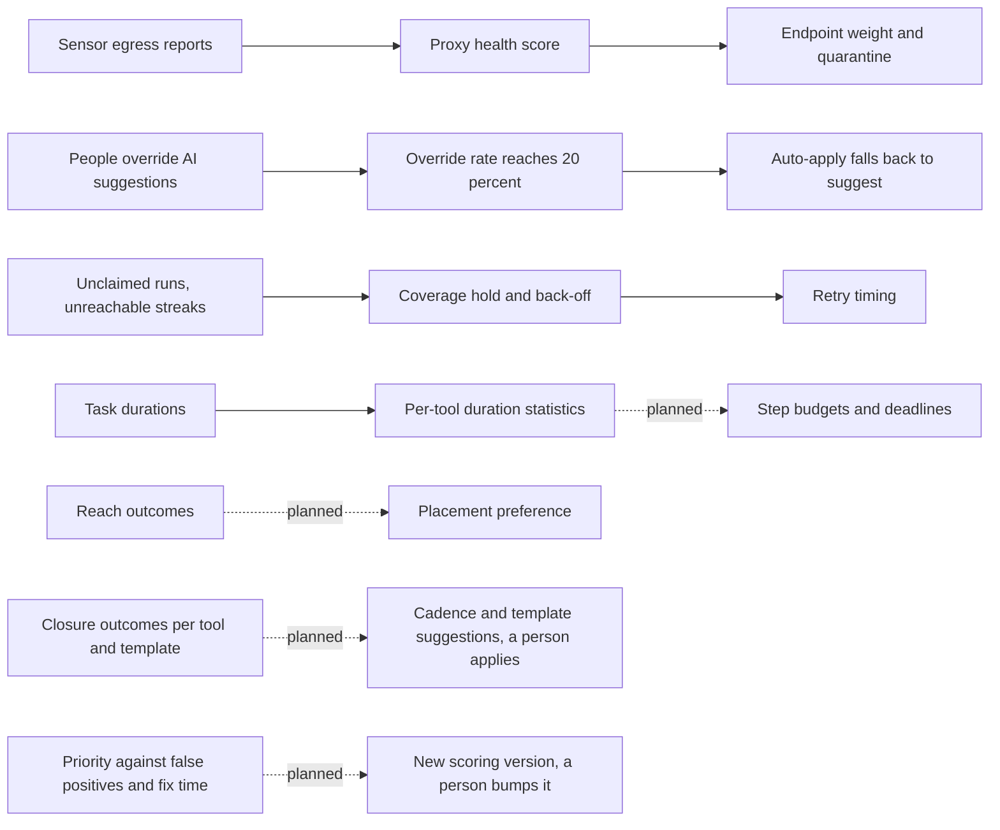
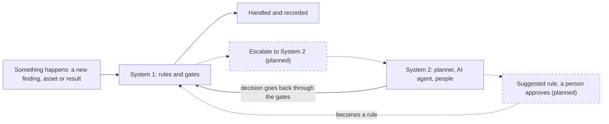
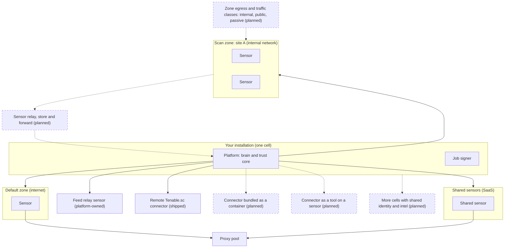

# How OpenCTEM works as one machine
{: .no_toc }

OpenCTEM is one system made of parts with clear jobs. This page draws those
parts and how they work together, so that you can picture where your data goes
and who decides what. The detailed pages in this section zoom in on each flow.

1. TOC
{:toc}

## How to read the pictures

- A solid box or arrow is **shipped**: it works in the release you run.
- A box with a **dashed border**, a dashed arrow or a label ending in
  "(planned)" is **planned**. It does not exist yet and may change.
- One rule holds everywhere: **sensors do the work, the platform decides**.
  A sensor runs tools, paces itself, refuses unsafe jobs and buffers results.
  It never closes a finding, merges assets away, widens scope or ranks risk.

## The parts

| Part | Its job |
|---|---|
| Brain | Plans coverage, builds scans, places tasks on sensors, ranks findings, decides what may be probed, runs AI triage |
| Senses | Sensors, connectors, imports, CI runs and intelligence feeds bring in what is out there |
| Limbs | Scan tools run on sensors. Tickets and notifications go out |
| Nervous system | Signed jobs go out, signed results come back |
| Memory | Runs, assets, findings and history, the catalog, the audit trail, dashboards |
| Reflexes | Automations, SLA and KEV escalation and auto-close react to events |
| Immune system | Result binding, quarantine, local policy, the sandbox and the egress forwarder |
| Metabolism | Slots, limits, proxy pools and storage quota bound the work |
| Learning | Proxy health and the AI downgrade work today. The rest is planned |

## The organ map

The platform drawn as one body. The brain plans and decides. The senses observe. The limbs act. The nervous system carries signed jobs out and results back. Memory keeps what happened. Reflexes react to events without waiting for the planner. The immune system checks every message that comes from a sensor. Metabolism limits how much work runs at once. Learning is the youngest part: two loops work today, the rest are planned.

## One scan cycle, end to end

This is the main loop. The platform notices an asset that is due for a check and starts a run. A sensor claims a task, the separate signer signs it, and the sensor checks the signature and its own local policy before it runs the tool in a sandbox. The result is uploaded, bound to the job it answers, and turned into assets and findings. Priority is recomputed, notifications go out, and a retest later confirms a fix. The platform records how long each task took; using that to plan better is planned.

## How a sensor gets work

Sensors pull their work. Each heartbeat renews the leases of running jobs and brings back hints. A claim gets a task with a new lease number, signed by the signer. The sensor verifies it, fetches its secrets sealed to a one-time key, runs the tool and uploads the result in signed segments. If a sensor loses its lease, the platform reclaims the task and the sensor drops its results.

[Signed jobs](scans/signed-jobs.md) and [task claim and lease](scans/task-claim-and-lease.md) explain these two steps in detail.

## Trust: platform and sensors

The platform and your sensors do not trust each other blindly. The platform side signs jobs and holds scope, secrets and signing keys. The sensor side verifies every job, can only narrow what it is allowed to do, confines every tool in a sandbox and sends all network traffic through a forwarder that refuses internal and metadata addresses outside the job scope. Results come back signed and are matched to the job they answer. Dashed boxes are planned hardening.

## Memory

Run state is short-lived and is cleaned up after days or weeks. Assets, findings and their history are the long-term memory. Each asset attribute is decided from ranked sources. The public catalog (CVE, KEV, EPSS) feeds your own threat alerts and matches. The audit trail is tamper-evident. Dashboards read precomputed facts, and every read is limited to your organization and your data scope. Per-source sightings and a separate intel database are planned.

## Reflexes and decisions

Reflexes follow fixed rules and run automatically: escalation, notification, releasing held results, reopening when a VEX statement expires, auto-close only where the closure mode and coverage proof allow it. Decisions that need judgment stay with the planner or a person: starting scans, widening scope, accepting risk, marking false positives and changing priority rules. Today automations run inside the platform process, and only the finding-created event is stored durably. A durable event journal and more triggers are planned.

## What the platform learns

Some loops already change later decisions: proxy health sets how often an endpoint is used, a high override rate on AI suggestions turns auto-apply back into suggest, and repeated unclaimed runs put coverage on hold with a back-off. Task durations are recorded but not used yet. Reach routing, tool yield and priority calibration are planned. Values that only tune operations will adjust within bounds. Anything that changes risk stays a suggestion that a person applies.

## System 1 and System 2

The two links between the modes, described below, are **planned**.

The machine works in two modes. **System 1** is fast and deterministic: fixed rules and reflexes that handle the common case the same way every time. **System 2** is slow and deliberate: a planner with the full picture, an AI agent, or a person, for cases that are novel, ambiguous or high risk.

### What runs as System 1 today

- The scope gate and the active-probe gate: one answer to "may this be probed".
- Fingerprinting and deduplication of findings when results come in.
- Result binding and the sensor-result quarantine, including auto-release of held results under fixed rules.
- SLA escalation and KEV escalation.
- Automations on events, and closure modes that auto-close only where the coverage proof allows it.
- Precomputed dashboard facts.
- The sensor's own reflexes: local policy, the egress forwarder and the tool sandbox.

### What runs as System 2

- The coverage planner and the scan planner, which choose what to scan and when .
- AI agents that suggest or apply triage under organization consent (available for some use cases).
- People who approve scope, accept risk, mark false positives and change priority rules .

### The invariant

Everything System 2 proposes still passes the System 1 gates. A planner cannot start a scan outside scope, an AI agent cannot close a finding outside the closure mode, and a person's approval is recorded in the audit trail like any other decision. The brain proposes and the rules dispose. Nothing System 2 does skips the gates.

### The two bridges (planned)

- **Escalation, System 1 to System 2.** When a rule cannot decide, it hands the case up through one shared escalation record (reason, subject, target, state). Triggers: low confidence, conflicting sources, high impact (production or crown-jewel assets, lowering a security attribute, bulk close), novelty (a new CVE matching the inventory, an unknown asset, an anomalous sensor), and a rule lacking the authority to act (an intrusive scan needs approval). Today such cases are handled by separate mechanisms, not one shared record.
- **Compile-down, System 2 to System 1.** Repeated human or AI decisions produce **rule suggestions**. A person approves each one, and the resulting rule is versioned, audited and can be switched off. Examples: the same false-positive template accepted five times suggests a suppression rule; an AI suggestion type accepted more than 95 percent of the time becomes a deterministic rule.

Planned measures: the share of cases handled by System 1, the escalation rate, the suggestion acceptance rate and the number of rules compiled.

## Where work runs

Sensors belong to scan zones, such as an internal site or the internet. Shared sensors can serve several organizations. Traffic leaves through the forwarder, directly or through a proxy pool. Connectors run near the system they read, never inside the platform. Intelligence feeds come through a platform-owned relay sensor. Multiple cells for large SaaS installs, zone egress settings and the sensor relay are planned.

See [shared sensors and zones](sensors/shared-sensors-zones.md) for how to group sensors.
