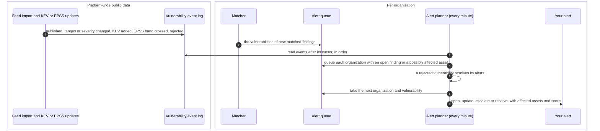
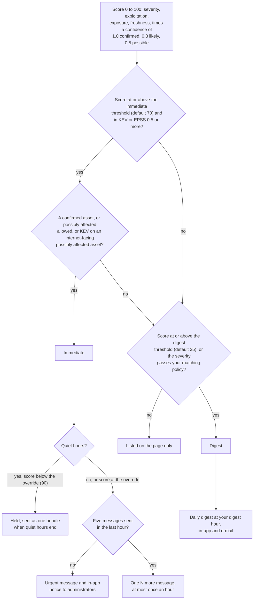

# Emerging threat alerts
{: .no_toc }

When the public facts about a vulnerability change (it is published, its
ranges or severity change, it enters KEV, its EPSS score crosses a band, or
it is rejected), the platform asks each organization: does this hit us? An
organization with an affected asset gets one alert for that vulnerability,
never one message per asset. A score decides whether administrators are told
at once, in the daily digest, or only on the **Emerging threats** page.

1. TOC
{:toc}

## The flow

### From public events to alerts

1. Each feed import and each KEV or EPSS update writes public events: no
   organization data is in them. A sync run again by hand writes no
   duplicate.
2. The planner reads new events in order. It waits up to two minutes on a
   gap, so an event that is still being written is not skipped.
3. Each event queues the organizations with an open finding for the
   vulnerability, or an asset that runs the named product in an unknown
   version (**possibly affected**). The matcher also queues the
   vulnerabilities of the findings it creates.
4. A vulnerability rejected upstream resolves every open alert for it.
5. For each queued organization and vulnerability the planner opens an alert
   only inside the active window (an event in the last 30 days, or a KEV
   addition in the last 90). With no affected asset left, the alert resolves
   as fixed.
6. An organization seen for the first time gets the alerts of the active
   window with nothing sent at once, then one baseline digest.

### Score and who is told

1. An immediate alert needs exploitation evidence (in KEV, or EPSS of 0.5
   or more), never severity alone.
2. Quiet hours hold immediate messages except those at or above the override
   score. The held ones go as one bundle when quiet hours end.
3. At most five immediate messages an hour per organization. The rest go as
   one summary message, at most once an hour.
4. The digest goes once a day at the organization's digest hour in its time
   zone. Members whose e-mail digest preference is daily (or weekly) get it
   by e-mail, counted within each member's own data scope.
5. An alert marked **Not affected** comes back when its suppression expires,
   when a stronger match appears, or when the vulnerability enters KEV and
   the reason allows it.

## When something fails

| What happens | What you see | What to do |
|---|---|---|
| Alerts are switched off, or the **Threat intel** module is off | No alerts. Checked again hourly | Turn them on in **Settings > Emerging threats** |
| An alert could not be planned | It is queued again for the next run | Nothing |
| Many urgent alerts at once | Five messages, then one "N more" message | Open **Emerging threats** for the full list |
| A message could not be queued for delivery | A warning in the server log. The alert stays on the page | Check the notification integrations |

## Security

- **Public events, private alerts.** The event log holds only public facts
  about vulnerabilities. Alerts, their assets and their state belong to one
  organization, and the asset links must belong to that organization.
- **Data scope.** The page lists an alert only when you can see one of its
  assets, and counts only assets in your scope. Marking an alert
  **Not affected** needs every affected asset in your scope.
- **Messages carry little.** A message names the vulnerability, the product,
  why now and counts. Asset names are included only when your organization
  allows it, and at most five. Product text is stripped of control
  characters and channel markup.
- **Settings are audited.** Changing the thresholds or quiet hours needs an
  administrator and is recorded.

## Related

- [Emerging threats](../../user-guide/emerging-threats.md)
- [KEV and EPSS updates](kev-epss.md)
- [Version matching](vulnerability-matching.md)
