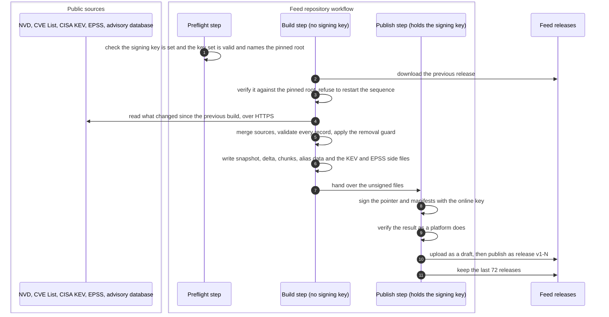

# Feed build and signing
{: .no_toc }

The vulnerability feed is the platform's only source of CVE records, affected
version ranges, KEV and EPSS. It is built every hour outside your platform, in
the public `openctemio/vulnfeed-bundles` repository, from the collector code
in `openctemio/vulnfeed`. Every release is signed under a key set that an
offline root key signed. Your platform pins that root and refuses anything
else.

1. TOC
{:toc}

## The flow

1. A preflight step stops the run early when the signing key is missing or
   the key set has expired or names another root. It warns 30 days before
   the key set ends.
2. The build step downloads the previous release and verifies it. The
   sequence number continues from it. A build that finds no previous release
   fails rather than restart at 1, because platforms refuse a lower sequence.
3. The build reads the sources: NVD and the CVE List for records and
   affected ranges, CISA KEV and FIRST EPSS for exploitation signals, and the
   advisory database for advisory id aliases. Each CVE's ranges come from one
   source, never a mix.
4. Every record is validated before anything is signed. If more than 2 % of
   the stored ranges would disappear at once, the build is refused until a
   maintainer checks the source and publishes on purpose.
5. A KEV or EPSS source that fails or looks truncated is not published: the
   previous verified copy is carried forward with its older data date.
6. Only the publish step holds the signing key. It signs, verifies the result
   exactly as a platform would, uploads a draft, and publishes the release
   once every file is in. Platforms read only the latest published release,
   never a draft.

## What a release holds

| Part | Signed | Purpose |
|---|---|---|
| Key set | by the offline root | lists the online signing keys, valid at most 180 days, version only grows |
| Pointer | by an online key | the sequence, the snapshot and delta manifests, the expiry (7 days) |
| Manifests | by an online key | every file or chunk with its SHA-256, size and record count |
| Snapshot, delta, chunks | through the manifests | products, CVE records and affected version ranges |
| Alias data, advisory id map | own signed manifests | product name aliases, and advisory ids tied to one CVE |
| KEV and EPSS side files | own signed manifest | the known exploited list and the EPSS scores, with their data dates |

## When something fails

| What happens | What you see | What to do |
|---|---|---|
| The signing key is missing or the key set expired | No new release. Your platform's feed card turns **Stale** after 3 days | Nothing on your side. The feed maintainers rotate the key set |
| A source fails or is truncated | A release with the previous copy of that source and an older data date | Nothing. The platform may fetch KEV and EPSS directly, see [KEV and EPSS updates](kev-epss.md) |
| Too many ranges would disappear | No new release until a maintainer checks the source | Nothing. The last release keeps working until it expires |
| A release is older than 7 days | The platform refuses it as expired | Check that your platform can reach the feed, see [Feed delivery](feed-delivery.md) |

## Security

- **Two keys, two places.** The offline root only signs key sets. The online
  key signs releases and lives in a protected environment that only the
  default branch can deploy to. The build step, which talks to the sources,
  never sees it.
- **No rollback, no freeze.** Sequences only grow, key set versions only
  grow, and everything expires after 7 days.
- **Untrusted text.** Text from sources is cleaned of control and formatting
  characters and clipped before it is signed. Platforms validate every
  record again with their own parsers.
- **Reproducible.** The same previous release and source data give
  byte-identical record files, so anyone can rebuild and compare.
- **No organization data.** The feed holds public data only. Nothing about
  your organization leaves the platform to build it.

## Related

- [Vulnerability and program feeds](../../operations/feeds.md)
- [Feed delivery](feed-delivery.md)
- [Content and intelligence feeds in air-gapped sites](../../airgap/feeds.md)
