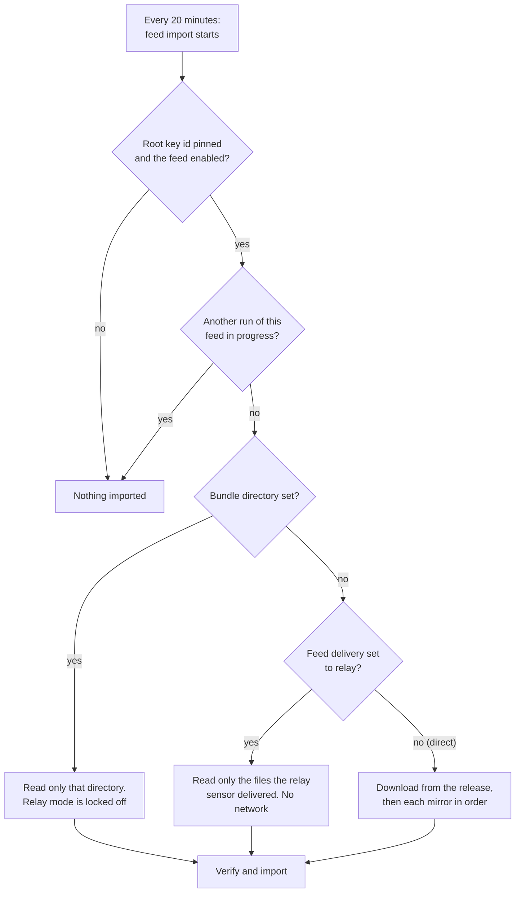
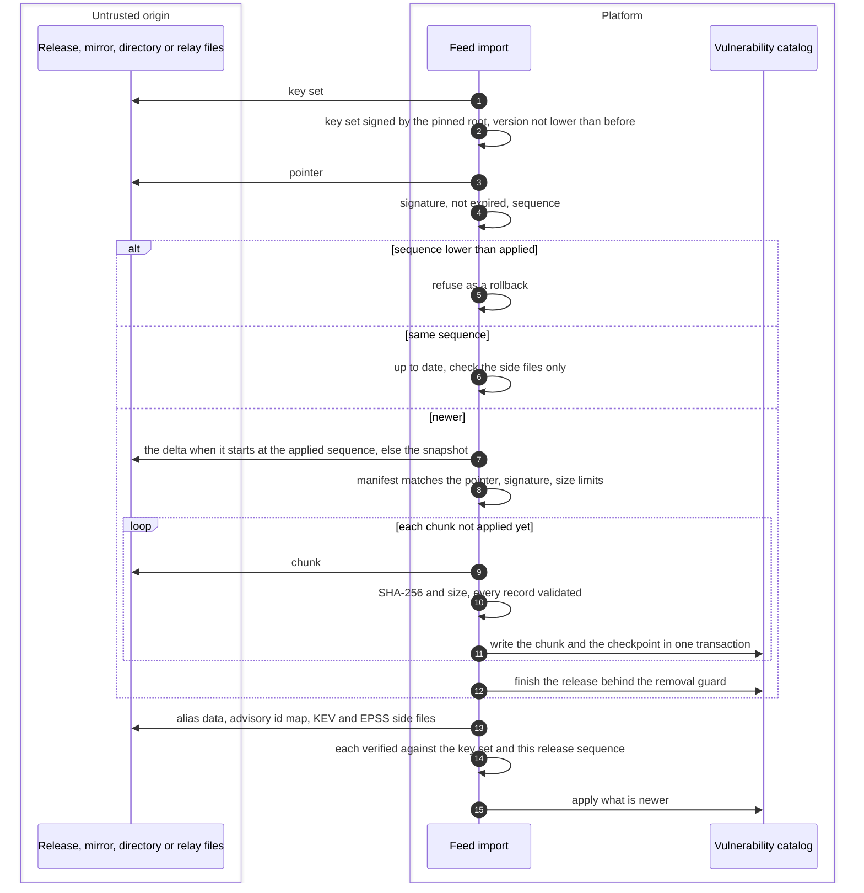

# Feed delivery
{: .no_toc }

Every 20 minutes the platform looks for a newer vulnerability release. It can
get the files in three ways: download them itself, read them from a directory
you copy them to (air-gapped sites), or receive them through one of its own
shared sensors (a feed relay). Whichever way the files arrive, the same
checks run before anything is imported, so a mirror, a copied directory or a
relay can delay the feed but never change it.

1. TOC
{:toc}

## The flow

### Where the files come from

1. The feed imports only when its root key id is pinned (built into current
   releases) and the feed is not switched off. One run at a time: the
   scheduled run and **Sync now** on any server never import together.
2. **Bundle directory** (`VULNFEED_BUNDLE_DIR`): the platform reads only that
   directory. Use it in air-gapped sites. The relay cannot be turned on.
3. **Relay**: a super administrator chose **Relay** in
   **System > Threat intelligence > Feed delivery**. The platform makes no outbound feed request. One to three shared
   sensors download the files the platform asks for, see
   [Feed relay sensors](../sensors/feed-relay.md).
4. **Direct** (the default for existing installs): the platform downloads
   from the release address (`VULNFEED_BASE_URL`), then each mirror in
   `VULNFEED_MIRRORS` in order, through its guarded HTTP client with retries,
   resume and a circuit breaker per origin.

### What the import checks

1. The key set must be signed by the root you pin, and its version may never
   go down.
2. The pointer must be signed and not expired (7 days). A lower sequence than
   the one applied is refused. The same sequence means the catalog is up to
   date.
3. The platform downloads only what it needs: the delta when the platform
   holds its base, the snapshot otherwise. Chunks it already has are not
   fetched again.
4. Every chunk is checked against the signed manifest and every record is
   validated again. Each chunk is written with a checkpoint in one
   transaction, so a crash resumes at the next chunk and a half-applied
   release is never reported as applied.
5. Finishing the release removes ranges the new data no longer holds. If
   more than 2 % of the stored ranges (at least 500) would be left without
   any range, the finish is refused and retried until a newer release comes.
6. Then the side files are applied: product name aliases, advisory ids, and
   KEV and EPSS (see [KEV and EPSS updates](kev-epss.md)).
7. The changed CVEs go to the matcher and to the emerging threat planner (see
   [Version matching](vulnerability-matching.md) and
   [Emerging threat alerts](emerging-threat-alerts.md)).

## When something fails

| What happens | What you see | What to do |
|---|---|---|
| The publisher has not published yet | **Waiting for the publisher** on **System > Threat intelligence** | Nothing, or check the feed address |
| A file fails a check (signature, key set, sequence, expiry, size or digest) | **Refused** with an error code. The previous data stays | Check what sits between the platform and the release. Report it if it persists |
| No release for 3 days | **Stale**, and a warning in the server log | Check the network path, the mirror, the directory or the relay |
| Too many ranges would disappear | **Refused** with a guard error, retried each run | Nothing. A newer release normally clears it |
| The import stopped half way | Nothing lost. The next run resumes at the next chunk | Nothing |

## Security

- **Origins are untrusted.** The release host, mirrors, a copied directory and
  the relay are all checked the same way. Trust comes only from the root key
  id you pin.
- **No rollback.** A replayed older release, an older key set or an expired
  pointer is refused.
- **Guarded downloads.** Direct downloads go through the platform's guarded
  HTTP client, which refuses private address ranges unless you allow them.
- **Shared data, no organization data.** The vulnerability catalog is
  platform-wide public data. The import writes no organization's data and
  reads none.

## Related

- [Vulnerability and program feeds](../../operations/feeds.md)
- [Content and intelligence feeds in air-gapped sites](../../airgap/feeds.md)
- [Feed relay sensors](../sensors/feed-relay.md)
- [Feed build and signing](feed-build.md)
