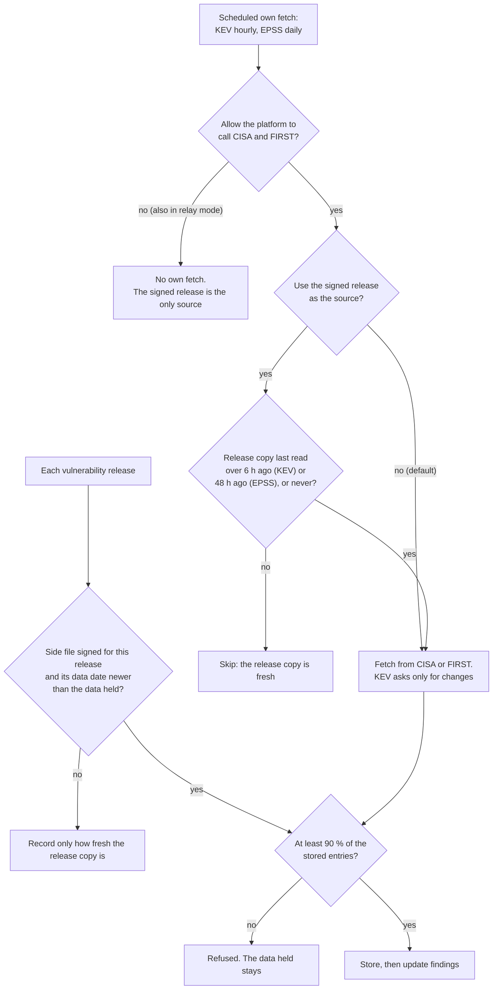
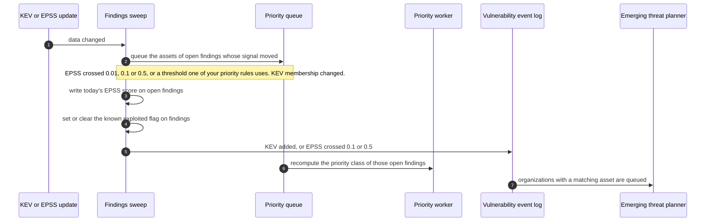

# KEV and EPSS updates
{: .no_toc }

Two public signals say whether a vulnerability is being exploited: the CISA
Known Exploited Vulnerabilities list (KEV) and the EPSS score, the chance it
is exploited in the next 30 days. They reach the platform in two ways: as
signed side files of each vulnerability release, and by the platform's own
fetch from CISA (hourly) and FIRST (daily). A super administrator decides
which way supplies the data. Either way, a change moves only the open
findings it touches.

1. TOC
{:toc}

## The flow

### Which path supplies the data

1. **Where KEV and EPSS come from** is a setting in
   **System > Threat intelligence** (super administrator, step-up, audited).
   By default the platform's own fetch supplies the data, and a release copy
   is applied when its data date is newer.
2. With **Use the signed release as the source** on, the own fetch runs only
   as a fallback, when the release's copy was last read by the collector
   more than 6 hours (KEV) or 48 hours (EPSS) ago.
3. With **Allow the platform to call CISA and FIRST** off, or in relay mode,
   the platform never calls them. A stale release copy shows as stale.
4. A release copy is applied only when it is signed for the release the
   platform just verified and its data date is newer than the data held from
   either path. A replayed or older copy never rolls the data back.
5. A copy with under 90 % of the stored entries is refused as truncated.
   When a KEV update would remove more than 25 entries, or more than 2 % of
   the list, at once, nothing is removed and the next update tries again.

### From a change to your findings

1. After every change, and at least once a day, the sweep compares open
   findings with the catalogs. Only the assets of findings whose signal moved
   in a way a priority rule can see are queued, never a whole organization.
2. Open findings get today's EPSS score, so a CI gate with an EPSS threshold
   sees the current value.
3. Findings whose vulnerability entered or left KEV get their known exploited
   flag set or cleared. The severity is not changed: KEV reaches the priority
   through the exploitation floor (see
   [Priority from threat intelligence](priority.md)).
4. A KEV addition, or an EPSS score that crosses 0.1 or 0.5, is recorded as a
   public event. The emerging threat planner turns it into alerts (see
   [Emerging threat alerts](emerging-threat-alerts.md)).
5. Closed findings are never changed.

## When something fails

| What happens | What you see | What to do |
|---|---|---|
| CISA or FIRST cannot be reached | The KEV or EPSS card shows **Failing**, later **Stale** (KEV after 6 hours, EPSS after 48 hours) | Allow the hosts, or switch to the signed release as the source |
| A copy is under 90 % of the stored list | **Refused**. The data held stays | Nothing. The next good copy is applied |
| The release copy is old | **Stale** for the source. With the release as source, the own fetch takes over | Check the feed delivery |
| The findings sweep fails | A warning in the server log. Retried on the next run | Nothing |

## Security

- **Signed or from the source.** A release copy is verified with the feed's
  pinned root and bound to the release sequence. The own fetch reads fixed
  CISA and FIRST addresses through the guarded HTTP client.
- **No rollback.** Data older than the data held is never applied.
- **Organization isolation.** KEV and EPSS are public, platform-wide data.
  Each organization's findings are updated with that organization's id in
  every statement, and another organization's priority rule thresholds never
  queue your findings.
- **Who can change the source.** Only a super administrator, after step-up,
  and the change is audited.

## Related

- [Vulnerability and program feeds](../../operations/feeds.md)
- [Prioritization](../../user-guide/06-prioritization.md)
- [Feed delivery](feed-delivery.md)
