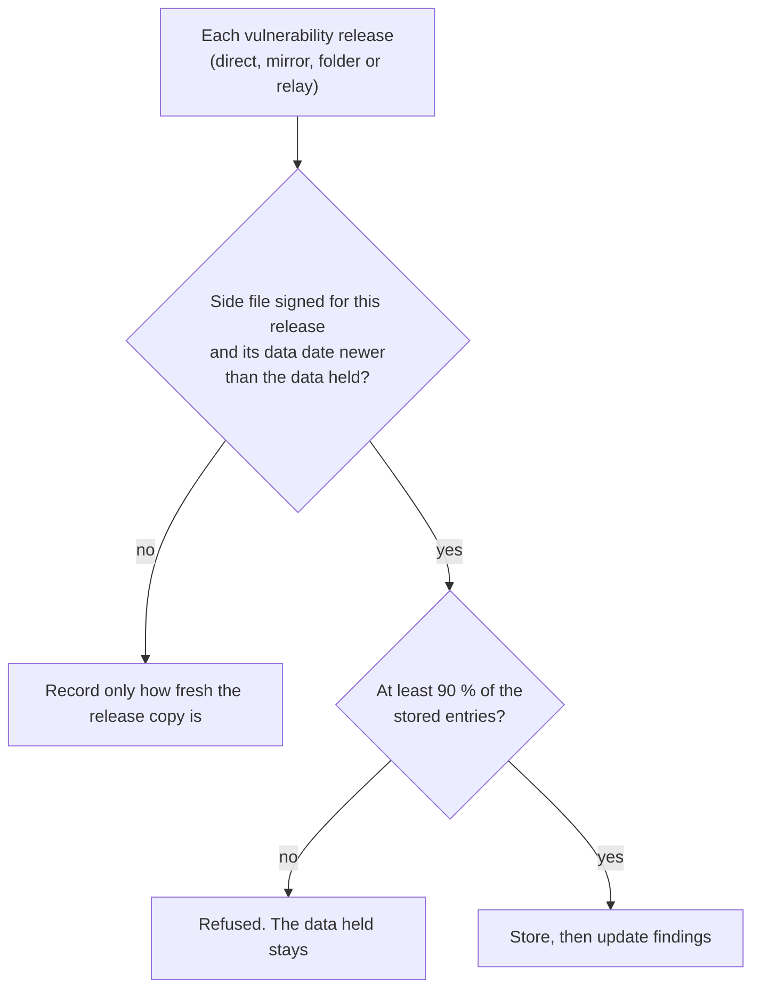
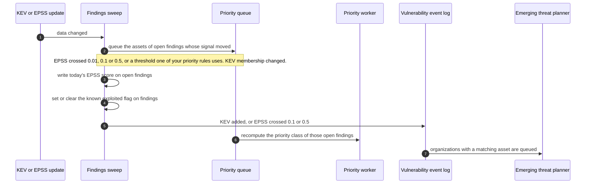

# KEV and EPSS updates
{: .no_toc }

Two public signals say whether a vulnerability is being exploited: the CISA
Known Exploited Vulnerabilities list (KEV) and the EPSS score, the chance it
is exploited in the next 30 days. They reach the platform as signed side files
of each vulnerability release. From v0.24.0 that is the only way: the platform
never calls CISA or FIRST itself, so an installation that does not receive the
vulnerability feed has no KEV flags and no EPSS scores
([Set up the vulnerability feed](../../operations/vulnerability-feed-setup.md)).
A change moves only the open findings it touches.

1. TOC
{:toc}

## The flow

### How a release copy is applied

1. Each release that carries KEV or EPSS counts as a check of that feed. A
   copy is applied only when it is signed for the release the platform just
   verified and its data date is newer than the data held. A replayed or older
   copy never rolls the data back.
2. When the release carries a copy the collector read longer ago than the
   feed's limit (KEV 6 hours, EPSS 36 hours), the feed fails with
   `source_stale`.
3. A copy with under 90 % of the stored entries is refused as truncated.
   When a KEV update would remove more than 25 entries, or more than 2 % of
   the list, at once, nothing is removed and the next update tries again.
4. **Sync now** on the KEV or EPSS card imports the newest vulnerability
   release.

### From a change to your findings

1. After every change, and at least once a day, the sweep compares open
   findings with the catalogs. Only the assets of findings whose signal moved
   in a way a priority rule can see are queued, never a whole organization.
2. Open findings get today's EPSS score, so a CI gate with an EPSS threshold
   sees the current value.
3. Findings whose vulnerability entered or left KEV get their known exploited
   flag set or cleared. The severity is not changed: KEV reaches the priority
   through the exploitation floor (see
   [Priority from threat intelligence](priority.md)).
4. A KEV addition, or an EPSS score that crosses 0.1 or 0.5, is recorded as a
   public event. The emerging threat planner turns it into alerts (see
   [Emerging threat alerts](emerging-threat-alerts.md)).
5. Closed findings are never changed.

## When something fails

| What happens | What you see | What to do |
|---|---|---|
| The vulnerability feed does not arrive | The KEV or EPSS card shows **Stale** (KEV after 6 hours, EPSS after 36 hours) or never loaded, and every user sees a banner | [Set up the vulnerability feed](../../operations/vulnerability-feed-setup.md) |
| A copy is under 90 % of the stored list | **Refused**. The data held stays | Nothing. The next good copy is applied |
| The release copy is old | `source_stale` on the card | Nothing to fix locally; it clears with a newer release |
| The findings sweep fails | A warning in the server log. Retried on the next run | Nothing |

## Security

- **Signed.** A release copy is verified with the feed's pinned root and bound
  to the release sequence. The platform makes no request to CISA or FIRST.
- **No rollback.** Data older than the data held is never applied.
- **Organization isolation.** KEV and EPSS are public, platform-wide data.
  Each organization's findings are updated with that organization's id in
  every statement, and another organization's priority rule thresholds never
  queue your findings.

## Related

- [Vulnerability and program feeds](../../operations/feeds.md)
- [Prioritization](../../user-guide/06-prioritization.md)
- [Feed delivery](feed-delivery.md)
