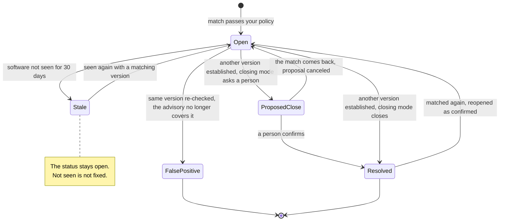
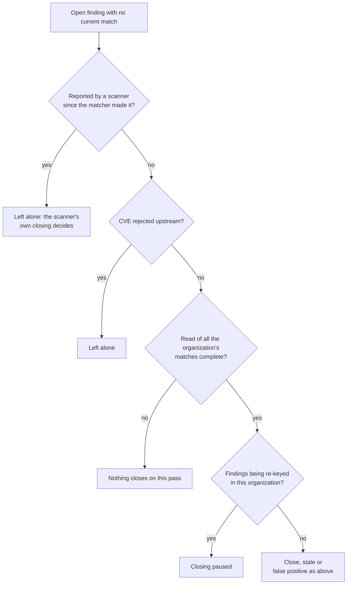

# Match close and reopen
{: .no_toc }

A finding that version matching opened is re-checked on every pass of the
matcher. It closes only for a reason it can show: the software moved to
another version, the advisory no longer covers the version, or the software
is no longer seen (which marks it stale, not fixed). It reopens when the
match comes back. A finding that a scanner also reported, or that a person
closed (accepted, false positive), is left alone.

1. TOC
{:toc}

## The flow

1. **Version changed.** Another version is established at the same place (a
   strong reading, or three scans in a row over at least 12 hours) and the
   finding's own version is superseded. The close follows your
   organization's closing mode: close it, propose it in **Ready to close**
   with the old and new versions as evidence, or keep it open.
2. **Software gone.** Nothing established and seen in the last 30 days at that
   place. The finding is marked stale and keeps its status.
3. **Advisory updated.** The same version was checked again against the
   current catalog and the CVE no longer covers it. The finding closes as a
   false positive with the reason **advisory updated**. It is never counted
   as fixed.
4. **Matched again.** A finding the matcher closed as fixed reopens as
   confirmed. A stale finding is marked present again. A pending version
   change proposal for a finding that matches again is canceled.
5. Every change is recorded on the finding's history as made by the software
   vulnerability matcher.

{: .note }
> From v0.20.0: a finding closes on a version change only after the new
> version has been checked against the catalog. Until then it stays open.
> When the new version is still affected, the finding stays open and records
> the version it is now seen on.

### What the matcher never closes

## When something fails

| What happens | What you see | What to do |
|---|---|---|
| A version flips between readings (load balancer, cache, rollout) | No close: alternating readings never establish a new version | Nothing |
| A finding closed wrongly as fixed | It reopens on the next pass that matches it | Check the version history on the asset's **Software** tab |
| A finding closed as advisory updated, and the advisory later covers the version again | It stays a false positive | Reopen it by hand |
| Too many matches for one pass | Nothing closes until the read fits | Narrow the matching policy |

## Security

- **Organization isolation.** Closing, reopening and proposals update only
  your organization's findings: every statement carries your organization's
  id, and the matcher touches only findings it owns.
- **One report cannot close a finding.** A new version must be established by
  strong evidence or repeated readings before it closes anything.
- **People and scanners win.** A finding a person closed, or a scanner
  reported, is never closed or reopened by the matcher. Only findings the
  matcher itself closed as fixed reopen.
- **Proposal evidence** holds inventory facts only: product, versions,
  source, evidence class, confidence and sightings.

## Related

- [Vulnerability matching](../../user-guide/vulnerability-matching.md)
- [Closing findings](../../user-guide/closing-findings.md)
- [Version matching](vulnerability-matching.md)
- [Automatic closing](../results/auto-close.md)
