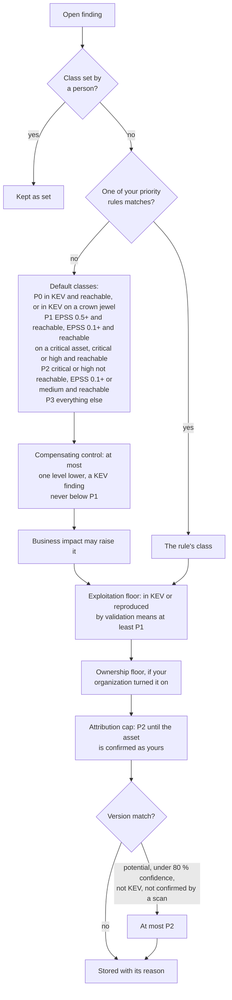
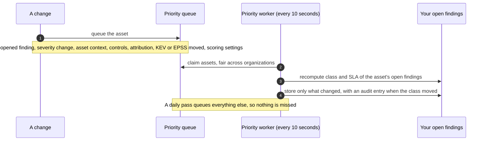

# Priority from threat intelligence
{: .no_toc }

Every open finding has a priority class from P0 (fix now) to P3. The class is
computed from the finding's vulnerability (KEV, EPSS, severity), how an
attacker can reach the asset, and how important the asset is. Your
organization's priority rules can change it, but platform floors keep a
known exploited finding at P1 or above. The class is recomputed whenever one
of these inputs changes.

1. TOC
{:toc}

## The flow

1. A class a person set by hand is kept. The explanation still shows what
   the engine would compute.
2. Your organization's priority rules are checked first, highest order
   first. The first that matches gives the class.
3. Otherwise the default classes apply. Reachable means internet-facing,
   reachable through tracked relationships, or on an open threat path. When
   nothing says whether the asset is reachable, exploitation evidence (KEV,
   or a high EPSS) still makes the finding P1.
4. An effective compensating control lowers the class by one level at most,
   never below P1 for a known exploited finding.
5. The exploitation floor runs after every rule: a finding whose
   vulnerability is in KEV, or that a validation reproduced, is at least P1.
6. The attribution cap runs last: a finding on an asset not yet confirmed as
   yours stays at P2 until someone confirms it.
7. A potential version match stays at P2 or lower, see
   [Version matching](vulnerability-matching.md).

{: .note }
> From v0.20.0: the potential match cap also holds when the class is
> recomputed (before, a recompute could raise such a finding again), and a
> version match on a provider's shared front end is capped at P3 unless a
> scan confirmed it. This cap runs after the exploitation floor.

### When the class is recomputed

1. Changes queue the asset whose findings need a new class. A KEV or EPSS
   change queues only the assets of open findings whose signal moved, see
   [KEV and EPSS updates](kev-epss.md).
2. The worker recomputes the class and the SLA deadline of the asset's open
   findings. Closed findings never change.
3. A daily pass queues every other open finding, for inputs no change
   watches (attack paths, the threat model).

## When something fails

| What happens | What you see | What to do |
|---|---|---|
| A class looks wrong | **Why it matters** on the finding page shows every input, the rule and the floors | Check the asset's exposure and criticality, or your rules |
| A rule cannot lower a KEV finding | The reason says the floor raised it | Expected. Use a compensating control or fix it |
| A finding stays at P2 though in a critical spot | The reason says the asset is not confirmed as yours | Confirm the asset's ownership |
| A recompute is pending | The explanation shows the class as stale | Wait a moment. The worker runs every 10 seconds |

## Security

- **Signals from untrusted input cannot lower a class.** An AI verdict never
  changes the class, and a rule cannot go below the floors.
- **Changing rules needs a recent sign-in**, and the rule dry run counts only
  the findings you can see.
- **Organization isolation.** Rules, reachability, controls and findings are
  read with your organization's id. Another organization's rule thresholds
  never queue your findings.

## Related

- [Prioritization](../../user-guide/06-prioritization.md)
- [KEV and EPSS updates](kev-epss.md)
- [Emerging threat alerts](emerging-threat-alerts.md)
