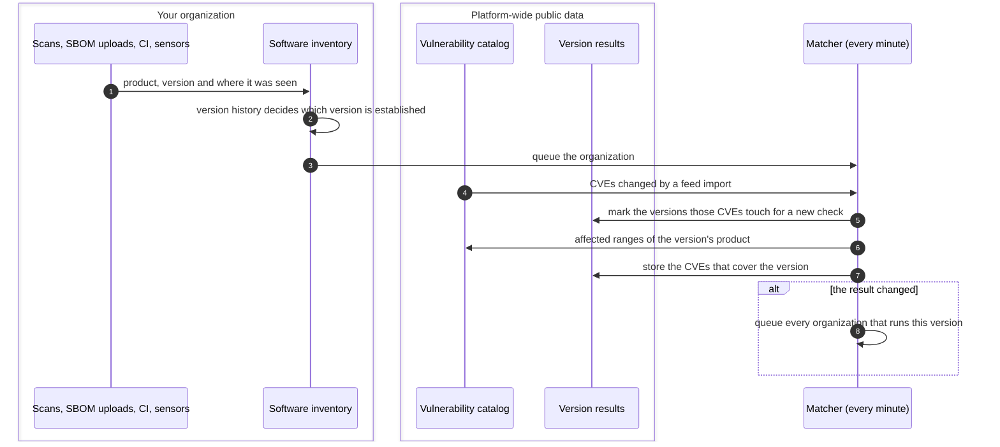
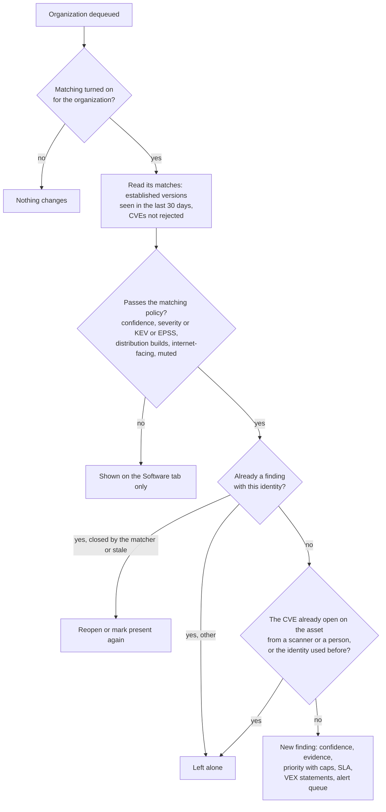

# Version matching
{: .no_toc }

The platform compares the software versions seen on your assets with the
affected version ranges of the vulnerability catalog. A match that passes
your organization's matching policy becomes a finding, without any scan of
the vulnerability itself. Matching runs every minute on new software and on
catalog changes, and every organization with software is swept once a day.

1. TOC
{:toc}

## The flow

### Software in, versions matched once

1. Every source writes to one software inventory: package lists from SBOM
   uploads, CI and sensors, and products with versions from service banners
   and technology detection.
2. For banners and detections the version history decides which version an
   asset runs at a place. A new version replaces the old one only on strong
   evidence (an inventory, an SBOM, or an active probe at confidence 80 or
   more) or after three scans in a row over at least 12 hours. Only
   established versions are matched.
3. A new observation, SBOM or dependency report queues the organization for
   the matcher.
4. A feed import moves the sync time of the CVEs it changed. The matcher marks
   every version of the products those CVEs name for a new check.
5. Each distinct version is checked once for all organizations, comparing it
   the way its ecosystem orders versions. A version that does not parse is
   never guessed at. When its result changes, every organization that runs it
   is queued.

### One organization's findings

1. The matcher reads only the organization's own matches. A match is the
   organization's software link joined with the public version result.
2. Your policy (**Settings > Findings & assets > Risk and threats >
   Vulnerability matching**) decides what becomes a finding: minimum
   confidence, minimum severity (a CVE in KEV or with EPSS 0.1 or more always
   passes), distribution builds, internet-facing only, muted products.
3. A package match uses the same identity as a scanner's report of that
   package and CVE, so the two are one finding. A finding of that identity in
   any state (closed as a false positive, accepted, closed by a VEX statement)
   stops the matcher from creating it again.
4. A new finding gets its priority from the same engine as every finding.
   Below 80 % confidence a match is **potential**: it stays at P2 or lower
   unless the CVE is known exploited or a scan confirmed it.
5. The vulnerabilities of new findings are queued for
   [Emerging threat alerts](emerging-threat-alerts.md).

{: .note }
> From v0.20.0: a match on a host that a provider's shared front end serves
> (a CDN or WAF edge, or shared hosting) is attributed to the provider and
> capped at P3 unless a scan confirmed it. The potential match cap also holds
> when the priority is recomputed later. When the product moves to another
> version that the CVE still covers, the finding stays open and records the
> new version. An unreadable catalog stops the run before anything changes.

## When something fails

| What happens | What you see | What to do |
|---|---|---|
| A product the catalog does not know | **No CPE match: CVEs not checked** on the asset's **Software** tab | Nothing, or report the product name |
| A version that does not parse | No match for that version | Nothing. It is never guessed |
| An organization has more matches than one pass reads (100,000) | Findings are created and reopened, nothing is closed, and the server logs an error | Narrow the policy or report it |
| One organization fails | It is queued again for the next run. Others continue | Nothing |
| A pass runs out of time (4 minutes) | The rest waits for the next minute | Nothing |

## Security

- **Organization isolation.** Every read and write of software links,
  matches and findings carries your organization's id. Version results are
  public data shared by all organizations and hold no organization data.
- **Only the feed writes shared rows.** What a scan observes never creates a
  shared product or alias. A name that is not public stays private to your
  organization.
- **A weak reading cannot change history.** One banner cannot replace an
  established version, and a sensor that reports false versions cannot close
  findings with one report.

## Related

- [Vulnerability matching](../../user-guide/vulnerability-matching.md)
- [Match close and reopen](match-close-reopen.md)
- [Feed delivery](feed-delivery.md)
- [Asset identity](../results/asset-identity.md)
