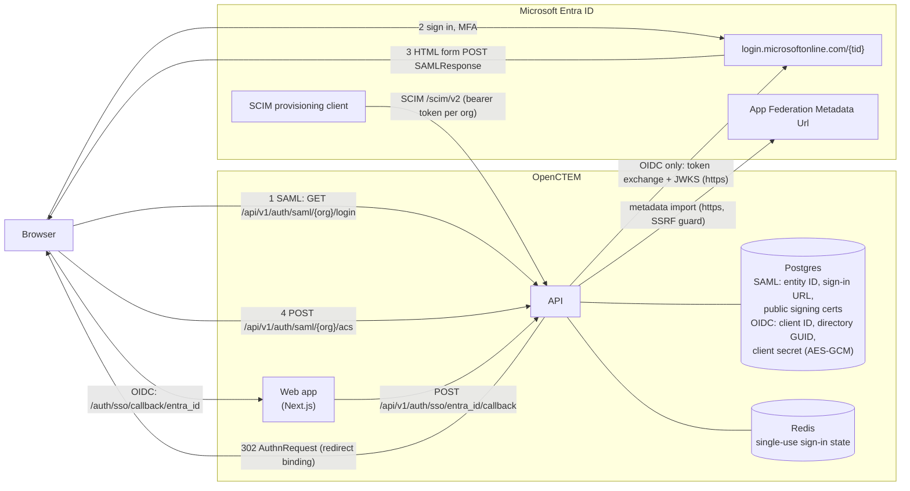

# Single sign-on with Microsoft Entra ID

OpenCTEM has two independent ways to sign in with Microsoft. They do not share configuration.

| | Organization SSO (recommended) | Social "Sign in with Microsoft" |
|---|---|---|
| Purpose | Members of one organization sign in through that organization's Entra directory | A generic button on the login page for the whole installation |
| Configured by | Platform administrator in the admin console, approved by the organization owner | Operator, with `OAUTH_MICROSOFT_*` environment variables |
| Directory | The organization's own directory (single tenant) | Any Entra directory (`/common`) |
| Joins people to an organization | Yes, just-in-time for DNS-verified domains, if enabled | No |
| Counts as the organization's SSO (SSO enforcement, 2FA requirement) | Yes | No |
| Redirect URI | `https://<app>/auth/sso/callback/entra_id` | `https://<app>/auth/callback/microsoft` |

`<app>` is the public origin of OpenCTEM, the address people open in the browser (`APP_URL`; with the
bundled gateway `OPENCTEM_PUBLIC_URL`, by default `https://<OPENCTEM_HOSTNAME>`). It is not the
platform admin console's own site.

You can also connect Entra ID with [SAML 2.0](sso-saml.md) instead of OIDC, and provision users with
[SCIM](scim.md).

## How it fits together

Organization SSO with Entra ID has two variants. **SAML is the default**: the
platform holds only Entra's public signing certificate(s), no Entra secret.
**OIDC** (Steps 1 to 5 below) needs a client secret, stored encrypted. Both admit people
into one organization; neither can open the platform admin console.

### Setup: who does what, where (SAML)

```mermaid
sequenceDiagram
    autonumber
    actor PA as Platform admin<br/>(admin console)
    actor EA as Entra admin<br/>(Entra admin center)
    actor OO as Organization owner<br/>(OpenCTEM, Settings)
    participant API as OpenCTEM API
    participant ENTRA as Microsoft Entra ID

    PA->>API: Organization > Single sign-on > SAML > Download SP metadata (XML)
    API-->>PA: SP metadata (entity ID, ACS URL, built on APP_URL)
    PA->>EA: hand over the SP metadata file
    EA->>ENTRA: Enterprise applications > New > Create your own (non-gallery)<br/>Single sign-on > SAML > Upload metadata file
    EA->>ENTRA: Attributes & Claims: Name ID = user.objectid (Persistent),<br/>keep emailaddress + name; assign users and groups
    ENTRA-->>EA: App Federation Metadata Url
    EA->>PA: hand over the App Federation Metadata Url
    PA->>API: SAML > Import from metadata (paste the URL)
    API->>ENTRA: GET federation metadata (https only, SSRF guard, 1 MiB, 10 s)
    ENTRA-->>API: entity ID, sign-in URL, signing certificate(s)
    API-->>PA: form filled in (nothing saved yet)
    PA->>API: Enable SAML login + Save
    alt organization has an owner
        API-->>OO: pending change (in-app + email)
        OO->>API: Settings > Access & security > SSO approvals > Approve (step-up)
    end
    PA->>API: Verified domains: add domain, publish TXT, Verify now
    API->>API: DNS TXT lookup (_openctem-verify.domain)
    PA->>API: test: https://app/login?org=slug signs in through Entra
    PA->>API: optional: Require single sign-on (preconditions checked)
```

The OIDC variant (Steps 1 and 2 below) replaces steps 1 to 9: the Entra admin registers an app
(App registrations), adds the redirect URI `https://<app>/auth/sso/callback/entra_id`
and the optional ID token claims `xms_edov` (required) and `auth_time`, creates
a client secret, and hands over the client ID, the **Directory (tenant) ID
GUID** and the secret, which the platform admin enters on the Entra ID form.

### Connections: what talks to what, and who holds what



- The browser carries every SAML message (SP-initiated redirect out, form POST
  back to the ACS). The API calls Microsoft only to import metadata (SAML) or
  to redeem the code and fetch signing keys (OIDC).
- **No logout channel.** Entra sends no back-channel logout and does not tell
  OpenCTEM when a user is disabled or deleted. Access ends through SCIM
  ([SCIM](scim.md): unassigning or deleting the user offboards the membership,
  effective on the next request), by removing the member, or when the session expires.
- SAML holds no Entra secret. The OIDC client secret is write-only in every API
  response and never logged.

### Sign-in sequence and refusals

```mermaid
sequenceDiagram
    autonumber
    actor U as Person
    participant B as Browser
    participant API as OpenCTEM API
    participant E as Entra ID

    U->>B: https://app/login?org=slug, choose the organization's sign-in
    B->>API: start (SAML login, or OIDC authorize)
    API->>API: state: single use, bound to this browser,<br/>nonce + PKCE (OIDC), request id (SAML)
    API-->>B: redirect to Entra
    B->>E: authenticate (password, MFA by Conditional Access)
    E-->>B: SAMLResponse (form POST) or code (redirect)
    B->>API: ACS POST, or callback with code + state + binding
    alt SAML
        API->>API: one signed assertion, configured cert(s), no SHA-1,<br/>audience, destination, InResponseTo, replay cache
    else OIDC
        API->>E: redeem code (secret + PKCE verifier), JWKS
        API->>API: id_token signature, aud, exp/nbf/iat, nonce,<br/>iss == login.microsoftonline.com/{tid}/v2.0
    end
    break issuer/tid differs from the configured directory, bad signature, replayed state
        API-->>B: refused (SSO_INVALID_ID_TOKEN / SSO_INVALID_STATE / saml_failed)
    end
    API->>API: identity: Entra oid (+ tid), never the email<br/>OIDC: email trusted only with xms_edov
    break xms_edov missing (OIDC)
        API-->>B: refused (EMAIL_UNVERIFIED_AT_IDP)
    end
    API->>API: account: bound oid, else email under proof-before-link
    break password account, or another Entra user bound to the email
        API-->>B: refused (ACCOUNT_LINK_REQUIRED / SSO_DIFFERENT_METHOD)
    end
    API->>API: membership: member, or just-in-time when auto-provision is on<br/>and the email domain is DNS-verified for the organization
    break domain not verified, not allowed, or JIT off
        API-->>B: refused (SSO_NOT_A_MEMBER / SSO_DOMAIN_NOT_ALLOWED)
    end
    API->>API: session for this organization, MFA evidence recorded<br/>(OIDC amr contains mfa; SAML AuthnContext multipleauthn)
    API-->>B: signed in
    B->>API: enter the organization
    break organization requires IdP MFA evidence and the session has none
        API-->>B: refused (MFA_IDP_EVIDENCE_REQUIRED): sign in again with MFA
    end
```

For SAML, the steps are in [SAML 2.0](sso-saml.md) (download our metadata, upload it in Entra, import
Entra's App Federation Metadata Url, verify the domain, test).

## Step 1: Register the application in Entra ID

In the Azure portal, **Microsoft Entra ID > App registrations > New registration**:

1. **Name:** for example `OpenCTEM`.
2. **Supported account types:** *Accounts in this organizational directory only* for organization
   SSO. Choose *Accounts in any organizational directory* only for the social button.
3. **Redirect URI**, platform **Web**: the URI from the table above, exactly (scheme, host, port and
   path). A mismatch gives Azure error `AADSTS50011`.
4. **Certificates & secrets > New client secret.** Copy the secret **Value** (not the Secret ID).
   Note its expiry date: sign-in stops when it expires.
5. **Overview:** copy the **Application (client) ID** and the **Directory (tenant) ID**.
6. **API permissions:** delegated Microsoft Graph `openid`, `email`, `profile` and `User.Read`.
   Grant admin consent if your directory requires it. No application permissions are needed.
7. **Token configuration > Add optional claim > ID**, and add:
   - `xms_edov` (required): "email domain owner verified". OpenCTEM trusts the email address of an
     Entra sign-in only when this claim is `true`. Without it, every Microsoft sign-in is refused.
     Accept the prompt to turn on the Microsoft Graph email permission.
   - `auth_time` (recommended): needed for [step-up re-authentication](two-factor.md#step-up-re-authentication)
     of SSO users who have no authenticator. Without it they cannot perform protected actions.

Because organization SSO is pinned to your directory (the token's `tid` must equal the Directory
(tenant) ID you enter), accounts of other directories and personal Microsoft accounts are refused.
`xms_edov` must also be true, so a user whose email domain is not verified in your directory is
refused.

## Step 2: Configure organization SSO

Organization SSO is configured by a **platform administrator** (super admin, with a fresh
authenticator code for every change) in the admin console, not by the organization's own admins:

1. **Console > Customers > Organizations >** the organization **> Single sign-on** (tab).
2. Under **Verified domains**, add the organization's email domain. Publish the TXT record shown:

   | Host | Type | Value |
   |---|---|---|
   | `_openctem-verify.example.com` | TXT | `openctem-domain-verification=<token>` |

   Then select **Verify now**. A domain can be verified for SSO by only one organization on the
   installation; public email providers, disposable-email domains and public suffixes are refused.
3. Under **Identity providers**, open **Microsoft Entra ID**. The form opens with **Set up in
   Microsoft Entra ID**: the **Redirect URI (type: Web)** with a copy button, and the optional ID token claims to add (`xms_edov` required, `auth_time`). The addresses come from `APP_URL` on the API; without it the form says so. Okta and Google
   Workspace show their redirect URI the same way. Fill in:

   | Field | Value |
   |---|---|
   | Display name | The button label, for example `Sign in with Contoso` |
   | Directory (Tenant) ID | Directory (tenant) ID, the GUID from the app's Overview. Required: `common`, `organizations`, `consumers` and domain names are refused. |
   | Client ID | Application (client) ID |
   | Client secret | The secret value. It is stored encrypted with `APP_ENCRYPTION_KEY`. |
   | Allowed email domains | Optional. Narrows which verified domains may sign in. |
   | Auto-provision users | On to create memberships at first sign-in (just-in-time) |
   | Default role | `viewer` (default) or `member`. SSO never provisions admins or owners. |
   | Status | Active or not |

   The scopes are `openid email profile User.Read` unless a custom list (which must include `openid`)
   is sent with the admin API (`scopes` on `POST /api/v1/admin/tenants/{tenantId}/sso/identity-providers`).

4. If the organization already has an owner, the change is **pending** until an owner approves it in
   the organization under **Settings > Access & security > SSO approvals** (with step-up re-authentication). The owner
   sees the change and is notified in the app and by email. Pending changes expire after 7 days. An
   organization with no owner yet gets the change applied directly.


*Figure: Admin console, organization, Single sign-on.*


*Figure: The owner approves the change under Settings, Security, SSO approvals.*

Users then sign in at `https://<app>/login?org=<organization-slug>` and choose the provider.

### Who is admitted

- An **existing member** signs in when their account is already bound to this Entra user, or when
  their account has no password yet (for example invited or SCIM-provisioned), the Entra account's
  verified email matches it and the email domain is verified for the organization. A member who
  has a password signs in with it once and links Entra under **Account > Security** (with their
  second factor); SSO never takes over a password account by itself.
- A **new person** is provisioned just in time only when auto-provision is on, their email domain is
  DNS-verified for the organization, it is in the provider's allowed domains (if set), and it is in
  the organization's allowed email domains (if set). They get the provider's default role.
  Otherwise they must be [invited](sign-up-and-invitations.md).
- An account created by another method (for example a password account) is not taken over by an SSO
  sign-in with the same email.
- After the first sign-in the account is bound to the Entra object id (`oid`), so a later email
  change in Entra follows the same account.

### Enforcing SSO

A platform administrator can turn on **Require single sign-on** for the organization (admin console,
same tab). The card lists its preconditions and turns on only when all hold:

- a working provider exists (SAML or OIDC);
- at least one of the organization's domains is verified for SSO (DNS TXT record);
- an owner or admin has signed in through the organization's identity provider at least once
  ("Waiting for an owner or admin to sign in through the identity provider once");
- an owner has two-factor authentication on, so owner break-glass works ("Waiting for an owner to
  turn on two-factor authentication").

Otherwise the API refuses with 400. Turning it on also revokes the user API keys and AI (MCP)
connections that exist at that moment; the card shows their counts, and the option (or
`revoke_credentials=false` in the API) keeps them. Keys and connections made later from an SSO
sign-in keep working.

If a verified domain later fails its daily DNS check, it stops admitting new people, and the owners
and admins are alerted. SSO stays required, so removing the DNS record cannot reopen password
sign-in. Members must then sign in through the organization's identity provider; a password session,
a social sign-in or another organization's SSO is refused for this organization (`SSO_REQUIRED`).

An **owner** can still get in with a password **and their second factor** (break-glass), so the
organization cannot be locked out. Each such sign-in is written to the audit log as
`sso.break_glass_used` and announced to the other owners and admins. An owner without two-factor is
refused with a message to turn it on or use the identity provider.

The owner can grant time-limited exceptions to named members (`sso_exceptions`, at most 90 days, 2FA
required; an invitation to someone outside the organization says so when SSO is enforced).

An owner can also turn on **Approve new SSO members** (`jit_requires_approval`, owner with step-up): people the
organization's SSO admits for the first time wait with no access until an administrator approves them
under **Settings > Access & security > Members**; rejecting offboards them.

The platform administrator can also choose, per verified domain, whether new people from that domain
are admitted at all and in which role (**New people** action on the domain: **Admit new people**,
and **Identity provider default**, Viewer or Member).

## Step 3: Optional: one shared Entra app for selected organizations

An operator can run one Entra app registration for several organizations with environment variables.
The fallback applies only to organizations listed in `SSO_ENTRA_ALLOWED_TENANTS` that have no Entra
provider of their own, and the same admission rules apply.

| Variable | Default | Meaning |
|---|---|---|
| `SSO_ENTRA_ENABLED` | `false` | Turns the fallback on |
| `SSO_ENTRA_CLIENT_ID`, `SSO_ENTRA_CLIENT_SECRET` | | App registration credentials |
| `SSO_ENTRA_TENANT_ID` | `common` | Directory id. With `common`, `organizations` or `consumers`, `SSO_ENTRA_ALLOWED_DOMAINS` is required and auto-provisioning is turned off |
| `SSO_ENTRA_ALLOWED_DOMAINS` | empty | Comma-separated email domains |
| `SSO_ENTRA_DEFAULT_ROLE` | `viewer` | `viewer` or `member` |
| `SSO_ENTRA_AUTO_PROVISION` | `true` | Just-in-time provisioning |
| `SSO_ENTRA_DISPLAY_NAME` | `Microsoft Entra ID` | Button label |
| `SSO_ENTRA_ALLOWED_TENANTS` | empty (fallback off) | Comma-separated organization slugs allowed to use the fallback |

## Step 4: When someone leaves

Microsoft Entra ID does not send OpenID Connect back-channel logout, and it does not tell OpenCTEM
when a user is disabled or deleted. Signing out of Microsoft or disabling the user in Entra does
**not** end that person's OpenCTEM sessions. Do not enter an OpenCTEM address as the app's
**Front-channel logout URL**: OpenCTEM does not support front-channel logout.

To remove access as soon as someone is removed in Entra:

- turn on [SCIM provisioning](scim.md): removing or unassigning the user in Entra offboards their
  membership in the organization, which takes effect on their next request;
- or remove the member in OpenCTEM (**Settings > Members**), or revoke their sessions.

Otherwise a session ends when it expires (`AUTH_SESSION_DURATION`, 30 days by default) or its refresh
token is not used for `AUTH_REFRESH_TOKEN_DURATION` (7 days by default).

## Step 5: Redirect URI allow-list

The API accepts only redirect URIs on an exact-match allow-list. Set it explicitly:

```bash
SSO_ALLOWED_REDIRECT_URIS=https://app.example.com/auth/sso/callback/entra_id
```

When unset, it is derived from `CORS_ALLOWED_ORIGINS`, `OAUTH_FRONTEND_CALLBACK_URL` and
`SMTP_BASE_URL`. The callback must present the same redirect URI as the sign-in that started it.

## Social sign-in with Microsoft

The installation-wide "Sign in with Microsoft" button is a separate feature with its own registration
and its own redirect URI. See [Social login with Microsoft](social-microsoft.md).

## Troubleshooting

| Symptom | Cause |
|---|---|
| `404 SSO provider not configured` | Wrong or missing `?org=` slug, no active `entra_id` provider for the organization, or a pending change not yet approved by the owner. For the env fallback: the slug is not in `SSO_ENTRA_ALLOWED_TENANTS`. |
| `AADSTS50011` | The redirect URI in Azure does not exactly match `https://<app>/auth/sso/callback/entra_id`. |
| `invalid redirect URI` | The callback is not in `SSO_ALLOWED_REDIRECT_URIS`. |
| Sign-in refused after Microsoft authentication | `xms_edov` claim missing or false; `email` claim missing (add the `email` optional claim or scope); the token's directory does not match the configured Directory (tenant) ID; `openid` missing from the scopes. |
| `SSO provider not configured` for an organization that has an Entra provider | The provider has no Directory (tenant) ID GUID (an empty value, `common` or a domain name was saved before it became required). Set the GUID in the admin console. |
| A person disabled in Entra can still use OpenCTEM | Entra sends no logout to OpenCTEM. Turn on SCIM provisioning, or remove the member (step 4). |
| "An account with this email already exists" (`ACCOUNT_LINK_REQUIRED`) | The address has a password account. Sign in with the password and second factor, then link the organization's sign-in from your account. |
| "Your identity provider must confirm a second factor" (`MFA_IDP_EVIDENCE_REQUIRED`) | The organization requires IdP MFA evidence. Enforce MFA for the app with Conditional Access: OIDC tokens then carry `amr` `mfa`, SAML assertions the `multipleauthn` context. Sign in again. |
| SAML: back on the sign-in page with `error=saml_failed` | Certificate not Entra's current one (import the metadata again), Identifier or Reply URL differs from our SP metadata, SHA-1 signing, clock skew, or a response not started from OpenCTEM's sign-in page. |
| `AADSTS50105` / `AADSTS700016` | User or group not assigned to the enterprise application / the Identifier differs from our SP entity ID. |
| "not a member of this organization" | Just-in-time provisioning was not allowed: verify the domain, turn on auto-provision, or invite the user. |
| "email is registered with a different login method" | The account belongs to another sign-in method or another Entra user. This is the account-takeover guard. |
| Protected actions say "sign in again" and then fail | Add the `auth_time` optional claim, or have the user enrol an authenticator. |

The engineering reference is
[sso-authentication.md](https://github.com/openctemio/openctem/blob/develop/api/docs/architecture/sso-authentication.md).
