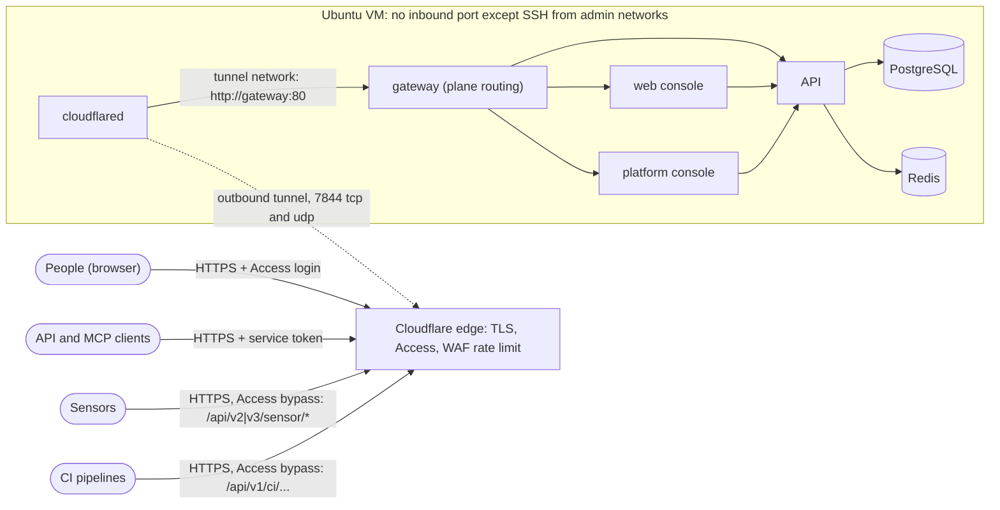

# Deploy with Cloudflare Tunnel and Access
{: .no_toc }

Install OpenCTEM on one Ubuntu VM that accepts **no inbound connection except SSH
from your administrator networks**. A tunnel connector on the VM dials out to
Cloudflare; Cloudflare terminates TLS, makes people sign in through your identity
provider (Access), lets sensors and CI through on their exact paths only, and
rate-limits those paths.

Read [Install with Ansible](ansible.md) first for the VM, the controller, the
inventory and the stages; this page adds what is specific to Cloudflare. Without
Cloudflare, use [Deploy without Cloudflare](ansible-without-cloudflare.md).

1. TOC
{:toc}

---

## How it fits together



- **One origin for everything people and machines use**: `https://ctem.example.com`
  (your `openctem_app_host`). The gateway on the VM routes each path to the web console
  or the API.
- **The platform console is another origin**: `https://admin.example.com` (your
  `openctem_admin_host`), another container and process, with its own Access application
  for platform administrators only.
- **The tunnel is the origin's only way in.** The connector reaches only the gateway, on an
  internal Docker network. Postgres and Redis are reachable only from the API.
- **Bypass is not "no authentication".** The machine paths skip the identity-provider
  login because a sensor or a CI job cannot complete one. They still need their own
  credentials in OpenCTEM: a sensor key and signed jobs, or a CI provider's OIDC token and
  then a 15-minute run token.

## Before you start

- The VM, controller, age key and the rest of the [prerequisites](ansible.md#prerequisites).
- A Cloudflare account with your DNS zone, and **Zero Trust** (the free tier is enough)
  with your identity provider connected. Know your Zero Trust team name (the
  `<team>.cloudflareaccess.com` domain).
- Two names in that zone: `ctem.example.com` for the platform and `admin.example.com` for
  the platform console. Use your own names throughout.
- Outbound 7844/tcp and 7844/udp from the VM to Cloudflare must be allowed by whatever
  sits between the VM and the internet. Tunnels try QUIC (udp) first and fall back to
  HTTP/2 (tcp).

{: .important }
Do the Cloudflare work in the order of this page: the **Access applications first,
the tunnel route and DNS last**. A host name that reaches the tunnel before its Access
application exists is reachable without a login. The platform console above all must
never be published without its Access application.

## Step 1: controller and inventory

Set up the controller as in [Set up the controller](ansible.md#set-up-the-controller),
then edit `group_vars/all.yml`:

```yaml
openctem_app_host: ctem.example.com
openctem_version: v0.10.1

openctem_ingress: cloudflared          # the default
cloudflared_management: remote         # or local, see step 3

admin_cidrs:
  - 192.0.2.0/24                       # where you administer from (SSH)

# Platform console on its own host name, behind its own Access application.
openctem_admin_site: host
openctem_admin_host: admin.example.com
# Behind the tunnel the client is the visitor Access let through. The default
# (private networks) would refuse every visitor. List your staff's egress
# ranges, or, when Access is the gate, every address:
openctem_admin_allowed_cidrs: ['0.0.0.0/0', '::/0']

backup_age_recipient: age1...          # your public key, see Backups
backup_offsite_command: ''             # set it, see Backups
monitoring_webhook_url: "{{ vault_monitoring_webhook_url | default('') }}"
```

| Variable | What it does in this path |
|---|---|
| `openctem_ingress: cloudflared` | Adds the `cloudflared` service (`compose.cloudflared.yml`); no container publishes a port. |
| `cloudflared_management` | `remote`: the tunnel's route is set in the dashboard (step 6). `local`: the role writes `/opt/openctem/cloudflared.yml` with the route and mounts it into the connector (step 3). |
| `openctem_admin_site: host` and `openctem_admin_host` | The platform console as its own service on its own host name; the role adds that host name to a locally managed tunnel's route file. |
| `openctem_admin_allowed_cidrs` | The gateway admits only these client addresses to the console. The address is the visitor's, taken from Cloudflare's `Cf-Connecting-Ip` header. |
| `monitoring_external_probes` | Leave `true`: the monitor checks the tunnel path, Access and the edge certificate from outside. |

The allow-list needs care. Because the client is the visitor, the default list of private
networks blocks everyone and the console answers 403 after the Access login. Two correct
choices: list your administrators' egress ranges (a second wall, but it breaks when they
roam or use a different network), or admit every address and let Access be the only gate.
With every address allowed the gateway logs a warning at start, which is expected; the
consequence is that **the Access application of `admin.example.com` is the
only network-level protection**, so never remove it, never add a Bypass rule for that
host, and keep its policy short.

## Step 2: prepare the VM and install the host stages

From the controller, one stage at a time, following [the apply cycle](ansible.md#the-apply-cycle)
(preflight, snapshot, `--check --diff`, apply):

```bash
ansible-playbook -i $INV playbooks/00-preflight.yml -K
ansible-playbook -i $INV playbooks/10-os.yml -K -e apply_os=true
ansible-playbook -i $INV playbooks/20-ssh.yml -K -e apply_ssh=true
# open a NEW ssh session with your key; only then:
ansible-playbook -i $INV playbooks/20-ssh.yml -K -e apply_ssh=true -e ssh_stage=2
ansible-playbook -i $INV playbooks/30-docker.yml -K -e apply_docker=true -e docker_daemon_restart=true
ansible-playbook -i $INV playbooks/35-firewall.yml -K -e apply_firewall=true
```

After this the VM drops everything inbound except SSH from `admin_cidrs`. Keep the
hypervisor console open during the SSH and firewall stages.

## Step 3: create the tunnel and place its token

1. In the Cloudflare dashboard open Zero Trust, **Networks, Tunnels, Create a tunnel**,
   choose **Cloudflared** and name it, for example `openctem`.
2. On "Install and run a connector" choose **Docker** and copy only the **token**, the long
   string after `--token`. Do not run the command: the kit runs the connector.
3. On the VM (SSH or console), put the token in place without echoing it into your
   shell history or a log:

   ```bash
   sudo install -d -m 0700 -o root -g root /opt/openctem/secrets
   sudo sh -c 'umask 077; cat > /opt/openctem/secrets/cloudflared_tunnel_token'   # paste, Enter, Ctrl-D
   sudo chown 65532:65532 /opt/openctem/secrets/cloudflared_tunnel_token
   sudo chmod 0400 /opt/openctem/secrets/cloudflared_tunnel_token
   ```

   Use numeric ids for `chown` as shown; on Ubuntu 26.04 `install -o 65532` fails because
   that uid has no passwd entry. The kit checks only the file's owner and mode, never its
   content.
4. **Which kind of tunnel is it?** The tunnel's page says so.
   - **Remotely managed**, the dashboard default: you set the route in the dashboard
     (step 6). Keep `cloudflared_management: remote`.
   - **Locally managed**, created with `cloudflared tunnel create`: the dashboard says "This
     tunnel is locally managed. Routes are configured via the local configuration file" and
     cannot add a route. Set `cloudflared_management: local`. The role then writes
     `/opt/openctem/cloudflared.yml` with exactly these rules: `openctem_app_host` to
     `http://gateway:80`, the console host (host mode) to `http://gateway:80`, and
     everything else a 404. Skip step 6, but you still need DNS (step 7).

   Either way the symptom of a missing route is the same: every request returns 503 and
   the connector logs `No ingress rules were defined`.

## Step 4: create the Access applications (before anything is published)

In Zero Trust open **Access, Applications, Add an application, Self-hosted**. The menu
names are those of the Zero Trust dashboard in 2026; the settings matter more than the
labels.

### 4.1 The platform, for people

- Application name `OpenCTEM`; public hostname `ctem.example.com`, **path empty** (the
  whole host).
- Session duration 8 to 24 hours. OpenCTEM keeps its own, shorter sign-in on top.
- Identity providers: yours only. Turn off the one-time PIN unless you mean to use it.
- Policy **Allow people**: Action *Allow*; Include *Emails ending in* your domain, or better
  an identity-provider group; Require *Authentication method, mfa*. Optionally require device
  posture (WARP) if the console must be reachable only from managed devices.
- Settings: cookie **SameSite Lax**, **HTTP Only** on, **Binding Cookie** on; CORS off (one
  origin).

### 4.2 The platform console

A second application named `OpenCTEM platform console`, public hostname
`admin.example.com`, path empty, with a policy for your **platform administrators only**
(a group of a few named people, MFA required, hardware-key MFA where your identity provider
offers it, a short session of about 8 hours). **No Bypass policy, no service-token policy.**
No machine calls the console. The identity provider of the console redirects to
`https://admin.example.com/login/callback`.

### 4.3 Machine paths: Bypass applications

Create **one self-hosted application per machine path**. Access uses the most specific
matching application, so these win over 4.1 for their paths only.

| Application name | Public hostname | Path | Caller |
|---|---|---|---|
| `OpenCTEM sensors v2` | `ctem.example.com` | `api/v2/sensor/*` | sensors (enrollment, hello, heartbeat, commands, results) |
| `OpenCTEM sensors v3` | `ctem.example.com` | `api/v3/sensor/*` | sensors, HTTPS transport of protocol v3 |
| `OpenCTEM CI exchange` | `ctem.example.com` | `api/v1/ci/oidc/exchange` | CI: exchange the job's OIDC token for a run token |
| `OpenCTEM CI runs` | `ctem.example.com` | `api/v1/ci/runs/*` | CI: upload results, baseline diff, gate |

For each: one policy, **Bypass**, Include **Everyone**. A Bypass policy must be the only
policy of its application. No identity providers are needed. Check the path field: no leading
slash, `*` only at the end, and never a shorter prefix such as `api/*` or `api/v1/*`.

What authenticates them in OpenCTEM: sensors use an enrollment token and then their key
(jobs are signed when the job signer is on); the CI exchange needs the CI provider's OIDC
token, checked against a trust configuration; `ci/runs` needs the run token (15 minutes, one
run, one repository). `api/v1/ci/runs` also serves two console reads that still need a
signed-in session and the `scans:ci:read` permission, so the bypass removes only the
identity-provider step in front of them.

**Add these only if you use them**, each with the same Bypass policy (each one authenticates
itself in the API):

| Path | Use |
|---|---|
| `hooks/*` | inbound webhooks (Jira and others), HMAC per organization |
| `scim/v2/*` | user provisioning from your identity provider, SCIM bearer token |
| `api/v1/auth/backchannel-logout` | OIDC back-channel logout, called by your identity provider |

**Never bypass**: the console, `/api/v1/*`, the platform console and `/api/v1/auth/*`.
SAML and OIDC sign-in callbacks pass through the user's browser, which already holds an
Access session.

### 4.4 API and MCP clients: service tokens

Scripts with an `oct_` API key and MCP clients are not browsers and cannot do an
interactive Access login. Give them an Access **service token**:

1. Zero Trust, **Access, Service credentials, Service Tokens, Create**: name it for the
   client (one token per client, so you can revoke one), choose a duration, and copy the
   **Client ID** and **Client Secret** now; the secret is shown once. Calendar the expiry.
2. On the application of 4.1 add a policy **Automation**: Action **Service Auth**, Include
   the token. Order it after **Allow people**.
3. The client sends both headers on every request, next to OpenCTEM's own credential:

   ```bash
   curl https://ctem.example.com/api/v1/me \
     -H "CF-Access-Client-Id: <client id>.access" \
     -H "CF-Access-Client-Secret: <client secret>" \
     -H "Authorization: Bearer oct_..."
   ```

   An MCP client that lets you set request headers does the same toward
   `https://ctem.example.com/api/v1/mcp`.

The service token gets a request past Access; the API key or OAuth token still has to pass
OpenCTEM's checks and permissions. Do not bypass `/api/v1/` for this.

**Assistants that connect with OAuth from the provider's cloud** (the usual way, see
[Connect an AI assistant](../user-guide/12-connect-an-ai-assistant.md)) are not browsers and
cannot send those headers either. If you want them, add Bypass applications for the paths the
assistant's servers call: `api/v1/mcp*`, `.well-known/oauth-protected-resource*`,
`.well-known/oauth-authorization-server*`, `oauth/token*` and `oauth/revoke*`. Leave
`oauth/authorize` and `oauth/register` behind Access: the person's browser, which has an
Access session, opens the consent page. This is an opt-in with a cost: the MCP endpoint is
then reachable from the internet and protected only by OpenCTEM's own OAuth tokens, the
organization's [AI assistant policy](../user-guide/12-connect-an-ai-assistant.md) and your rate
limit (step 5). Test with your assistant before relying on it, and add these paths to the WAF
rule.

## Step 5: WAF rate limit on the bypassed paths

Access does not rate-limit a Bypass path; the zone's WAF does. Security, **WAF, Rate limiting
rules, Create rule** on the zone of your domain:

- Name `OpenCTEM machine paths`. Expression:

  ```
  (http.host eq "ctem.example.com" and (
     starts_with(http.request.uri.path, "/api/v2/sensor/") or
     starts_with(http.request.uri.path, "/api/v3/sensor/") or
     http.request.uri.path eq "/api/v1/ci/oidc/exchange" or
     starts_with(http.request.uri.path, "/api/v1/ci/runs/")))
  ```

- Characteristic **IP**. On the Free plan one rule with a 10-second period is allowed:
  **200 requests per 10 seconds, then block for 10 seconds**. On Pro or higher use two rules:
  sensors at 1200 a minute per IP, and the CI exchange at 600 a minute per IP, each blocking
  for 10 minutes.
- Hosted CI runners put many customers behind one egress address, so a strict per-IP limit on
  the exchange throttles all of them at once; the API limits the exchange per organization and
  token issuer (60 a minute) and per address (600 a minute) behind it.
- Many sensors behind one NAT address share a budget: raise the sensor rate above about 50
  sensors per address.

## Step 6: deploy OpenCTEM and the connector

With the token in place (step 3) and the Access applications created (step 4), rehearse, then
apply:

```bash
ansible-playbook -i $INV playbooks/50-openctem.yml -K --check --diff -e apply_openctem=true
ansible-playbook -i $INV playbooks/50-openctem.yml -K -e apply_openctem=true
```

What the play does, in order: checks the token's owner and mode; copies the release's gateway
files (checked against `SHA256SUMS`); **generates every secret on the VM**; verifies each image
digest with cosign; renders `/opt/openctem/compose.yml` and `compose.cloudflared.yml`; pulls
and starts everything with the database jobs and migrations before the API; then runs
`openctem-verify`. In the `--check --diff` output expect `cloudflared.yml` (locally managed
tunnel) to contain your host names, and **no published port**.

Then finish the Cloudflare side.

**Remotely managed tunnel: the route.** Tunnel, **Published application routes, Add**:

- Subdomain and domain `ctem.example.com`; path empty; service type **HTTP**, URL
  **`gateway:80`** (the gateway container on the internal tunnel network; not `localhost`,
  which inside the connector is the connector itself).
- Additional settings, HTTP settings: leave **HTTP Host Header** empty. The gateway answers
  only for `openctem_app_host` and `openctem_admin_host` and returns 404 for any other host
  name.
- **Do not enable "Protect with Access" or origin JWT validation on the route.** It would
  refuse the bypassed machine paths, which carry no Access token. The tunnel being the only
  way in is the origin protection.
- Add a second route for `admin.example.com` to the same service `gateway:80`.

The tunnel shows **Healthy** once the connector runs.

## Step 7: DNS

- Remotely managed tunnel: the route in step 6 creates the proxied CNAME records.
- Locally managed tunnel: create them yourself, either with
  `cloudflared tunnel route dns <tunnel> ctem.example.com` and again for
  `admin.example.com` on a machine where `cloudflared` is logged in, or as proxied CNAME records to
  `<tunnel-id>.cfargotunnel.com`.

The records must be **proxied** (orange cloud): Access works only on proxied names.

## Step 8: zone settings that matter

- **Network, WebSockets: On.** The console's live updates use `/api/v1/ws`.
- **SSL/TLS, Edge Certificates**: Always Use HTTPS on, minimum TLS 1.2, HSTS on once everything
  works (six months; subdomains only if every subdomain is HTTPS).
- **Speed, Optimization**: Rocket Loader and any HTML rewriting **off**. They break the
  console's Content-Security-Policy.
- **Caching, Cache Rules**: one rule that bypasses the cache for both host names when the path
  does not start with `/_next/static/`.
- **Upload limit**: Cloudflare caps a request body at 100 MB on Free and Pro (200 MB Business).
  Larger imports are split, or sent through a CI or sensor integration instead of the console.

## Step 9: backups, monitoring and the first administrator

```bash
ansible-playbook -i $INV playbooks/55-backup.yml -K -e apply_backup=true -e backup_run_now=true
ansible-playbook -i $INV playbooks/60-monitoring.yml -K -e apply_monitoring=true
```

Create the first platform administrator **on the VM in an interactive session**, as
described in [First administrator](ansible.md#first-administrator). The administrator's e-mail
must match the policy of the Access application of `admin.example.com`, or Access stops the
person before OpenCTEM sees them. Sign in at `https://admin.example.com`: first the Access page,
then the console's sign-in with the temporary password and TOTP. Run a restore drill before you
call the installation done ([Backups](ansible.md#backups-and-the-restore-drill)).

Sensors and CI use the same URL as people, `https://ctem.example.com`. Sensors use the HTTPS
transport through the tunnel; the mutual-TLS gRPC transport on port 9443 is not offered by this
kit ([Sensor transport](../sensors/transport.md)).

## Step 10: verify

On the VM:

```bash
sudo openctem-verify            # every service healthy, no port published, routing correct
ansible-playbook -i $INV playbooks/85-exposure-audit.yml -K
```

From a machine **outside your network** (replace the names):

```bash
H=https://ctem.example.com
A=https://admin.example.com
curl -s -o /dev/null -w '%{http_code} %{redirect_url}\n' $H/                 # 302 to <team>.cloudflareaccess.com
curl -s -o /dev/null -w '%{http_code} %{redirect_url}\n' $H/api/v1/me        # 302 to Access
curl -s -o /dev/null -w '%{http_code} %{redirect_url}\n' $A/                 # 302 to Access, never 200
curl -s -o /dev/null -w '%{http_code}\n' $H/api/v2/sensor/hello              # 401 from OpenCTEM, no Access page
curl -s -o /dev/null -w '%{http_code}\n' -X POST $H/api/v1/ci/runs/00000000-0000-0000-0000-000000000000/results   # 401
curl -s -w ' %{http_code}\n' -H 'Content-Type: application/json' -d '{}' $H/api/v1/ci/oidc/exchange              # 400
curl -s -o /dev/null -w '%{http_code}\n' $H/metrics                          # 302 (and 404 behind Access)
curl -m 5 http://VM_ADDRESS:80/ ; curl -m 5 -k https://VM_ADDRESS:443/       # refused or timeout
```

| Test | Expected |
|---|---|
| Anonymous browser to `https://ctem.example.com/` | the Access login page |
| An identity outside the policy signs in | Access denies |
| An allowed identity with MFA | the OpenCTEM sign-in page |
| `https://ctem.example.com/admin` | 404: the platform console is not on the main host |
| `https://admin.example.com` | Access first, then the console's sign-in, then TOTP |
| A sensor enrolled with `https://ctem.example.com` | heartbeats; Online under Sensors |
| A CI pipeline with the OpenCTEM CI action and that URL | exchange and upload succeed |
| More requests than the WAF rule allows on a bypassed path | 429 from Cloudflare |
| A request to `/api/v2/sensor/hello` with `X-Request-ID: <id>`, then the API log line for `<id>` | `client_ip` is your public address, not an internal one |
| The VM's address on any port, from the LAN and the internet | refused: nothing is published |

Check what the API sees as the client address (audit log, sign-in throttling and organization IP
allow-lists all use it):

```bash
rid=check-$RANDOM
curl -s -o /dev/null -H "X-Request-ID: $rid" https://ctem.example.com/api/v2/sensor/hello
sudo docker compose -p openctem -f /opt/openctem/compose.yml -f /opt/openctem/compose.cloudflared.yml \
  logs --since 2m api | grep -F "\"request_id\":\"$rid\"" | grep -o '"client_ip":"[^"]*"'
```

The gateway believes `Cf-Connecting-Ip` only from the connector's fixed address on the tunnel
network and ignores it from anything else. If the log shows an internal address for every
request, the gateway image predates that fix: deploy a release that has it and re-run
`playbooks/50-openctem.yml`. The host monitor repeats the Access, sensor-path and client-address
checks every five minutes and alerts when one fails.

## Security checklist for this path

In addition to [the shared checklist](ansible.md#security-checklist):

- [ ] The Access application for `ctem.example.com` requires your identity provider and MFA; the one-time PIN is off.
- [ ] The Access application for `admin.example.com` exists **before** the route, allows only platform administrators, requires MFA, and has no Bypass and no service-token policy.
- [ ] Bypass applications exist for exactly the four machine paths (plus the optional ones you use), each a single Bypass policy, no path shorter than listed.
- [ ] No origin JWT validation on the route; the tunnel is the only way in (`curl` to the VM's address fails).
- [ ] A WAF rate-limit rule covers the bypassed paths.
- [ ] Service tokens: one per client, short enough lifetimes, expiry on a calendar, revoked when a client is retired.
- [ ] The tunnel token is in the 0700 secrets directory (0400, uid 65532); the dashboard's copy is not in a ticket or chat; rotate it yearly (Tunnel, Refresh token, then place it as in step 3 and recreate the connector).
- [ ] `openctem_admin_allowed_cidrs` is what you decided: staff ranges, or every address with Access as the gate and the warning understood.
- [ ] Cloudflare account hardening: MFA for every Cloudflare administrator, a short list of them, audit logs reviewed.
- [ ] Break-glass: the platform break-glass account works and is offline; know how to reach the VM without Cloudflare (SSH from an admin network, or the hypervisor console), because if Cloudflare is unavailable the console is too.

## Day-2 operations

- **Backups, restore drill, monitoring**: [shared sections](ansible.md#backups-and-the-restore-drill).
  The monitor's webhook is where an Access or tunnel problem shows up first.
- **Upgrade**: [shared procedure](ansible.md#upgrade). The tunnel adds one thing to watch: when an
  upgrade (or any change) alters the route file `cloudflared.yml` of a **locally managed** tunnel,
  for example when you add `openctem_admin_host`, the running connector must be recreated to read
  it. The kit does that in the same run in versions that include the "recreate the connector when
  its route file changes" change. With an older kit, or if the new host name still answers 404
  after Access although the route file has it, recreate it by hand (the tunnel is interrupted for a
  few seconds):

  ```bash
  sudo docker compose -p openctem -f /opt/openctem/compose.yml -f /opt/openctem/compose.cloudflared.yml \
    up -d --no-deps --force-recreate cloudflared
  ```

  A remotely managed tunnel needs none of this: its routes live in Cloudflare.
- **Rollback**: [shared procedure](ansible.md#rollback). Rolling back OpenCTEM does not touch
  Cloudflare: the Access applications and routes stay.
- **Take OpenCTEM offline at once**: disable the public hostname route in the dashboard (the connector
  stays up, nothing reaches the gateway), or stop the connector on the VM:
  `sudo docker compose -p openctem -f /opt/openctem/compose.yml -f /opt/openctem/compose.cloudflared.yml stop cloudflared`.
- **Tunnel trouble**: point the route back at a previous origin or disable it; the Access applications
  stay in place. Record the tunnel and Access settings whenever you change them.

## Troubleshooting

| Symptom | Cause and fix |
|---|---|
| Every request returns 503; the connector logs `No ingress rules were defined` | The tunnel has no route. Remotely managed: add the published application route (step 6). Locally managed: set `cloudflared_management: local` and re-run `playbooks/50-openctem.yml`. |
| Cloudflare error 1033 or the tunnel shows **Down** | No connector is connected. `sudo docker logs openctem-cloudflared-1` (tokens are not printed). Check outbound 7844/tcp and 7844/udp, and that the token is the right tunnel's; re-place it and `up -d cloudflared`. |
| 404 for every page | The route sends another host name, or sets an HTTP Host Header override. The gateway serves only `openctem_app_host` and `openctem_admin_host`. |
| `admin.example.com` answers 404 after the Access login | The connector is stale (it still has the old route file; see Day-2 operations), or the gateway has no console site: check that the `console` service is healthy and `openctem_admin_site: host`. |
| `admin.example.com` answers 403 after the Access login | The visitor's address is not in `openctem_admin_allowed_cidrs`, or the gateway does not believe the client header. See step 1. |
| `admin.example.com` answers **200 without** an Access login | Dangerous: its Access application is missing or disabled. Re-create it at once, or stop the console service, then find out how it happened. |
| Sensors or CI get an HTML login page | The Bypass application for that path is missing or its path is wrong (leading slash, wildcard not at the end). |
| Sensors get 429 | The WAF rule is too low for the number of sensors behind one address. |
| CI jobs get 429 from Cloudflare on `oidc/exchange` | A per-IP limit sized for one machine; hosted runners share addresses. Use 600 a minute per IP. |
| The audit log shows the connector's internal address for every request; one person's sign-in throttling hits everyone | The gateway predates the client-address fix, or lacks `OPENCTEM_CLIENT_IP_HEADERS=Cf-Connecting-Ip`. Check `sudo docker inspect openctem-gateway-1 --format '{{.Config.Env}}'` and upgrade. |
| The console loads but live updates never connect | WebSockets are off in the zone (step 8), or the public URL differs from the origin in the browser. |
| Uploads over 100 MB fail | Cloudflare's request body limit on Free and Pro. |
| A script gets 302 to Access | It sends no service token, or the token is not in a Service Auth policy on the application, or has expired. |
| The API log shows `GET /api/v2/sensor/hello` 401, `POST /api/v1/ci/oidc/exchange` 400 and `GET /api/v1/me` every five minutes with no sensor installed | Expected: the monitor and `openctem-verify` probe the paths. Their user agents are `openctem-monitor` and `openctem-verify`. A 404 on `/api/v1/me` with an alert "without a Cloudflare Access challenge" means the Access application is not enforcing yet. |
| `journalctl -t openctem-monitor` shows alerts | Each line names the failing check: health, routing, disk, backup age, tunnel path, certificate, Access, client address. |

The shared table in [Install with Ansible](ansible.md#troubleshooting) covers the controller,
sudo, firewall and Docker problems. The host firewall and Docker's interaction with it are
explained in the kit's `docs/FIREWALL.md`.
